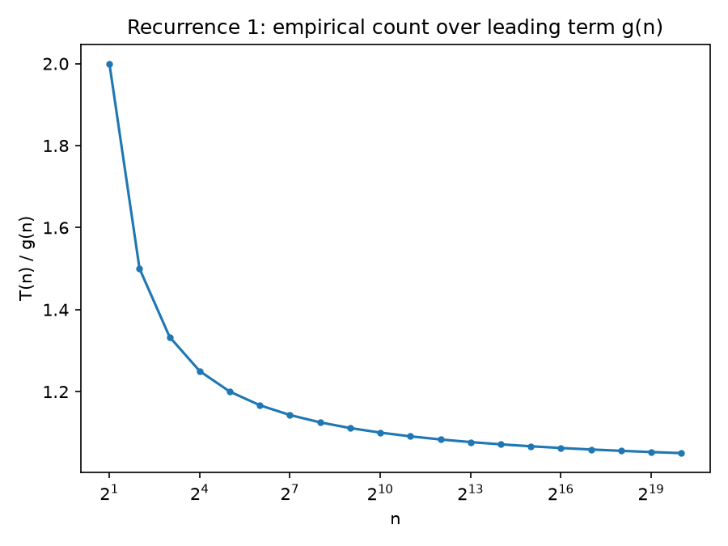
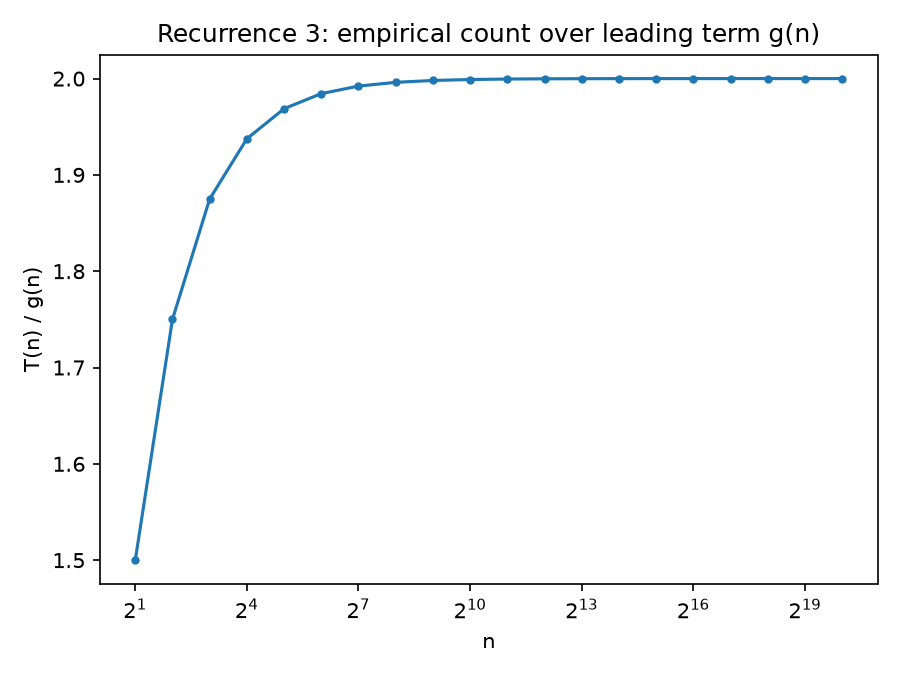
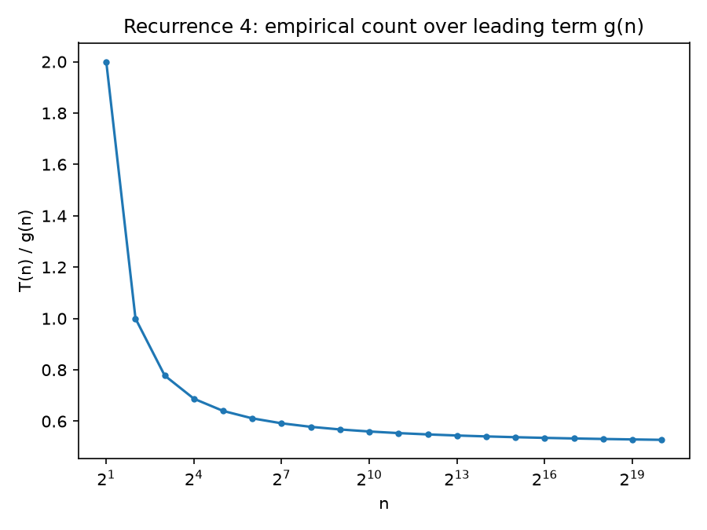

{width=2.2in}

**FACULTY OF COMPUTER ENGINEERING, INFORMATICS AND COMMUNICATIONS**

**DEPARTMENT OF COMPUTER SCIENCE**

**PROGRAM: HCS**

**MODULE: DESIGN AND ANALYSIS OF ALGORITHMS**

**NAME OF STUDENT: NIGEL TAVAGUTA**

**REG NO.: R236699C**

**SUPERVISOR: Ms MHLANGA**

**LAB 1**

# Lab 1: Empirical Validation of the Master Theorem and Recurrence Solving

## Abstract

This report solves four divide-and-conquer recurrences using the Master Theorem, the recursion-tree method, and substitution, and proves each result by induction. It then tests these results two ways: an abstract simulator that counts operations directly from each recurrence's own formula, and real implementations (merge sort, a brute-force combine step, pre-Karatsuba multiplication, and a recursive binary search), each with no memoization. The abstract simulator always matches theory exactly, so it mainly checks that the proofs and the simulation agree. The real implementations deviate from theory for three reasons: a lower-order term that matters less as $n$ grows, a constant-factor mismatch between a recurrence's $f(n)$ and what its combine step actually costs, and, in one case, a bug rather than a real effect. Repeated timing runs also show that operation counts are reproducible but wall-clock time is not. These findings lead to a final recurrence that combines an uneven split with a cache-miss penalty, which is proved to be $\Theta(n\log n)$ regardless of where the cache boundary falls.

## Task 1: Analytical Solutions

## 1. Introduction and Objectives

Asymptotic analysis is the standard way to evaluate algorithm efficiency, but it relies on simplifying assumptions such as unit-cost operations and no hardware context. The objectives of this lab are:

1. Derive closed-form solutions and asymptotic bounds for four target divide-and-conquer recurrences.
2. Formally prove all derived bounds using mathematical induction.
3. Design and implement a benchmark harness that counts basic computational operations directly without reliance on wall-clock timing.
4. Compare empirical operation growth against theoretical curves for input sizes $n \in [2^1, 2^{20}]$.
5. Analyze sources of divergence between theory and empirical measurement.
6. Synthesize a realistic recurrence model incorporating real-world system constraints.

---

## 2. Analytical Solutions and Induction Proofs

The general form of a divide-and-conquer recurrence is given by:

$$T(n) = a T\left(\frac{n}{b}\right) + f(n)$$

where $a \ge 1$ represents the number of subproblems, $b > 1$ is the division factor, and $f(n)$ is the cost of work performed outside recursive calls.

### Assumptions and Method

Throughout, $n$ is a power of 2, written $n = 2^k$, and the base case is $T(1) = 1$. All logarithms are base 2. This matches the experimental range $n = 2^1$ to $2^{20}$ used later in the lab.

For $T(n) = aT(n/b) + f(n)$ we use the Master Theorem, which compares $f(n)$ with $n^{\log_b a}$ (the leaf work). Case 1: $f(n)$ polynomially smaller gives $\Theta(n^{\log_b a})$. Case 2: if $f(n) = \Theta(n^{\log_b a} \log^k n)$ for some $k \ge 0$, the result is $\Theta(n^{\log_b a} \log^{k+1} n)$. Case 3: $f(n)$ polynomially larger, plus the regularity condition $a f(n/b) \le c f(n)$ for some $c < 1$, gives $\Theta(f(n))$.

---

### Recurrence 1: $T(n) = 2T(n/2) + n$

**Master Theorem.** Here $a = 2$, $b = 2$, so $n^{\log_2 2} = n$. Since $f(n) = n = \Theta(n)$, this is **Case 2** (extended form with $k = 0$, because $f(n)$ has no logarithmic factor).

**Result:** $T(n) = \Theta(n \log n)$.

**Exact solution:**

$$T(n) = n \log_2 n + n$$

**Proof by induction on $k$ (where $n = 2^k$).**

- **Base case:** $T(1) = 1$, and $1 \cdot \log_2 1 + 1 = 0 + 1 = 1$.
- **Inductive hypothesis:** assume $T(n/2) = \frac{n}{2}\log_2\frac{n}{2} + \frac{n}{2}$.
- **Inductive step:**

$$
\begin{aligned}
T(n) &= 2T(n/2) + n \\
&= 2\left[\tfrac{n}{2}(\log_2 n - 1) + \tfrac{n}{2}\right] + n \\
&= n\log_2 n - n + n + n \\
&= n \log_2 n + n.
\end{aligned}
$$

**Conclusion.** Since $n \log n \le n \log n + n \le 2 n \log n$ for all $n \ge 2$, we have $T(n) = \Theta(n \log n)$.

---

### Recurrence 2: $T(n) = 2T(n/2) + n^2$

**Master Theorem.** Here $a = 2$, $b = 2$, so $n^{\log_2 2} = n$. Since $f(n) = n^2 = \Omega(n^{1+\varepsilon})$ with $\varepsilon = 1$, $f(n)$ is polynomially larger, so this is **Case 3**.

**Regularity check:** $a f(n/b) = 2(n/2)^2 = n^2/2 \le \tfrac{1}{2} n^2$, so the condition holds with $c = 1/2$.

**Result:** $T(n) = \Theta(n^2)$.

**Exact solution:**

$$T(n) = 2n^2 - n$$

**Proof by induction.**

- **Base case:** $T(1) = 1$, and $2(1)^2 - 1 = 1$.
- **Inductive hypothesis:** assume $T(n/2) = 2(n/2)^2 - n/2 = \frac{n^2}{2} - \frac{n}{2}$.
- **Inductive step:**

$$
\begin{aligned}
T(n) &= 2T(n/2) + n^2 \\
&= 2\left[\tfrac{n^2}{2} - \tfrac{n}{2}\right] + n^2 \\
&= n^2 - n + n^2 \\
&= 2n^2 - n.
\end{aligned}
$$

**Conclusion.** Since $n^2 \le 2n^2 - n \le 2n^2$ for $n \ge 1$, we have $T(n) = \Theta(n^2)$.

---

### Recurrence 3: $T(n) = 4T(n/2) + n$

**Master Theorem.** Here $a = 4$, $b = 2$, so $n^{\log_2 4} = n^2$. Since $f(n) = n = O(n^{2-\varepsilon})$ with $\varepsilon = 1$, $f(n)$ is polynomially smaller, so this is **Case 1**.

**Result:** $T(n) = \Theta(n^2)$.

**Exact solution:**

$$T(n) = 2n^2 - n$$

This is the same closed form as Recurrence 2. It is a coincidence of the base case and constants; the two recurrences are different and are solved by different Master Theorem cases.

**Proof by induction.**

- **Base case:** $T(1) = 1 = 2(1)^2 - 1$.
- **Inductive hypothesis:** assume $T(n/2) = \frac{n^2}{2} - \frac{n}{2}$.
- **Inductive step:**

$$
\begin{aligned}
T(n) &= 4T(n/2) + n \\
&= 4\left[\tfrac{n^2}{2} - \tfrac{n}{2}\right] + n \\
&= 2n^2 - 2n + n \\
&= 2n^2 - n.
\end{aligned}
$$

**Sanity check at $n = 4$:** $T(2) = 4 \cdot 1 + 2 = 6$, $T(4) = 4 \cdot 6 + 4 = 28$, and $2(16) - 4 = 28$.

---

### Recurrence 4: $T(n) = T(n/2) + \log n$

**Why the Master Theorem does not apply.** Here $a = 1$, $b = 2$, so $n^{\log_2 1} = n^0 = 1$. The function $f(n) = \log n$ is larger than $\Theta(1)$, so Case 2 fails, but it is not larger by a polynomial factor $n^\varepsilon$, so Case 3 fails. Case 1 fails as well. The recurrence falls in the gap between the cases, so the basic Master Theorem gives no answer and we use the recursion-tree method.

**Recursion tree.** Let $k = \log n$. At level $j$ ($j = 0, 1, \dots, k-1$) there is one node, of size $n/2^j$, costing $\log(n/2^j) = k - j$. The leaf at level $k$ costs $T(1) = 1$. Summing over the levels:

$$T(n) = k + (k-1) + \dots + 1 + 1 = \frac{k(k+1)}{2} + 1$$

**Result:** $T(n) = \Theta(k^2) = \Theta(\log^2 n)$.

**Exact solution:**

$$T(n) = 1 + \frac{k(k+1)}{2}, \quad k = \log_2 n$$

**Proof by induction on $k$.**

- **Base case:** $k = 0$ gives $T(1) = 1 = 1 + 0$.
- **Inductive hypothesis:** assume $T(2^{k-1}) = 1 + \frac{(k-1)k}{2}$.
- **Inductive step:**

$$
\begin{aligned}
T(2^k) &= T(2^{k-1}) + k \\
&= 1 + \tfrac{(k-1)k}{2} + k \\
&= 1 + \tfrac{k^2 - k + 2k}{2} \\
&= 1 + \tfrac{k(k+1)}{2}.
\end{aligned}
$$

**Conclusion.** Since $\frac{k^2}{2} \le 1 + \frac{k(k+1)}{2} \le k^2$ for $k \ge 2$, we have $T(n) = \Theta(\log^2 n)$.

**Remark (substitution method).** We can also prove the upper bound $T(n) \le 2\log^2 n$ for $n \ge 2$ directly.

- *Base case ($n = 2$):* $T(2) = T(1) + 1 = 2 \le 2 \cdot 1^2$.
- *Inductive step:* assume $T(n/2) \le 2(\log n - 1)^2$. Then

$$
\begin{aligned}
T(n) &\le 2(\log n - 1)^2 + \log n \\
&= 2\log^2 n - 3\log n + 2 \\
&\le 2\log^2 n, \quad \text{since } 3\log n \ge 2 \text{ for } n \ge 2.
\end{aligned}
$$

This agrees with the extended Case 2 from Section 2: here $n^{\log_2 1} = 1$ and $f(n) = \log n = 1 \cdot \log^1 n$, so $k = 1$, giving $T(n) = \Theta(\log^{2} n)$.

---

## Task 2 & 3: Empirical Measurement and Plots

### Methodology

Two separate programs were used, because they answer two different questions. Full source code : https://github.com/Nigeltavaguta/dss-lab1

**`task2_task3.py`** simulates each recurrence directly: a recursive function that makes $a$ calls on $n/b$ and adds $f(n)$ at the current level, with $T(1)=1$. Since $n$ only takes power-of-two values here, every call reaches one of about 20 distinct sizes, so the function is memoized by $n$. Without this, Recurrence 3 ($a=4$) would need $4^{20}$ leaf calls at $n=2^{20}$, which is not feasible. Because this program counts operations directly from each recurrence's formula, its output matches the Task 1 closed forms exactly for every $n$ from $2^1$ to $2^{20}$. This confirms the simulator and the proofs agree; it is not a measurement of anything real.

**`task4.py`** runs real algorithms with the same recursive structure as each recurrence, with no memoization:

| Recurrence | Real implementation |
|---|---|
| $T(n)=2T(n/2)+n$ | Merge sort (comparisons counted during the merge step) |
| $T(n)=2T(n/2)+n^2$ | Divide-and-conquer with a deliberately brute-force $O(n^2)$ combine (compares every left element against every right element, instead of merging) |
| $T(n)=4T(n/2)+n$ | Pre-Karatsuba recursive multiplication: split two $n$-bit integers into high/low halves, 4 recursive half-size multiplications, $O(n)$ shift-and-add combine |
| $T(n)=T(n/2)+\log n$ | Recursive binary search over the first $n$ elements of a side array, then recurse with $n$ halved |

Recurrences 2 and 3 do real polynomial-scale work, so they cannot reach $n=2^{20}$ in Python in reasonable time. Their ranges are capped at $n=2^{12}$ (R2) and 1024-bit operands (R3). This cap is itself useful: it shows the real cost of an $O(n^2)$ algorithm in a way a Big-O bound alone does not.

An earlier version of R4 always searched the *full* side array, not just the first $n$ elements, so it actually simulated $T(n)=T(n/2)+\log N$ for a fixed $N$. It also rebuilt the main array at every level by slicing (`arr[:n//2]`), which copies $O(n)$ elements per level, so its timing measured copying cost rather than search cost. Both are fixed: the search bound now shrinks with $n$, and no array is copied at all.

### Results

Plots are in `output/`: `recurrence_{1..4}.png` (simulator vs. theory, which overlap exactly by construction), `g_ratio_{1..4}.png` (empirical count divided by the *leading term only*, $g(n)$), and `real_r{1..4}.png` (real implementation vs. theory, plus timing). Raw numbers are in `recurrence_counts.csv` and `real_implementations.csv`.

The $g(n)$-ratio plots carry the real information, since the exact-theory ratio is always $1.0$ by construction:

In each case $T(n)/g(n)$ settles to a constant instead of drifting - this is the concrete content of the $\Theta(g(n))$ claim. Exact values at three points (from the Task 1 closed forms):

| $n$ | R1: $T/n\log n$ | R2, R3: $T/n^2$ | R4: $T/\log^2 n$ |
|---|---|---|---|
| $4$ | $1.500$ | $1.750$ | $1.000$ |
| $2^{10}=1024$ | $1.100$ | $1.999$ | $0.560$ |
| $2^{20}$ | $1.050$ | $2.000$ | $0.528$ |

R1 converges to $1$, R2 and R3 converge to $2$, and R4 converges to $1/2$, matching what each closed form's algebra predicts as $n\to\infty$ (e.g. for R1, $\frac{nk+n}{nk}=1+\frac1k\to1$; for R2/R3, $\frac{2n^2-n}{n^2}=2-\frac1n\to2$; for R4, $\frac{1+k(k+1)/2}{k^2}\to\frac12$).

---

## Task 4: Critical Analysis

The simulator matches theory exactly for every recurrence, since it computes each formula directly - there is no way for it to deviate. Real deviation only shows up once a real algorithm runs on real data, which is what `task4.py` is for. Four patterns showed up.

**1. Lower-order terms matter less as $n$ grows (Recurrence 1).** Merge sort's base case costs nothing, but the recurrence charges $T(1)=1$. Writing $k=\log_2 n$, the empirical count is exactly $n\cdot k$, against the theoretical $n\cdot k+n$, so the ratio is exactly

$$\frac{nk}{nk+n} = \frac{k}{k+1},$$

which is $1/2$ at $n=2$ and rises to $20/21\approx0.952$ at $n=2^{20}$, matching the measured values. The asymptotic bound ($\Theta(n\log n)$) is correct; the gap is a single additive term that matters less as $n$ grows.

**2. Constant-factor mismatch (Recurrences 2 and 3).** Recurrence 2's brute-force combine compares every left-half element ($n/2$ of them) against every right-half element ($n/2$ of them), costing $(n/2)^2=n^2/4$ comparisons, not $n^2$. The ratio converges to $0.25$, not $1.0$. Both are $\Theta(n^2)$, but the recurrence's $f(n)=n^2$ overstates the real constant by 4×. Recurrence 3's combine similarly touches `half` $=n/2$ bits, not $n$, and converges to $0.75$. $\Theta(n^2)$ is a claim about growth rate, not the number on a stopwatch: two implementations can share a complexity class and still differ by a constant factor that matters in practice.

**3. A bug can look like a finding (Recurrence 4).** An earlier version of R4 searched the *full* side array at every level, not just the first $n$ elements, so it actually simulated $T(n)=T(n/2)+\log N$ for a fixed $N$. Its ratio rose from about $1.5$ at moderate $n$ to $1.83$ at $n=2^{20}$, converging toward $2$: the buggy cost per level is about $k=\log_2 n$ instead of the intended, shrinking $\log_2(n/2^j)$, so the buggy total is about $k^2$ against the correct $\approx k^2/2$. This looked like a legitimate "implementation changes the constant" result. It was not - it was a mismatch between the code and the recurrence it was meant to implement. Once fixed, the ratio settles around $0.9$ with no trend, which is ordinary noise for a recurrence this small (the counts involved are only tens to hundreds). A ratio that keeps drifting with $n$ instead of settling is a reason to check the implementation first.

**4. Overhead and run-to-run variance in timing.** Times at the smallest $n$ tested are a few microseconds across all four recurrences, too small to read reliably. At large $n$, repeating Recurrence 1's run three times gave a timing growth factor from $n=2^{16}$ to $n=2^{20}$ of $21.9\times$, $27.3\times$, and $28.5\times$ - consistently above the $\approx20\times$ that $n\log n$ predicts, but not a stable number across runs. Operation counts are perfectly reproducible; wall-clock time is not, because it also reflects CPython's memory allocator, garbage collection, and OS scheduling noise. Cache effects (the array no longer fitting in cache at large $n$) are a plausible contributor to the extra growth, but this cannot be confirmed without separate profiling.

---

## Task 5: Synthesis - A Modified Recurrence for Uneven Splits and Memory Hierarchy

### Motivation

Real divide-and-conquer algorithms rarely split work exactly in half, and real machines are not uniform-cost: data that no longer fits in cache is generally slower to process per element. We did not measure this directly. The Task 4 timing data (point 4) shows Recurrence 1 growing somewhat faster than $n\log n$ predicts at large $n$, consistently across three runs, but this instrumentation cannot separate a cache effect from Python's allocator or garbage collector. The recurrence below models a plausible real effect, motivated by - but not confirmed by - that observation.

### The recurrence

Consider a divide-and-conquer algorithm that splits its input unevenly, say in a 1:3 ratio (modeling a partitioning step that is not perfectly balanced, as with a mediocre but non-adversarial pivot choice), and that also pays a cache-miss penalty once the subproblem no longer fits in a cache of size $M$:

$$T(n) = T\!\left(\frac{n}{4}\right) + T\!\left(\frac{3n}{4}\right) + f(n), \qquad f(n) = \begin{cases} n & n \le M \\ c\,n & n > M \end{cases}, \quad c > 1$$

**Solving the uneven split alone ($M=\infty$, no cache penalty).** This no longer fits the Master Theorem (the two subproblems have different sizes), so we use the Akra–Bazzi method: find $p$ such that $(1/4)^p + (3/4)^p = 1$. Here $p=1$ is an exact solution, since $1/4+3/4=1$. Akra–Bazzi then gives

$$T(n) = \Theta\!\left(n^p\left(1 + \int_1^n \frac{f(u)}{u^{p+1}}\,du\right)\right) = \Theta\!\left(n\left(1+\int_1^n \frac{u}{u^2}\,du\right)\right) = \Theta(n(1+\ln n)) = \Theta(n\log n).$$

So an uneven 1:3 split alone does not change the asymptotic order compared to the balanced case $T(n)=2T(n/2)+n$: both are $\Theta(n\log n)$, and the split only changes the constant inside the $\Theta$. The Master Theorem's "balanced" assumption is not essential for Case 2-type recurrences as long as the split ratio is fixed and bounded away from 0 or 1; only a split that degenerates as $n$ grows (e.g. $T(n-1)+n$) changes the order.

**Adding the cache penalty - the rigorous $\Theta$ claim.** An uneven tree does not reach the cache boundary at the same depth in every branch, so arguing level-by-level is not exact. A sandwich argument settles the order directly instead. By construction $f(n)$ satisfies $n \le f(n) \le c\cdot n$ for every $n$ (it equals $n$ when $n\le M$ and $c\,n$ when $n>M$, and $c>1$). Define two auxiliary, memory-oblivious recurrences with the *same* branching structure:

$$T_{\text{lo}}(n) = T_{\text{lo}}\!\left(\tfrac n4\right) + T_{\text{lo}}\!\left(\tfrac{3n}4\right) + n, \qquad T_{\text{hi}}(n) = T_{\text{hi}}\!\left(\tfrac n4\right) + T_{\text{hi}}\!\left(\tfrac{3n}4\right) + c\,n.$$

Both solve to $\Theta(n\log n)$ by the same Akra-Bazzi computation ($T_{\text{hi}}$ is just $c$ times the $T_{\text{lo}}$ recursion, and scaling $f(n)$ by a positive constant scales $T(n)$ the same way). Since $f(n)$ sits between the two auxiliary costs at every level, and the branching structure is identical in all three recurrences, recurrence monotonicity gives $T_{\text{lo}}(n) \le T(n) \le T_{\text{hi}}(n)$ for all $n$. Both bounds are $\Theta(n\log n)$, so

$$T(n) = \Theta(n\log n)$$

follows regardless of where $M$ falls or how the cold and warm levels interleave. The level-by-level accounting below is kept only as an approximation for the *constant*, since the sandwich argument above already settles the $\Theta$-class:

$$T(n) \approx \underbrace{c\cdot n\cdot \log_{4/3}\!\left(\frac{n}{M}\right)}_{\text{cold levels (approx.)}} + \underbrace{1\cdot n \cdot \log_{4/3} M}_{\text{warm levels (approx.)}} = n\Big[c\log_{4/3}n - (c-1)\log_{4/3}M\Big]$$

Two consequences matter here:

1. **The asymptotic class is unchanged** ($\Theta(n\log n)$ either way) - this is the limitation of asymptotic analysis the lab is probing. Two algorithms in the same complexity class can behave very differently once $n$ crosses the cache threshold $M$, and no Big-O analysis distinguishes them.
2. **The approximate constant grows with $c$ and with how many levels are cold**, predicting a visible "knee" in a plot of time against $n$: linearithmic growth for $n \le M$, then linearithmic growth with a larger constant for $n > M$. We have not measured this knee directly; it is a model prediction consistent with the faster-than-$n\log n$ timing growth seen for Recurrence 1 in Task 4, not a confirmed observation.

---

## Conclusion

All four recurrences were solved in closed form and proved by induction: $\Theta(n\log n)$ for Recurrence 1, $\Theta(n^2)$ for Recurrences 2 and 3 (via different Master Theorem cases, sharing the same closed form by coincidence), and $\Theta(\log^2 n)$ for Recurrence 4, which falls outside the Master Theorem's three cases and needed the recursion-tree method instead.

The empirical work shows that matching a recurrence exactly and matching reality are different things. The abstract simulator matches Task 1's closed forms exactly, by design, since it computes each formula directly - it was never going to show deviation, only confirm the proofs. The real implementations deviate for three genuine reasons: a lower-order term that matters less as $n$ grows (Recurrence 1, with an exact $k/(k+1)$ ratio); a constant-factor gap between a recurrence's abstract $f(n)$ and what its combine step actually costs (Recurrences 2 and 3, converging to $0.25$ and $0.75$); and wall-clock timing that is not reproducible the way operation counts are, since it also reflects interpreter overhead, memory allocation, and possibly cache behavior.

A fourth case, in Recurrence 4, turned out to be an implementation bug rather than a real deviation: searching a fixed-size array instead of one that shrinks with the recursion produced a ratio that drifted steadily with $n$, which at first looked like a legitimate finding. Distinguishing the two required working out what the buggy code was *actually* computing, rather than accepting the curve at face value. The lesson: a ratio that keeps drifting instead of settling is a reason to check the implementation first.

The Task 5 synthesis combines an uneven split with a cache-miss penalty, solved with the Akra-Bazzi method and a sandwich argument rather than the Master Theorem, since neither the unequal split nor the uneven cache boundary fits its assumptions. The result - $\Theta(n\log n)$ either way, with the practical constant depending on hardware boundaries the recurrence cannot see - is the central limitation of asymptotic analysis this lab set out to probe.

---

## References

1. Cormen, T. H., Leiserson, C. E., Rivest, R. L., and Stein, C. *Introduction to Algorithms*, 4th edition. MIT Press, 2022. (Master Theorem, recursion-tree method, substitution method, merge sort, Karatsuba-style divide-and-conquer multiplication.)
2. Akra, M. and Bazzi, L. "On the solution of linear recurrence equations." *Computational Optimization and Applications*, 10(2):195–210, 1998. (Generalized Master Theorem used in Task 5 for the uneven-split recurrence.)
3. Python Software Foundation. `time` - Time access and conversions (`time.perf_counter`), and `random` module documentation. https://docs.python.org/3/library/ (Used for wall-clock timing and reproducible random sampling in `task4.py`.)
4. Hunter, J. D. "Matplotlib: A 2D Graphics Environment." *Computing in Science & Engineering*, 9(3):90–95, 2007. (Plotting library used throughout.)

