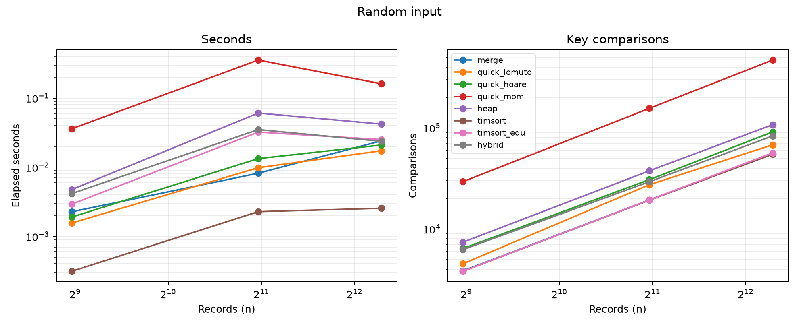
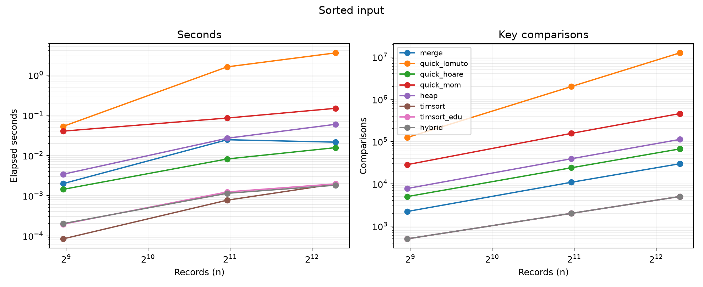
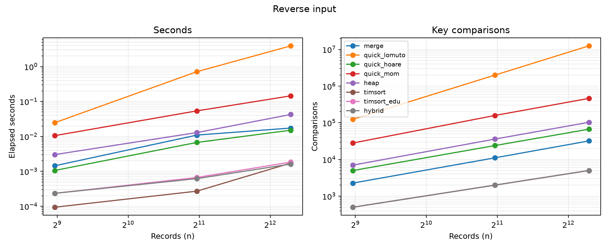
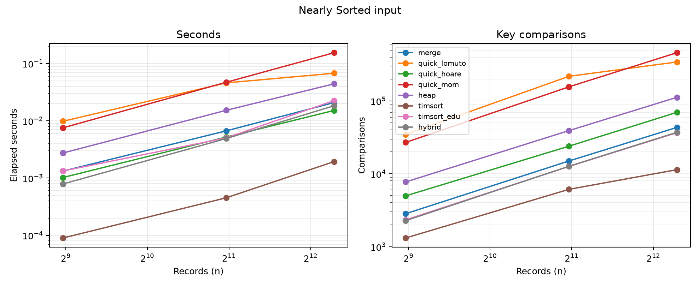
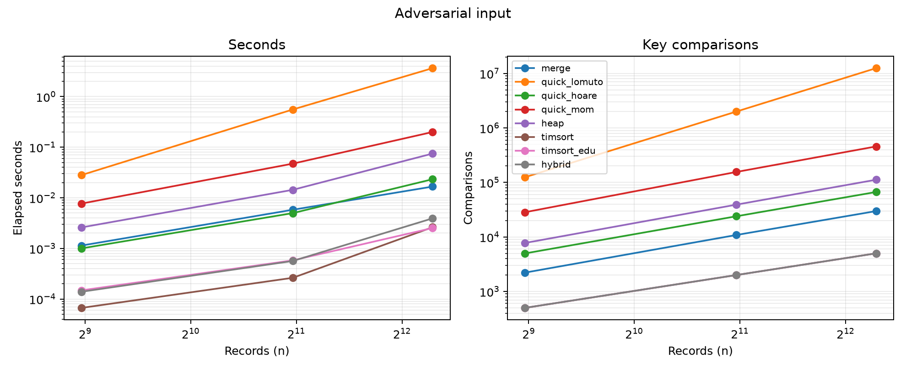

<style>
  body { font-size: 12pt; line-height: 1.3; max-width: 7.4in; margin: 0 auto; }
  p { margin: 0.5em 0; }
  img { max-width: 6.9in; height: auto; display: block; margin: 0.25em auto; }
  @page { size: letter; margin: 0.55in; @bottom-center { content: counter(page); font-size: 9pt; } }
  @page:first { @bottom-center { content: ""; } }
  table { font-size: 10.5pt; }
  h1, h2, h3 { margin-top: 0.7em; margin-bottom: 0.35em; }
</style>

<div style="text-align:center; margin-bottom: 2em;">

{width=2.2in}

**FACULTY OF COMPUTER ENGINEERING, INFORMATICS AND COMMUNICATIONS**

**DEPARTMENT OF COMPUTER SCIENCE**

**PROGRAM: HCS**

**MODULE: DESIGN AND ANALYSIS OF ALGORITHMS**

**NAME OF STUDENT: NIGEL TAVAGUTA**

**REG NO.: R236699C**

**LAB 2**

</div>

<div style="page-break-after: always;"></div>

# Lab 2: Sorting Under Real-World Constraints

## Contents

1. Requirements and record model
2. Algorithms, complexity, and implementation details
3. Adversarial analysis and correctness arguments
4. External sorting under the memory limit
5. Benchmark design, results, and interpretation
6. Recommendations and limitations
7. Conclusion and reproduction instructions

## Abstract

This report compares eight sorting approaches on transaction-like records. I tested random, ordered, nearly ordered, and adversarial inputs, then compared elapsed time with key-comparison counts. The benchmark CSVs contain the results from my machine. The tests use smaller inputs than the 100 million records in the scenario, so they show how the algorithms behave rather than proving that a full daily batch fits in memory.

## 1. Requirements and record model

Each record has a timestamp, amount, merchant, and id. I sort by timestamp, then amount, then merchant. The generated id is unique. I use it to check that no records were lost or duplicated. It is not part of the required sort key. A stable sort matters when two records have the same three sort fields, because it keeps their original order.

The scenario processes 100 million records per day. I used smaller inputs for the benchmarks because the quadratic algorithms become very slow and Python objects use much more memory than the CSV data. The external sorter is intended for data that cannot be held in memory as one list.

## 2. Algorithms and complexity

| Algorithm | Best | Average | Worst | Auxiliary space | Stable | Adaptive |
|---|---:|---:|---:|---:|---|---|
| Merge sort | n log n | n log n | n log n | O(n) | Yes | No |
| Lomuto quicksort | n log n | n log n | n² | O(log n) with smaller-side-first processing | No | No |
| Hoare quicksort | n log n | n log n | n² | O(log n) expected | No | No |
| Heapsort | n log n | n log n | n log n | O(1) | No | No |
| Timsort (`list.sort`) | n | n log n | n log n | O(n) worst | Yes | Yes |
| Educational Timsort-style version | n | n log n | n log n | O(n) | Yes | Yes |
| Hybrid | n on one natural run | n log n | n log n | O(n) merge buffer in run merging; bounded recursion | No guarantee for equal-key stability | Yes |
| Median-of-medians quicksort | n log n typical | O(n log n) | O(n log n) | O(log n) typical stack | No | No |

The merge sort implementation takes the left element on equality, so it is stable. Python's built-in Timsort is the production baseline. The educational version detects natural runs, extends short runs with binary insertion, and merges runs using a stack. It leaves out CPython's galloping optimizations and some of its exact stack rules. Heapsort uses only a constant amount of extra space. The quicksort implementations use an explicit work stack, which avoids Python call-stack limits but does not prevent quadratic comparisons when pivots are poor.

The hybrid first scans for ascending or strictly descending natural runs, reverses descending runs, and returns immediately when the whole input is one run. When it finds many short runs, it switches to introsort. Introsort uses median-of-three partitioning and insertion sort for short ranges, then falls back to in-place heapsort if the partition depth exceeds twice the logarithm of the input size. With fewer runs, the algorithm merges neighboring runs in a linear pass over each pair. It has O(n log n) worst-case work and scans already sorted or reverse-sorted input in linear time. Merge passes are stable, but the introsort fallback is not. Use Timsort or a stable merge-based hybrid when equal-key transaction order must be retained.

The median-of-medians variant selects a deterministic pivot from medians of groups of five. It sorts groups of at most five in place, compacts their medians into the current array segment, selects the median of those medians, and partitions the array in place into less/equal/greater regions. The sort uses an explicit work stack and processes the smaller side immediately, avoiding Python recursion-limit failures. The pivot guarantees a constant-fraction split, yielding O(n log n) worst-case quicksort time, at the cost of larger constants than randomized or median-of-three pivots. It is included as an explicit defense, while introsort is the practical fallback recommended for general-purpose quicksort.

### 2.1 Implementation outline

The implementations use a common lexicographic key function for `(timestamp, amount, merchant)`. The generator attaches a unique record id so output can be checked deterministically. The id is not part of the required sort key. Each algorithm mutates a list in place except merge sort, the educational Timsort-style method, and the natural-run branch of the hybrid, which use temporary storage during merges.

Merge sort recursively sorts two halves, then merges them by choosing the left item on equality. This rule preserves the input order of equal keys. Its recurrence is `T(n)=2T(n/2)+Θ(n)`. It is predictable and stable, but a full in-memory merge needs O(n) temporary records.

Lomuto quicksort uses the last item as its pivot and moves keys less than or equal to it before the pivot. Hoare quicksort uses the middle item and scans inward from both ends. Both use an explicit range stack to limit stack growth. Their partition rules have different boundaries. Using Lomuto's boundary rule with Hoare's partition can cause infinite loops or skip records.

Heapsort first builds a max heap, then moves the maximum to the end and restores the heap. Each parent must be at least as large as its children. The `sift_down` function restores that property after a swap. Heapsort uses O(1) auxiliary storage and O(n log n) comparisons for every input order. Its memory access pattern can make it slower than merge sort.

The hybrid has two paths. Its first linear scan detects ascending and strictly descending natural runs. A wholly monotone input returns after the scan, while a run-rich input is merged pairwise in linear passes. When run fragmentation exceeds the threshold, introsort partitions ranges using a median-of-three pivot, finishes small ranges with insertion sort, and switches to heapsort when the depth budget `2 floor(log₂ n)` is exhausted. The heapsort fallback is what makes the worst-case bound independent of the pivot sequence.

The educational Timsort-style implementation detects natural runs and reverses only strictly descending ones. It extends short runs with stable binary insertion, then merges runs from a stack. For the top three run lengths `A, B, C`, it merges when `A <= B+C`. It also merges the top pair when `B <= C`. During the final collapse, it selects neighboring runs to avoid an imbalanced merge. This version omits galloping searches and some details of CPython's implementation.

```text
TIMSORT-STYLE(A):
    scan A for natural runs; reverse only strictly descending runs
    extend each short run to minrun with stable binary insertion
    push each run onto stack S
    while the top run lengths violate A > B + C or B > C:
        merge the neighboring pair selected by the smaller-run rule
    while S contains more than one run:
        merge the adjacent pair with the smaller combined workload
```

### 2.2 Pseudocode for the adaptive hybrid

```text
HYBRID-SORT(A):
    runs = detect ascending or strictly descending runs in A
    reverse each strictly descending run
    if runs contains the whole array:
        return A
    if number of runs > max(2, n / insertion_threshold):
        INTROSORT(A, depth = 2 floor(log2(n)))
        return A
    while more than one run remains:
        merge each neighboring pair in one stable linear pass
    return A

INTROSORT(A, lo, hi, depth):
    while hi - lo + 1 > insertion_threshold:
        if depth == 0:
            HEAPSORT-RANGE(A, lo, hi)
            return
        pivot = median(first, middle, last)
        (left, right) = partition_around_pivot(A, pivot)
        recurse on smaller range; continue iteratively on larger range
        depth = depth - 1
    INSERTION-SORT(A[lo:hi])
```

The median-of-medians quicksort uses three-way partitioning to create less-than, equal-to, and greater-than regions. Grouping equal keys together prevents duplicate-heavy data from repeatedly sorting the same equal keys as separate partitions. The hybrid's introsort path uses a two-way partition, but its depth limit still bounds the damage from repeated poor partitions.

## 3. Adversarial inputs and defense

Lomuto partitioning with a fixed endpoint pivot takes quadratic time on already sorted and reverse-sorted sequences. A sequence ordered so that the chosen endpoint is repeatedly the minimum or maximum causes partitions of sizes `0` and `n−1`. The recurrence becomes `Q(n)=Q(n−1)+Θ(n)=Θ(n²)`. Duplicate-heavy data is another concern when a two-way partition groups equal keys poorly. The generator supplies monotone records with the endpoint key pattern, and includes many repeated merchant values.

Hoare partitioning with a middle-element pivot avoids the simple sorted-input failure, but fixed pivot policies still admit crafted killer sequences. The defenses implemented are (1) median-of-medians pivots, which provide a worst-case balanced-partition guarantee, and (2) introsort's depth limit and heapsort fallback, which guarantee O(n log n) worst-case runtime without paying median-of-medians selection costs at every partition.

### 3.1 Why endpoint-pivot Lomuto becomes quadratic

For an ascending input, Lomuto chooses the final and largest key as its pivot. Every scan comparison succeeds, so the pivot lands at the end and the remaining subproblem has size `n−1`. The work satisfies `Q(n)=Q(n−1)+c n` for some positive constant `c`, with `Q(1)=Θ(1)`. Expanding gives `Q(n)=c(n+(n−1)+...+2)+Θ(1)=Θ(n²)`. The exact comparison count in this implementation is `n(n−1)/2`, which is why the measured count at n=5,000 is 12,497,500. Reverse-sorted data also yields extreme pivots for the particular last-element Lomuto rule here. The result depends on choosing the last item as pivot.

### 3.2 Median-of-medians selection proof

The pivot-selection procedure splits the current range into groups of five, sorts each small group, and recursively selects the median of the group medians. Ignore at most one incomplete group and a constant number of boundary groups. At least half of the group medians are at least the selected median. Each such full group contributes at least three keys greater than or equal to its median, and therefore at least `3n/10−O(1)` keys are no smaller than the pivot. By the symmetric argument, at least `3n/10−O(1)` keys are no larger. Thus the larger side after partition contains at most `7n/10+O(1)` keys.

Let `S(n)` be the number of comparisons for deterministic selection. Group sorting and partitioning cost at most `c n`. The algorithm recursively selects the pivot from `ceil(n/5)` medians. It then recurses into a remaining partition of at most `7n/10+6` elements. Thus

`S(n) ≤ S(ceil(n/5)) + S(7n/10+6) + c n`.

For sufficiently large n, assume inductively that `S(m) <= d m` for all smaller m. The recursive terms then total at most `d(0.9n+O(1))`. The partition work adds `c n`. Choosing d large enough makes the total at most `d n`, since the recursive subproblems together are smaller than n by a fixed fraction. A larger base-case constant handles the finitely many small values. Therefore `S(n)=O(n)`. In quicksort, both partitions have at most `0.7n+O(1)` elements. Each level does O(n) partition work, and there are O(log n) levels. The full sort therefore uses O(n log n) comparisons in the worst case. In my measurements, median-of-medians used far more comparisons than the other fast methods.

The selection recursion has two smaller subproblems whose sizes add to at most `0.9n+O(1)`. That strict shrinkage is what makes the induction close. Quicksort applies the selected pivot to the full range, partitions it, then repeats on the remaining unsorted intervals. Using median-of-medians only once is not enough. The sort needs a protected pivot at every partition level to keep its worst-case guarantee.

### 3.3 Correctness and stability reasoning

Merge sort is correct by induction on range length. A range of length zero or one is already ordered. If its two halves are sorted, each merge step emits the smaller remaining item. No un-emitted item can be smaller than the item chosen. The result is sorted and contains all the original records. Choosing the left item when keys are equal preserves their original order.

Quicksort partitions the range so each side satisfies its relation to the pivot. Sorting those sides produces a sorted range. Heapsort maintains a max heap, moves its maximum to the end, and repeats on the shorter prefix. Insertion sort inserts each new item into a sorted prefix. The merge-based algorithms preserve the order of equal keys. The hybrid does so on its merge path, but not in its introsort path.

## 4. Memory-constrained external sorting

An in-memory Python list of 100 million records cannot be assumed to fit within 512 MB. Each row includes a tuple, strings, integer objects, list pointers, sorting workspace, and allocator overhead, all of which add to the raw field sizes. External merge sort bounds memory by chunking the input, sorting each chunk, and writing sorted runs to disk. It then performs a k-way merge, holding one current row per run and a heap of run heads.

Let `N` be the record count, `B` the number of records per disk block, and `M` the number that fit in memory. The initial run count is `R=ceil(N/M)`. Reading the input and writing the runs costs `2N/B` I/Os. Each merge pass costs another `2N/B`. With fan-in `F`, the number of passes is `ceil(log_F R)`, so total I/O is `2N/B * (1 + ceil(log_F R))`, excluding headers and file system effects. Comparison work is O(N log N). The merge heap holds O(F) row heads, and a chunk uses O(M) memory.

The sorter estimates each chunk at 128 MiB and merges at most 32 runs at a time. The estimate includes parsed rows, strings, sort keys, and extra space for temporary references. At about 64 bytes per CSV record, 100 million rows occupy 6.4 GB on disk. At an estimated 500 bytes of Python memory per row, each chunk holds about 268,000 rows, producing roughly 374 initial runs. Fan-in 32 requires two merge levels after run generation. That is about three full read and write passes, or 38.4 GB of sequential I/O. Actual CSV widths and Python object sizes will change these estimates. The 128 MiB budget is an estimate rather than a hard memory limit. Measure peak memory with the longest expected fields and leave room below 512 MB. The bounded fan-in also limits open files. Temporary storage must hold the initial runs and the next merge level.

In a local validation run, the sorter processed a generated CSV containing 500,000 transaction-like rows (16.3 MB on disk) with a 128 MiB chunk budget and fan-in 32. It exited with code 0 and Windows reported a peak working set of 164.0 MiB. This measured run is below the 512 MiB limit and provides evidence for this record format and dataset size. It does not prove the same peak for 100 million production records or rows with longer fields. The memory figure should be remeasured with representative maximum-length production records before deployment.

### 4.1 External-sort procedure

```text
EXTERNAL-SORT(input, output, estimated_chunk_budget, fan_in):
    read input rows until the estimated chunk budget is reached
    sort that chunk by (timestamp, amount, merchant, id)
    write it as a sorted temporary run
    repeat until the input is exhausted
    while number of runs > fan_in:
        merge each group of at most fan_in runs into a new run
    merge the remaining runs into output
```

The final merge keeps one current row from each input run in a min-heap. Each time it writes the smallest head row, it reads one replacement row from the same run. The heap therefore holds at most `F` rows and each output record requires O(log F) heap work. Run generation sorts chunks at O(M log M) work each, while the merge passes together require O(N log F) heap operations per pass. If F is fixed, each pass is linear in N and the number of passes grows logarithmically in the run count.

The record id is included as a final internal key so identical business keys have deterministic ordering. If the required contract is strictly only `(timestamp, amount, merchant)`, preserving order among equal business keys requires a monotonically increasing input sequence and a stable run sort and merge. The current external sorter reads a CSV header once and writes it once, but assumes each data row has valid numeric timestamp, amount, and id fields. A production pipeline should validate schema and length, log rejected records, write to a temporary destination, and atomically rename the completed result so an interrupted merge does not leave a partial output presented as final.

The 128 MiB run budget deliberately leaves room below 512 MiB for the Python interpreter, input and output buffers, file-reader state, heap entries, and operating-system processes. It still does not prove a hard memory ceiling. Python's allocator can retain memory after a chunk is written, a very long merchant string increases the row estimate, and Timsort creates temporary key references during each in-memory sort. A deployment acceptance test should generate worst-case field lengths, monitor process peak RSS, increase `fan_in` only while file and head memory remain safe, and reduce the chunk budget until the process stays below its allocation. If the measured peak cannot be held below 512 MiB with adequate reserve, use a packed-record implementation in a compiled language.

## 5. Evaluation protocol and results

`benchmark.py` generates five seeded distributions. These are random fields, sorted data, reverse-sorted data, nearly sorted data with about one percent random swaps, and monotone keys aimed at endpoint-pivot Lomuto implementations. Each algorithm receives a fresh copy and is timed three times by default. The CSV records the median, minimum, and maximum elapsed time. The harness then sorts a separate copy to count key comparisons. The counter measures comparisons between lexicographic keys, not swaps, assignments, or Python bytecode operations. The output also records correctness against a trusted sort. Absolute times should not be compared across machines.

The full-size comparison run in `output/benchmarks.csv` covers all eight algorithms through n=5,000. A second run, `output/fast_20k.csv`, scales the faster methods (merge, Hoare, heap, built-in Timsort, educational Timsort-style version, and hybrid) to n=20,000. Lomuto is excluded there because its quadratic cases make a full 20,000-record sweep needlessly slow. All 120 full-run rows and 60 scale-run rows passed correctness checks. Each row's time is the median of three runs. The CSV also records the minimum and maximum.

### Measured results at n=5,000

The table below reports median wall-clock time in milliseconds from three runs at n=5,000. The timing runs use native tuple comparison. The separate operation-count run enables the comparison counter, so counting overhead does not affect the timing results.

| Algorithm | Random | Sorted | Reverse | Nearly sorted | Adversarial |
|---|---:|---:|---:|---:|---:|
| Merge sort | 24.08 | 21.40 | 17.38 | 20.88 | 16.65 |
| Lomuto quicksort | 17.29 | 3,551.95 | 3,909.33 | 67.86 | 3,644.87 |
| Hoare quicksort | 20.94 | 15.62 | 15.07 | 15.22 | 23.26 |
| Median-of-medians quicksort | 160.94 | 148.51 | 145.14 | 155.01 | 199.53 |
| Heapsort | 42.05 | 59.52 | 42.51 | 44.41 | 74.79 |
| Built-in Timsort | 2.55 | 1.95 | 1.72 | 1.95 | 2.62 |
| Educational Timsort-style version | 25.10 | 1.96 | 1.85 | 22.62 | 2.53 |
| Hybrid | 23.64 | 1.82 | 1.62 | 18.37 | 3.92 |

The absolute values reflect this Python version and machine. The large Lomuto timings on ordered data match its quadratic comparison counts. Built-in Timsort is much faster because most of its work runs in optimized C.

### Key comparisons at n=5,000

| Algorithm | Random | Sorted | Reverse | Nearly sorted | Adversarial |
|---|---:|---:|---:|---:|---:|
| Merge sort | 55,215 | 29,804 | 32,004 | 43,339 | 29,804 |
| Lomuto quicksort | 68,052 | 12,497,500 | 12,497,500 | 342,565 | 12,497,500 |
| Hoare quicksort | 91,249 | 66,807 | 66,808 | 69,739 | 66,807 |
| Median-of-medians quicksort | 468,619 | 457,665 | 462,439 | 459,511 | 457,665 |
| Heapsort | 107,678 | 112,126 | 103,227 | 112,105 | 112,126 |
| Built-in Timsort | 54,928 | 4,999 | 4,999 | 11,404 | 4,999 |
| Educational Timsort-style version | 56,642 | 5,000 | 4,999 | 36,692 | 5,000 |
| Hybrid | 83,311 | 5,000 | 4,999 | 37,121 | 5,000 |

Lomuto's sorted/adversarial count is the triangular sum `n(n−1)/2 = 12,497,500`, directly exhibiting Θ(n²) behavior. At n=2,000 its sorted count is 1,999,000 while its random count is 27,443. Hoare's midpoint pivot avoids this particular monotone-input failure, while median-of-medians stays within a constant factor across these cases but pays a substantial constant cost. Both Timsort versions use about n comparisons on monotone input because they recognize a single run.

### Full results at n=20,000

The larger sweep excludes Lomuto because its 20,000-record adversarial cases would require about 200 million comparisons apiece. The remaining six algorithms were measured on all five distributions. Times below are median milliseconds across three runs. Comparison counts are deterministic for the fixed input.

| Algorithm | Random | Sorted | Reverse | Nearly sorted | Adversarial |
|---|---:|---:|---:|---:|---:|
| Merge sort | 304.09 | 234.26 | 226.06 | 283.38 | 176.29 |
| Hoare quicksort | 235.35 | 225.22 | 195.95 | 206.53 | 144.62 |
| Heapsort | 576.39 | 589.57 | 502.71 | 581.04 | 466.40 |
| Built-in Timsort | 38.13 | 19.59 | 22.33 | 31.16 | 11.25 |
| Educational Timsort-style version | 289.52 | 19.32 | 23.44 | 253.05 | 14.51 |
| Hybrid | 260.76 | 22.15 | 21.83 | 238.59 | 14.94 |

| Algorithm | Random | Sorted | Reverse | Nearly sorted | Adversarial |
|---|---:|---:|---:|---:|---:|
| Merge sort | 260,917 | 139,216 | 148,016 | 212,718 | 139,216 |
| Hoare quicksort | 415,287 | 307,231 | 307,232 | 307,614 | 307,231 |
| Heapsort | 510,744 | 529,074 | 493,307 | 528,790 | 529,074 |
| Built-in Timsort | 259,614 | 19,999 | 19,999 | 46,984 | 19,999 |
| Educational Timsort-style version | 266,798 | 20,000 | 19,999 | 185,276 | 20,000 |
| Hybrid | 372,834 | 20,000 | 19,999 | 183,812 | 20,000 |

On sorted and reverse-sorted inputs, built-in Timsort and the hybrid used about n comparisons. The educational Timsort version also handled those inputs well, but used 36,692 comparisons on nearly sorted data, compared with 11,404 for built-in Timsort. Heapsort stayed near n log n across the input types. Hoare quicksort was faster than heapsort in most of these runs, although its implementation has no worst-case guarantee. Wall-clock times also reflect Python overhead and memory access, not just comparison counts.

The figures plot time and key comparisons separately for each input distribution, using logarithmic axes. On random data, most comparison sorts follow the expected n log n growth. Median-of-medians has the largest comparison count because it selects a protected pivot at every partition. Built-in Timsort is fastest in these tests because its core sorting loop runs in optimized C.



*Figure 1. Timing and key comparisons on random records. The timing plot includes interpreter and allocation costs. The comparison plot shows algorithmic work more directly.*



*Figure 2. Already sorted records. Timsort and the hybrid recognize one natural run and need a linear scan, while Lomuto's endpoint pivot creates one empty partition at each step.*



*Figure 3. Reverse-sorted records. Natural-run detection identifies a descending run and reverses it. The last-element Lomuto partition again produces quadratic work.*



*Figure 4. Nearly sorted records with about one percent random swaps. The number and length of natural runs determine how much work Timsort and the hybrid can avoid.*



*Figure 5. Monotone adversarial keys selected to expose endpoint-pivot Lomuto. The median-of-medians line stays within O(n log n) growth, but its constant factor is high.*

### Decision matrix

| Situation | Recommended choice | Reason |
|---|---|---|
| Production Python, in-memory records | Timsort | Stable, adaptive, heavily optimized |
| Need predictable in-place memory and O(n log n) | Heapsort | Worst-case bound and constant auxiliary space; unstable |
| Need stable behavior with predictable work | Merge sort | Stable O(n log n), with linear extra memory |
| Nearly sorted runs and custom control | Hybrid | Detects runs and has an introspective worst-case fallback |
| Quicksort required with a hard bound | Introsort or median-of-medians quicksort | Avoids quadratic worst case |
| Dataset exceeds RAM | External merge sort | Sequential I/O and bounded memory |
| Adversarial/untrusted input | Timsort, heapsort, or introsort | Avoid exposed quadratic quicksort behavior |

## 6. Limitations and engineering recommendations

The Python timings include interpreter and object overhead. In my generated data, strings and tuples take more space than the raw CSV fields. The in-memory benchmarks compare algorithms but do not show that 100 million Python records fit in RAM. The external sorter expects one header and valid numeric fields. A real input file would need checks for malformed rows and duplicate handling. I ran each benchmark three times on one generated dataset. More random seeds would help show how much the results vary. Background processes and power settings can also affect timings.

For this workload, I would sort chunks and merge them from disk instead of building one Python list of 100 million rows. If equal business keys must keep their arrival order, each row needs an input sequence number, and the merge key should include it. My sample external-sort run peaked at 164.0 MiB, but used only 500,000 generated rows. I would repeat the measurement with production-sized fields before treating the 512 MB limit as verified for deployment.

## 7. Reproduction

From `lab2/`, run `python benchmark.py --sizes 500 2000 5000 --repeats 3` to run all algorithms. To test the faster methods at larger sizes, run `python benchmark.py --algorithms merge quick_hoare heap timsort timsort_edu hybrid --sizes 10000 20000`. Run `python plot_results.py` to regenerate the plots. The CSV results are in `output/`. Run the external sorter with `python external_sort.py input.csv output.csv --chunk-mib 128 --fan-in 32`. Matplotlib is needed only for regenerating plots.

## References

1. Cormen, T. H., Leiserson, C. E., Rivest, R. L., and Stein, C. *Introduction to Algorithms*. 4th ed. MIT Press, 2022. (Merge sort, heapsort, quicksort, and asymptotic analysis.)
2. Musser, D. R. “Introspective Sorting and Selection Algorithms.” *Software: Practice and Experience*, 27(8), 983–993, 1997. (Introsort and worst-case fallback design.)
3. Blum, M., Floyd, R. W., Pratt, V., Rivest, R. L., and Tarjan, R. E. “Time Bounds for Selection.” *Journal of Computer and System Sciences*, 7(4), 448–461, 1973. (Median-of-medians selection.)
4. Aggarwal, A. and Vitter, J. S. “The Input/Output Complexity of Sorting and Related Problems.” *Communications of the ACM*, 31(9), 1116–1127, 1988. (External-memory sorting bounds.)
5. Peters, T. “Timsort.” CPython source documentation, `Objects/listsort.txt`. (Natural runs and run-stack merging.)
