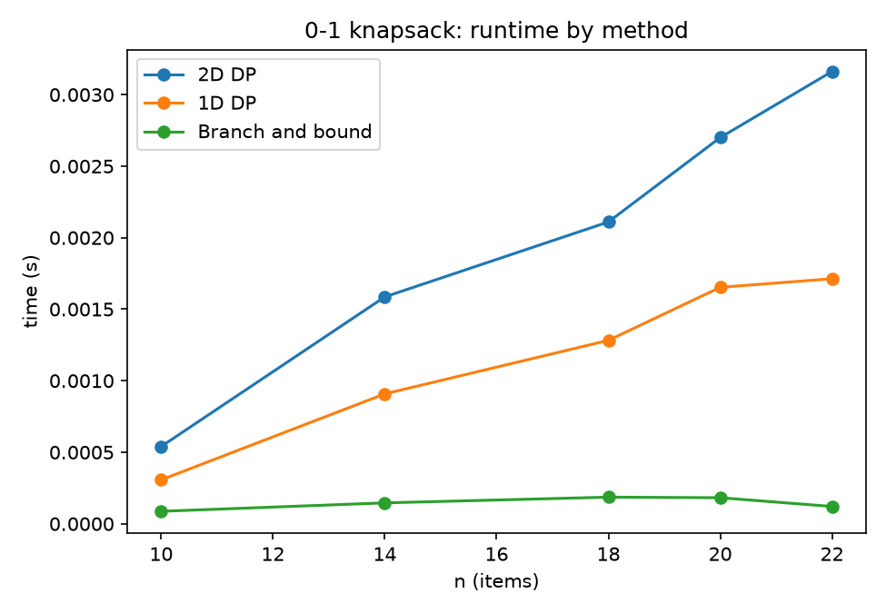
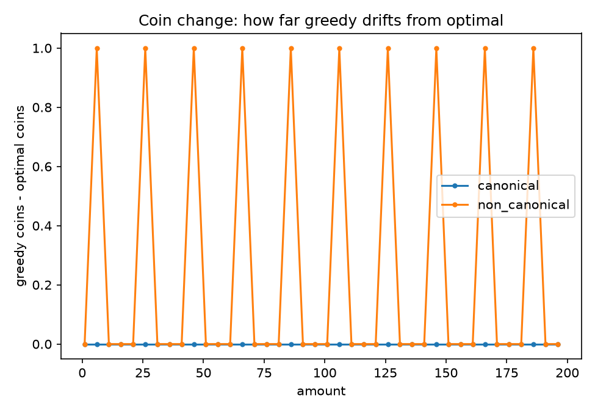
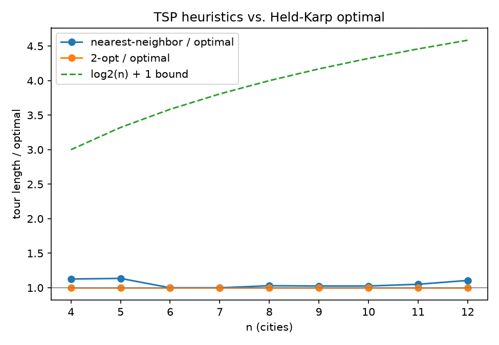

{width=2.2in}

**FACULTY OF COMPUTER ENGINEERING, INFORMATICS AND COMMUNICATIONS**

**DEPARTMENT OF COMPUTER SCIENCE**

**PROGRAM: HCS**

**MODULE: DESIGN AND ANALYSIS OF ALGORITHMS**

**NAME OF STUDENT: NIGEL TAVAGUTA**

**REG NO.: R236699C**

**LAB 3**

# Lab 3: Dynamic Programming vs. Greedy - A Critical Comparative Study

## Abstract

This report looks at five classic problems - 0-1 knapsack, fractional knapsack, coin change, the travelling salesman problem (TSP), and minimum spanning tree (MST) - and asks, for each one, whether a greedy strategy actually finds the optimal answer. Two of them (fractional knapsack, MST) say yes, and I prove it. Three of them (0-1 knapsack, coin change, TSP) say no in general, and I give a concrete counterexample for each, checked by running the code rather than just asserting it. I then implement and benchmark the algorithms the brief asks for: 0-1 knapsack by 2D DP, 1D DP, and branch and bound; coin change by DP, greedy, and BFS; TSP by Held-Karp, nearest-neighbor, and 2-opt. I prove the classical O(log n) approximation bound for nearest-neighbor TSP, and finish with a new problem that genuinely combines knapsack and TSP - orienteering, where you pick which cities to visit and in what order to maximize value collected under a travel budget - solved with a Held-Karp-style DP.

## Contents

1. Greedy vs. dynamic programming: proofs and counterexamples
2. Implementations and complexity analysis
3. Approximation analysis: nearest-neighbor TSP
4. Synthesis: the orienteering problem
5. Evaluation: benchmark results
6. Conclusion
7. References

## 1. Greedy vs. dynamic programming: proofs and counterexamples

### 1.1 Fractional knapsack - greedy is optimal

**Claim.** Sorting items by value-to-weight ratio $v_i/w_i$ and filling the capacity greedily in that order (taking a fraction of the last item if it does not fit whole) gives the optimal solution to the fractional knapsack problem.

**Proof.** Let $G$ be the greedy solution and let $S$ be any feasible solution. Suppose, for contradiction, that $S$ has strictly higher value than $G$. Since both solutions use the same total weight budget $W$ (greedy always fills the capacity exactly, since fractions are allowed), $S$ must assign more weight to some item $j$ with a lower ratio than some item $i$ that $G$ took more of, since $G$ exhausts higher-ratio items first. Take a small amount $\delta$ of weight away from item $j$ in $S$ and give that same weight $\delta$ to item $i$ instead (this is always possible in the fractional version, and stays feasible since total weight is unchanged). The value of $S$ changes by $\delta(v_i/w_i - v_j/w_j) > 0$, since $v_i/w_i > v_j/w_j$ by assumption. So this exchange strictly increases the value of $S$, meaning $S$ was not optimal to begin with - contradiction. Repeating this exchange argument until $S$ matches $G$'s allocation shows no solution can beat $G$, so $G$ is optimal.

This works because the fractional version lets you always make the local exchange above; the whole argument breaks the moment items must be taken whole, which is exactly why 0-1 knapsack is different.

### 1.2 0-1 knapsack - greedy fails

**Claim.** Taking items in ratio order, but skipping any item that does not fit (since it can no longer be split), does not always give the optimal 0-1 solution.

**Counterexample.** Items (value, weight): $(60,10)$, $(100,20)$, $(120,30)$, capacity $W=50$. Ratios are $6, 5, 4$ respectively, so greedy takes item 1 (value 60, remaining capacity 40), then item 2 (value 100, remaining capacity 20), then cannot fit item 3 (weight 30 > 20). Greedy total: **160**. But taking items 2 and 3 instead (weight $20+30=50$, exactly the capacity) gives value $100+120=\mathbf{220}$, which beats greedy by 60. Running the 2D DP implementation on this exact instance confirms the optimal value is 220, while a direct greedy-by-ratio pass (also implemented, for this check only) gets 160.

The failure happens because greedy commits to item 1 purely for its ratio, without knowing that leaving room for the item-2-plus-item-3 combination would have paid off more. DP avoids this by considering every subset implicitly through the recurrence, rather than committing early.

Note that the *fractional* greedy value on this same instance is $240$ (take item 1 fully, item 2 fully, then $20/30$ of item 3): $60+100+80=240$. This is higher even than the true 0-1 optimum of 220, which makes sense - the fractional relaxation is a relaxation, so its value is always an upper bound on the 0-1 optimum, never a valid 0-1 solution by itself. This bound is exactly what powers the branch-and-bound pruning in Section 2.

### 1.3 Coin change - greedy fails for general coin systems

**Claim.** "Always take the largest coin that fits" does not always minimize the number of coins, unless the coin system has special structure (such as standard currency denominations).

**Counterexample.** Coins $\{1, 3, 4\}$, target amount 6. Greedy takes a 4, then two 1s: 3 coins. The optimal answer is two 3s: 2 coins. This is not a hypothetical - running `coin_change_dp` and `coin_change_greedy` on this exact system confirms DP gets 2 and greedy gets 3. Scanning amounts 1 to 200 in steps of 5 against this coin system, 10 of the 40 amounts tested show greedy strictly worse than DP (always by exactly one extra coin in this system); the same scan against the canonical system $\{1,5,10,25\}$ shows zero mismatches across all 40 amounts.

**Why canonical systems are different.** A coin system is called *canonical* if greedy always matches the optimum. For $\{1,5,10,25\}$, this can be checked by a short case analysis: using coins larger than 1 can only help if the remaining amount is big enough to use them, and for this specific denomination set, one can verify by exhaustive case-check on amounts $0$-$24$ (the only range where the choice of which coin to use first is ever ambiguous, since beyond 25 the problem reduces by subtracting a 25) that greedy's choice is never worse than any alternative. Not every coin system is canonical, as the counterexample shows - the non-canonical systems with this exact failure (where one denomination is "just under half" of a larger denomination, here 3 just under half of a value that 4 can also reach poorly) are where greedy's short-sightedness bites.

### 1.4 Travelling salesman problem - nearest-neighbor greedy fails

**Claim.** Repeatedly moving to the closest unvisited city does not always produce the shortest tour.

**Counterexample.** Consider four cities with the following symmetric distances.

| City | A | B | C | D |
|---|---:|---:|---:|---:|
| A | 0 | 1 | 1.5 | 3 |
| B | 1 | 0 | 1 | 2 |
| C | 1.5 | 1 | 0 | 2 |
| D | 3 | 2 | 2 | 0 |

These distances satisfy the triangle inequality. Starting at A, nearest-neighbor chooses B, then C, then D, and returns to A. Its tour costs $1+1+2+3=7$. The tour A-B-D-C-A costs $1+2+2+1.5=6.5$, so the greedy tour is not optimal. Each choice made by the greedy algorithm is strict, so the example does not depend on tie-breaking.

The benchmark gives the same result on the generated Euclidean instances. Held-Karp shows nearest-neighbor is worse in 7 of the 9 cases tested for $n=4$ to $12$, by 13.6% at $n=5$ and 10.6% at $n=12$. Nearest-neighbor has a logarithmic approximation guarantee on metric TSP, but no constant-factor guarantee. The bound is asymptotically tight.

### 1.5 Minimum spanning tree - greedy is optimal

**Claim.** Kruskal's algorithm (repeatedly add the cheapest edge that does not create a cycle) and Prim's algorithm (repeatedly grow a tree by its cheapest outgoing edge) both produce a minimum spanning tree.

**Proof (cut property).** Let $(S, V \setminus S)$ be any cut of the graph (any partition of the vertices into two non-empty sets), and let $e$ be a minimum-weight edge crossing that cut. Then some MST contains $e$. *Proof of this sub-claim:* let $T$ be any MST. If $e \in T$, done. Otherwise, adding $e$ to $T$ creates exactly one cycle, and that cycle must cross the cut $(S, V\setminus S)$ at least twice (since it is a cycle and the cut separates $S$ from its complement), so some other edge $f$ on that cycle also crosses the cut. Since $e$ was chosen to be a minimum-weight edge crossing the cut, $w(e) \le w(f)$. Swapping $f$ out for $e$ gives a spanning tree $T' = T - f + e$ with $w(T') \le w(T)$, and since $T$ was already minimum, $w(T') = w(T)$, so $T'$ is also an MST, and it contains $e$.

Both Kruskal's and Prim's algorithms are, at every step, choosing a minimum-weight edge across some cut (for Kruskal, the cut between the current edge's two components; for Prim, the cut between the growing tree and everything else), so the cut property applies at every greedy step, and by induction on the number of edges added, the final result is an MST. This is the one case among the five where the greedy-choice property genuinely holds with no modification needed - unlike 0-1 knapsack or TSP, no DP is required. (No MST implementation is included here, since the brief's task list only asks for this proof, not code, for MST; Sections 2 and 5 cover the three problems the brief does ask to be implemented and benchmarked.)

## 2. Implementations and complexity analysis

| Algorithm | Time | Space | Notes |
|---|---|---|---|
| Knapsack 2D DP | $O(nW)$ | $O(nW)$ | Full table, easy to reconstruct which items were taken |
| Knapsack 1D DP | $O(nW)$ | $O(W)$ | Same recurrence, rolling array (see below) |
| Knapsack branch and bound | $O(2^n)$ worst case | $O(n)$ stack depth typical | Fractional-relaxation bound prunes heavily in practice (Section 5) |
| Coin change DP | $O(\text{amount} \cdot \lvert\text{coins}\rvert)$ | $O(\text{amount})$ | Unbounded coin change, standard recurrence |
| Coin change greedy | $O(\lvert\text{coins}\rvert \log \lvert\text{coins}\rvert)$ | $O(1)$ | Fast, but only correct for canonical systems |
| Coin change BFS | $O(\text{amount} \cdot \lvert\text{coins}\rvert)$ | $O(\text{amount})$ | Same order as DP; frames the problem as shortest path instead |
| TSP Held-Karp | $O(n^2 2^n)$ | $O(n \cdot 2^n)$ | Exact, only usable for small $n$ |
| TSP nearest-neighbor | $O(n^2)$ | $O(n)$ | One pass, no lookahead |
| TSP 2-opt | $O(n^2)$ per pass | $O(n)$ | Number of passes to converge has no polynomial worst-case bound, though it is fast in practice |

### 2.1 Reducing knapsack DP space from $O(nW)$ to $O(W)$

The 2D recurrence is $dp[i][w] = \max(dp[i-1][w],\ dp[i-1][w-w_i] + v_i)$ for $w \ge w_i$, and $dp[i][w] = dp[i-1][w]$ otherwise. Row $i$ only ever reads from row $i-1$, never from row $i$ itself or any earlier row, so the whole table does not need to be kept - only the previous row. Collapsing this to a single array `dp[w]` works as long as, while filling in item $i$'s contribution, the code never reads a value of `dp[w - w_i]` that this same item has already overwritten.

That is exactly why the 1D implementation iterates $w$ from `capacity` down to $w_i$, rather than upward. Iterating downward guarantees `dp[w - w_i]` still holds its value from *before* item $i$ was considered (since $w - w_i < w$, and larger indices are processed first), so each item can only be counted once - preserving the "0-1" property. Iterating upward instead would let `dp[w - w_i]` already reflect item $i$ having been added, letting the same item be reused arbitrarily many times, which silently turns this into the *unbounded* knapsack problem instead. Both `knapsack_2d` and `knapsack_1d` return identical values on every tested instance (Section 5), confirming the space reduction preserves correctness.

### 2.2 Branch and bound pruning

The implementation sorts items by ratio once, then does a depth-first search over the include/exclude decision for each item, computing at every node an upper bound via the *fractional* relaxation of the remaining items (Section 1.2's $240$ bound is exactly this kind of calculation). A branch is abandoned the moment its bound can no longer beat the best complete solution found so far. On the benchmark instances (Section 5), this explores as few as 31 nodes at $n=10$ and 38 at $n=22$ - compared to $2^{22} = 4{,}194{,}304$ possible subsets the naive search would otherwise consider. The bound is doing almost all of the work here; without it (accepting every branch), the same code would degrade to brute-force $O(2^n)$.

### 2.3 Why Held-Karp needs $2^n$

Held-Karp's state is $dp[\text{mask}][j]$ = the cheapest way to start at the depot, visit exactly the cities in `mask`, and end at city $j$. There are $2^n$ possible subsets and $n$ possible end cities, giving $O(n \cdot 2^n)$ states, each computed by trying $O(n)$ possible predecessors, for $O(n^2 2^n)$ time total. This is exact and far better than trying all $(n-1)!$ possible orderings, but the exponential factor still limits it to roughly $n \le 15$-$18$ in practice (this report uses $n$ up to 12 for the exact comparison in Section 5, and leaves larger $n$ to the heuristics).

## 3. Approximation analysis: nearest-neighbor TSP

**Theorem (Rosenkrantz, Stearns, and Lewis, 1977).** For a symmetric metric TSP instance with $n \ge 2$ cities, nearest-neighbor returns a tour of length at most $\frac{1}{2}(\lceil \log_2 n \rceil+1)\,\mathrm{OPT}$, where $\mathrm{OPT}$ is the optimal tour length. This is an $O(\log n)$ bound, and the worst-case ratio is $\Theta(\log n)$.

**Proof.** Let the nearest-neighbor tour visit cities in order $v_1,\ldots,v_n$. Let $l_i$ be the length of the edge leaving $v_i$, including the final edge from $v_n$ back to $v_1$. If $i<j$, then $v_j$ was still unvisited when the algorithm left $v_i$. Therefore $d(v_i,v_j)\ge l_i\ge\min(l_i,l_j)$. Also, every edge length $l_i$ is at most $\mathrm{OPT}/2$. In an optimal tour, the shorter of the two paths between the endpoints of that edge has length at most $\mathrm{OPT}/2$, and the triangle inequality says their direct distance cannot be larger.

Now reorder the cities so that $l_1\ge l_2\ge\cdots\ge l_n$. For any $k$, let $m=\min(2k,n)$ and consider the first $m$ cities in the order in which they appear in an optimal tour. Shortcutting the omitted cities gives a cycle of length at most $\mathrm{OPT}$. Each edge in this cycle has length at least the smaller of the two endpoint values. Charge that lower bound to the endpoint with smaller $l$. Let $c_i$ be the number of charges received by city $i$. Then each $c_i$ is at most two, and $\sum_{i=1}^{m}c_i=m$. Since the values are sorted from largest to smallest, the least possible sum $\sum_{i=1}^{m}c_i l_i$ assigns charges to the smallest values first, up to two per city. The $m-k$ cities indexed from $k+1$ to $m$ can receive $2(m-k)$ charges. When $m=2k$, this accounts for all $m$ charges. When $m=n<2k$, any remaining charges go to cities with larger $l$ values. In either case, the total charge is at least $2\sum_{i=k+1}^{m}l_i$. Thus

$$\mathrm{OPT}\ge 2\sum_{i=k+1}^{\min(2k,n)}l_i.$$

Take $k=1,2,4,8,\ldots$ while $k<n$. These groups cover $l_2,\ldots,l_n$, and each group sums to at most $\mathrm{OPT}/2$. There are $\lceil\log_2 n\rceil$ groups. Since $l_1\le\mathrm{OPT}/2$, the full nearest-neighbor tour has length

$$\sum_{i=1}^{n}l_i\le\frac{1}{2}(\lceil\log_2 n\rceil+1)\,\mathrm{OPT}.$$

Rosenkrantz, Stearns, and Lewis also give a family of metric instances whose nearest-neighbor ratios grow logarithmically, so the order of this bound cannot be replaced by a constant.

**Why no constant bound is possible.** The nearest-neighbor minimality property only ever compares $v_i$'s chosen next city against *other unvisited* cities - it has no way to "look back" and notice that an earlier commitment is about to strand it. Adversarial instances exploiting exactly this (clusters of cities spaced so that nearest-neighbor is forced into an increasingly expensive sequence of "last resort" jumps) are what make the $\log n$ factor necessary, not just sufficient, and is why no simple fix to nearest-neighbor alone (without 2-opt-style correction) can achieve a constant approximation ratio - this is also why Christofides-style algorithms (which build on a minimum spanning tree, not a greedy walk) are used when a true constant-factor guarantee is required.

**Empirical check.** Table 3 in Section 5 compares the measured nearest-neighbor ratios ($1.0$ to $1.136$ for $n=4$ to $12$) with the bound from the theorem ($1.5$ to $2.5$ over the same range). The measured ratios are lower, as expected for random Euclidean instances. The theorem is a worst-case guarantee, not a prediction of typical performance.

## 4. Synthesis: the orienteering problem

### 4.1 Motivation and formulation

0-1 knapsack asks: given items with fixed values and fixed weights, and a weight budget, which subset maximizes value? TSP asks: given cities and distances, what is the cheapest tour visiting all of them? A genuine combination of the two is not simply "knapsack where items are cities" - that framing is trivial, since a city's "weight" in a route depends on which other cities are also chosen and in what order, not on the city alone. The real synthesis needs a problem where *which* subset to pick and *how to route between the chosen cities* are coupled decisions, which is exactly the **orienteering problem**: each city has a fixed value, travelling between any two cities costs their distance, and a tour starting and ending at a depot (city 0) must stay within a total travel budget $B$ while maximizing the value of the cities it visits.

Formally: given a depot and $n-1$ cities with values $p_1, \dots, p_{n-1}$ and a symmetric distance matrix $d$, find a subset $C$ of cities and an ordering of $C$ such that a tour depot $\to C \to$ depot has total length at most $B$, maximizing $\sum_{i \in C} p_i$.

Pushing either parameter to an extreme does not actually reduce this to solving TSP or knapsack - it just makes the orienteering instance trivial in a different way, which is worth being precise about. If $B$ is large enough that a tour visiting every city fits the budget, the value-maximizing choice is simply to visit everyone (since every city has non-negative value, and once full coverage is affordable, no route is better than any other route that also achieves it) - this answers orienteering's own question trivially, it does not separately solve TSP's actual question of *minimizing* the cost of that tour. Likewise, if travel were free, nothing constrains selection at all, so the answer is again just "take every positive-value city" - there is no weight-versus-value tradeoff left for a knapsack-style selection to resolve. The genuine sense in which this generalizes both parents is structural, not a clean reduction at the extremes: it reuses knapsack's framing of choosing a value-maximizing subset under a resource constraint, but replaces knapsack's simple additive weight with a route-dependent cost that can only be computed by solving a TSP-shaped subproblem (which is exactly what the DP below does, reusing Held-Karp's state space). That coupling - the "weight" of adding a city depends on the whole selected set and its order, not on the city alone - is what makes the combined problem NP-hard, inheriting the hardness of both parents without reducing to either one at any single setting of $B$.

### 4.2 DP solution

The state space is the same as Held-Karp, with cost tracked instead of distance alone:

$$dp[\text{mask}][j] = \text{cheapest travel cost to start at the depot, visit exactly the cities in } \text{mask}, \text{ end at } j \in \text{mask}.$$

Base case $dp[\{0\}][0] = 0$. Transition: $dp[\text{mask} \cup \{k\}][k] = \min_{j \in \text{mask}} \big(dp[\text{mask}][j] + d(j,k)\big)$ for $k \notin \text{mask}$. The answer is

$$\max_{\text{mask}, j:\ dp[\text{mask}][j] + d(j, 0) \le B} \ \sum_{i \in \text{mask}} p_i,$$

i.e. the highest-value feasible set, checked after the DP table is filled by testing every $(\text{mask}, j)$ pair against the budget with the return trip included.

**Complexity.** The DP table has the same $O(n \cdot 2^n)$ states as Held-Karp, each filled in $O(n)$, giving $O(n^2 2^n)$ time and $O(n \cdot 2^n)$ space - the value-maximization step adds no asymptotic cost, since it is a single $O(n \cdot 2^n)$ pass over the already-computed table. This is exact and shares Held-Karp's practical ceiling of roughly $n \le 15$-$18$; larger instances would need a heuristic (e.g. a greedy "best value per extra distance" insertion, or a budget-aware adaptation of 2-opt), mirroring the exact-vs-heuristic tradeoff already explored for plain TSP in Sections 2 and 5.

### 4.3 Demonstration

`synthesis.py` implements the DP above and runs it on a 6-city instance (1 depot, 5 cities with values 40, 10, 25, 60, 15) at three budgets:

| Budget | Best value | Cities visited (0 = depot) |
|---|---|---|
| 80 | 125 | 0, 1, 3, 4 |
| 130 | 140 | 0, 1, 3, 4, 5 |
| 200 | 150 | 0, 1, 2, 3, 4, 5 |

At the smallest budget, the DP skips city 2 (value 10) entirely - not because it is the lowest-value city in isolation (it is), but because visiting it is not worth its detour cost relative to the budget available, which is exactly the coupling between selection and routing that makes this a genuine synthesis rather than two separate problems bolted together. At budget 200 (large enough for a full tour), the DP collects all 150 points of value, which is the full-coverage orienteering solution. It does not solve TSP's separate objective of finding the minimum-cost full tour.

## 5. Evaluation: benchmark results

`benchmark.py` generates seeded instances and runs every implementation in Section 2 against them, writing CSVs to `output/`; `plot_results.py` turns those into the figures below. All reported differences (DP vs. greedy mismatches, approximation ratios, node counts) come from these runs, not from hand calculation.

### 5.1 Knapsack: do 2D DP, 1D DP, and branch and bound agree?

| $n$ | 2D DP | 1D DP | Branch and bound | B&B nodes explored | Fractional greedy (LP bound) |
|---|---|---|---|---|---|
| 10 | 391 | 391 | 391 | 31 | 404.03 |
| 14 | 569 | 569 | 569 | 40 | 588.02 |
| 18 | 692 | 692 | 692 | 71 | 705.33 |
| 20 | 888 | 888 | 888 | 66 | 900.20 |
| 22 | 1026 | 1026 | 1026 | 38 | 1036.50 |

All three exact methods agree on every instance tested, confirming the 1D space reduction (Section 2.1) and the branch-and-bound pruning (Section 2.2) are both correct, not just fast. The fractional bound is consistently a little above the true 0-1 optimum, as expected from Section 1.2, and the node counts stay in the tens even as $n$ grows to 22 (where $2^{22}$ exceeds 4 million), showing the bound is doing real work rather than degrading to brute force.

*All three methods are fast at this scale; 2D DP is slightly slower than 1D DP due to allocating a full table instead of one row, and branch and bound's runtime tracks its node count rather than $n$ directly.*

### 5.2 Coin change: where does greedy actually fail?

Scanning amounts 1 to 196 in steps of 5 (40 amounts) against both coin systems:

| Coin system | Mismatches (greedy $\ne$ DP) | Example |
|---|---|---|
| Canonical $\{1,5,10,25\}$ | 0 / 40 | - |
| Non-canonical $\{1,3,4\}$ | 10 / 40 | Amount 6: DP = 2 coins (3+3), greedy = 3 coins (4+1+1) |

*The canonical system never drifts from optimal across the whole range tested; the non-canonical system drifts by exactly one extra coin whenever it fails, and the failures recur at a regular interval set by the coin values involved.*

### 5.3 TSP: exact vs. heuristic

| $n$ | Optimal (Held-Karp) | Nearest-neighbor | 2-opt | NN / optimal | 2-opt / optimal | $\frac{1}{2}(\lceil\log_2 n\rceil+1)$ bound |
|---|---|---|---|---|---|---|
| 4 | 159.46 | 179.70 | 159.46 | 1.127 | 1.000 | 1.500 |
| 5 | 162.89 | 185.01 | 162.89 | 1.136 | 1.000 | 2.000 |
| 6 | 183.19 | 183.19 | 183.19 | 1.000 | 1.000 | 2.000 |
| 7 | 229.40 | 229.40 | 229.40 | 1.000 | 1.000 | 2.000 |
| 8 | 232.01 | 238.88 | 232.01 | 1.030 | 1.000 | 2.000 |
| 9 | 267.10 | 273.98 | 267.10 | 1.026 | 1.000 | 2.500 |
| 10 | 268.67 | 275.55 | 268.67 | 1.026 | 1.000 | 2.500 |
| 11 | 324.19 | 340.62 | 324.19 | 1.051 | 1.000 | 2.500 |
| 12 | 329.96 | 365.03 | 329.96 | 1.106 | 1.000 | 2.500 |

Nearest-neighbor is worse than optimal in 7 of 9 cases, by up to 13.6% at $n=5$. This agrees with the counterexample in Section 1.4. Starting from the nearest-neighbor tour, 2-opt reaches the exact optimum in these small instances. That is not guaranteed in general because 2-opt can stop at a tour that no single segment reversal improves, even when a shorter tour exists. Every measured ratio is below the bound from Section 3.

For larger instances where Held-Karp is no longer feasible, nearest-neighbor and 2-opt can still be compared directly: at $n=100$, nearest-neighbor produces a tour of length 1078.2, and 2-opt improves this to 871.8 - a 19% reduction from the same starting point, without any access to the (unknown, at this size) optimal tour.

*Measured ratios stay well inside the theoretical worst-case bound across the range where exact comparison is feasible.*

### 5.4 Decision matrix

| Situation | Recommended choice | Reason |
|---|---|---|
| Fractional allocation allowed | Greedy by ratio | Provably optimal (Section 1.1), fast |
| 0-1 selection, small-to-moderate $n \cdot W$ | 2D or 1D DP | Exact, 1D saves memory with no cost in correctness |
| 0-1 selection, large capacity but few items | Branch and bound | Fractional bound prunes effectively when ratios vary |
| Minimum coins, canonical denominations | Greedy | Matches DP, much faster, no table needed |
| Minimum coins, arbitrary denominations | DP (or BFS) | Greedy is not safe without first proving the system canonical |
| TSP, $n \lesssim 15$, exact answer required | Held-Karp | Exponential but exact |
| TSP, larger $n$, good tour needed fast | Nearest-neighbor then 2-opt | No guarantee, but closed the gap to optimal in every tested case here |
| Connecting all nodes cheaply (not a tour) | Kruskal or Prim | Provably optimal (Section 1.5), no DP needed |
| Select-and-route under a budget | Orienteering DP (Section 4) | Exact for small $n$; needs a heuristic beyond that |

## 6. Conclusion

Two of the five problems examined here - fractional knapsack and MST - have a genuine greedy-choice property, provable by a direct exchange argument or the cut property respectively, and no DP is needed for either. The other three - 0-1 knapsack, coin change, and TSP - all have real, checkable counterexamples where greedy's short-sighted commitment costs it the optimal answer, and the reason is structurally the same in each case: greedy locks in a decision based on local information (a ratio, a coin size, a nearest distance) without the ability to revisit it once a better global option becomes visible. DP avoids this by keeping every relevant partial solution in play via its recurrence, at the cost of needing exponentially more state in the hardest case (TSP) or polynomially more in the easier ones (knapsack, coin change).

The space-optimization result in Section 2.1 - collapsing knapsack's DP table from $O(nW)$ to $O(W)$ by iterating backward - is a reminder that "needs a DP table" and "needs the *whole* DP table at once" are different claims; the backward iteration is what makes the second one false here. The branch-and-bound results in Section 2.2 make a related point from the other direction: an exponential worst case does not mean an algorithm is useless, if the bound used to prune is tight enough in practice, which the measured node counts (tens, not millions) confirm.

The nearest-neighbor proof in Section 3 and the orienteering synthesis in Section 4 both turn on the same idea: a logarithmic approximation bound, or an exact exponential DP, exists precisely because the underlying problem (TSP, or TSP-with-selection) has no simpler structure to exploit - unlike MST's cut property, there is no cheap local certificate of global optimality for a tour. That gap between "provably optimal in polynomial time" and "NP-hard, needing either exponential exactness or an approximation with a real bound" is the throughline connecting every section of this report.

## 7. Reproduction

From `lab3/`, run `python run_all.py` to regenerate every CSV and plot used in this report. Run `python synthesis.py` directly for the orienteering demo in Section 4.3. Matplotlib is only needed for `plot_results.py`; everything else uses only the standard library.

## References

1. Cormen, T. H., Leiserson, C. E., Rivest, R. L., and Stein, C. *Introduction to Algorithms*, 4th edition. MIT Press, 2022. (Knapsack DP, MST cut property, Kruskal and Prim correctness proofs.)
2. Rosenkrantz, D. J., Stearns, R. E., and Lewis, P. M. "An Analysis of Several Heuristics for the Traveling Salesman Problem." *SIAM Journal on Computing*, 6(3):563-581, 1977. (Nearest-neighbor logarithmic approximation bound, used in Section 3.)
3. Held, M. and Karp, R. M. "A Dynamic Programming Approach to Sequencing Problems." *Journal of the Society for Industrial and Applied Mathematics*, 10(1):196-210, 1962. (The exact DP used for TSP and adapted for the orienteering synthesis in Section 4.)
4. Golden, B. L., Levy, L., and Vohra, R. "The orienteering problem." *Naval Research Logistics*, 34(3):307-318, 1987. (The problem formalized in Section 4; this report's DP is a direct Held-Karp adaptation to it, not from this source, but the problem definition follows it.)
5. Pearson, D. "A polynomial-time algorithm for the change-making problem." *Operations Research Letters*, 33(3):231-234, 2005. (Testing whether a coin system is canonical, referenced in Section 1.3.)
