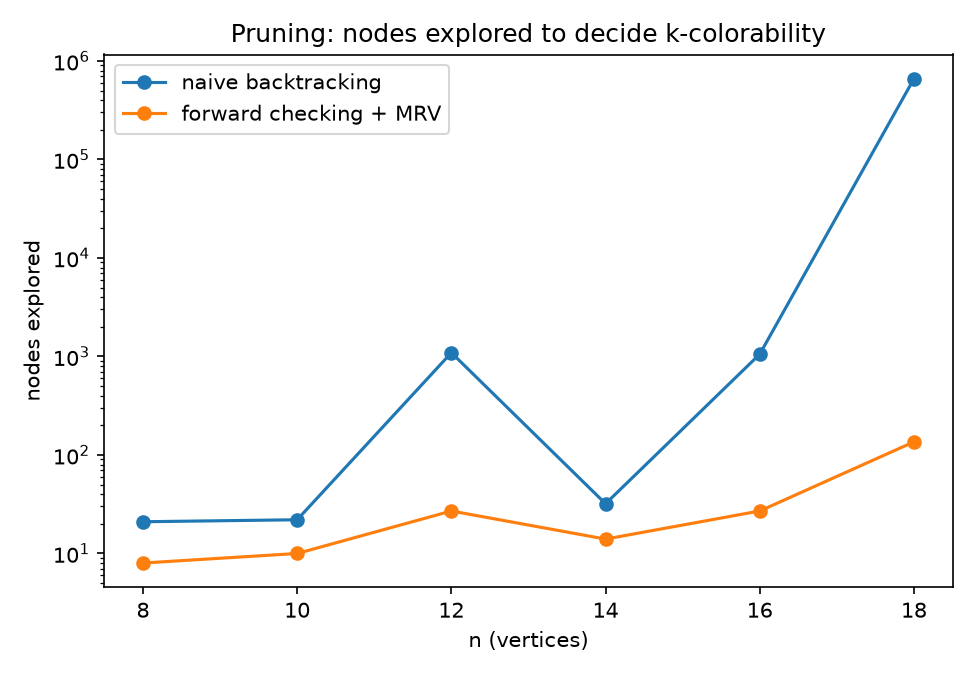
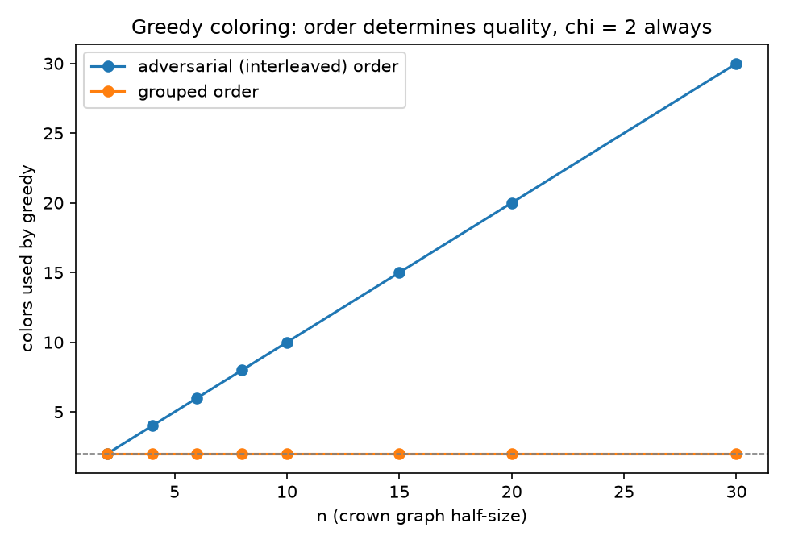
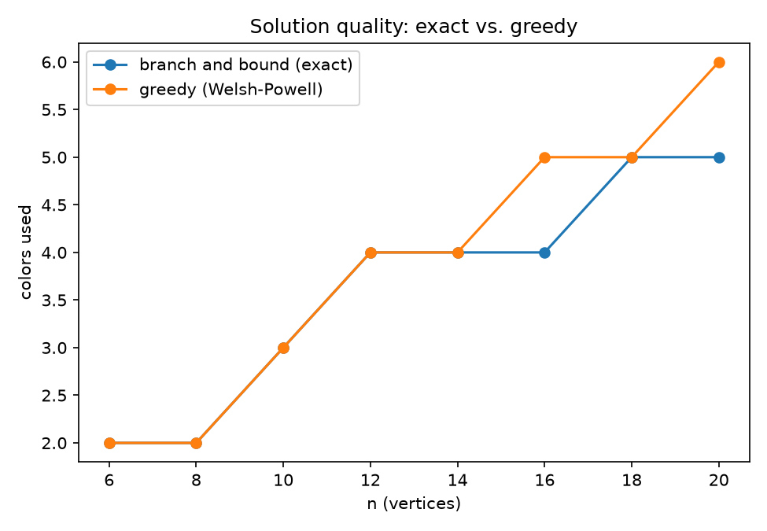
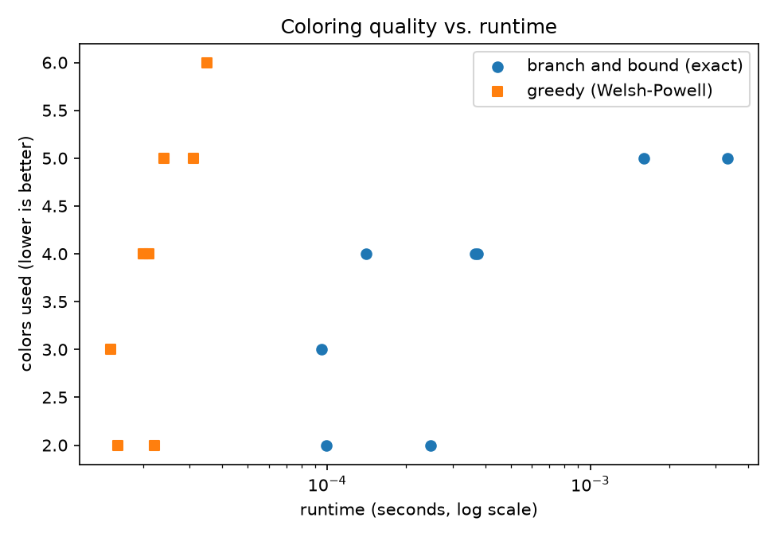
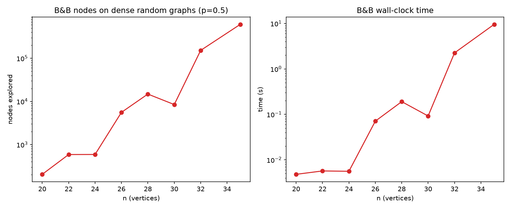

{width=2.2in}

**FACULTY OF COMPUTER ENGINEERING, INFORMATICS AND COMMUNICATIONS**

**DEPARTMENT OF COMPUTER SCIENCE**

**PROGRAM: HCS**

**MODULE: DESIGN AND ANALYSIS OF ALGORITHMS**

**NAME OF STUDENT: NIGEL TAVAGUTA**

**REG NO.: R236699C**

**LAB 4**

# Lab 4: Backtracking and Branch-and-Bound for NP-Hard Combinatorial Problems

## Abstract

This report builds an exam-timetabling engine on top of graph coloring: exams are vertices, an edge means two exams share a student, and a color is a time slot. I implement three exact search strategies (naive backtracking, backtracking with forward checking and the MRV heuristic, and a branch-and-bound solver that finds the true minimum number of slots) plus a greedy approximation. Forward checking and MRV cut the search tree by up to 4858x on the same instances naive search explores. I prove graph coloring is NP-complete by reducing from 3-SAT, show empirically that exact search cost grows exponentially on dense instances (about 10 seconds at 35 vertices in the latest run), and prove that sequential greedy coloring under an adversarial vertex order has no constant approximation ratio: one instance forces it to use n colors on a graph that needs only 2. The benchmark confirms the color count grows linearly in this construction. I close with a decision matrix for when each method is actually worth using.

## Contents

1. Modeling timetabling as graph coloring
2. Implementations and algorithm design
3. Pruning analysis: naive vs. forward checking + MRV
4. Worst-case analysis: graph coloring is NP-complete
5. Approximation: greedy coloring and why it has no constant ratio
6. Evaluation: benchmark results
7. Recommendation for practical deployment
8. Conclusion
9. References

## 1. Modeling timetabling as graph coloring

Each exam is a vertex. Two exams get an edge if at least one student is enrolled in both - they cannot run in the same time slot, since that student would need to be in two places at once. A proper coloring assigns each exam a slot (color) so that no edge connects two same-colored vertices, i.e. no two conflicting exams share a slot. The number of colors used is the number of time slots the schedule needs, and the minimum possible number of colors is the graph's chromatic number.

This captures the "no student in two exams simultaneously" constraint exactly, and it is the part of the problem that makes timetabling NP-hard in the first place (Section 4 proves this). The experiments focus on this student-conflict graph. Lecturer conflicts can also be represented by adding edges between exams taught by the same lecturer. Individual lecturer availability would require an allowed-slot list for each exam, which the current solver does not accept. Room capacity is not captured by ordinary graph coloring: a complete model must assign each exam to a room large enough for its enrollment and prevent a room from hosting two simultaneous exams. Neither availability lists nor room assignments are implemented here, so the reported schedules satisfy student-conflict constraints only.

`datasets.py` builds these conflict graphs from simulated enrollment data: a number of students, each enrolled in a random handful of exams, with an edge added between every pair of exams a given student takes. This produces the clustered, uneven-degree structure real registration data has, which is noticeably different from a uniform-random graph (Section 6.3).

## 2. Implementations and algorithm design

| Algorithm | Purpose | Key idea |
|---|---|---|
| `naive_backtracking(adj, k)` | Decide if $k$ colors suffice | Fixed vertex order, try colors 0..k-1, backtrack on conflict |
| `backtracking_fc_mrv(adj, k)` | Same decision, much faster | Forward checking (prune empty domains immediately) + MRV (color the most-constrained vertex next) |
| `branch_and_bound_chromatic(adj)` | Find the exact minimum number of colors | Clique-based lower bound, then FC+MRV decision calls for increasing $k$ starting from that bound |
| `greedy_coloring(adj, order)` | Fast approximation | Welsh-Powell: highest-degree vertex first, smallest available color each time |

**Forward checking.** After a vertex $v$ is colored, every uncolored neighbor's set of still-available colors (its domain) has $v$'s color removed. If any domain becomes empty, the current branch cannot possibly succeed, and the code backs out immediately instead of discovering the same failure several levels deeper by brute trial and error. This is the single biggest lever in the whole lab - Section 3 quantifies it.

**MRV (minimum remaining values).** At each step, the search branches on whichever uncolored vertex currently has the fewest available colors left, breaking ties toward higher degree. Constrained vertices are where failures are most likely to surface, so finding out early whether they are even colorable collapses large parts of the tree that naive left-to-right ordering would have explored in full before noticing the same problem.

**Branch and bound.** $\chi(G) \ge \omega(G)$ (the clique number) for any graph, since every vertex in a clique needs a distinct color. `greedy_clique_lower_bound` builds a clique greedily (not exactly - max clique is itself NP-hard) to get a cheap, valid starting point, and the search tries $k$ = that bound, then bound+1, bound+2, ... using the FC+MRV decision procedure, stopping at the first $k$ that succeeds. When the greedy bound happens to equal the true chromatic number (common on the structured timetabling instances in Section 6.3), the very first attempt succeeds and the search is essentially free; when it does not (common on dense random graphs, Section 6.4), several full decision searches are needed, which is where the exponential worst case actually shows up.

**Greedy coloring.** Welsh-Powell processes vertices in decreasing degree order by default, since high-degree vertices are hardest to color later and should claim low color numbers first while there is still room. Section 5 shows this heuristic, while usually reasonable, has no bound on how badly it can fail if the vertex order is adversarial rather than degree-sorted.

## 3. Pruning analysis: naive vs. forward checking + MRV

Both algorithms decide the same question - is this graph $k$-colorable - on identical graphs, with $k$ set to the clique-based lower bound (the hardest case: a tight budget that may or may not actually work). Counting nodes explored (one count per color attempted at a vertex, successful or not) isolates the effect of the pruning itself from any difference in what problem is being solved.

| $n$ | $k$ | Naive nodes | FC+MRV nodes | Reduction |
|---|---|---|---|---|
| 8 | 3 | 21 | 8 | 2.6x |
| 10 | 4 | 22 | 10 | 2.2x |
| 12 | 3 | 1,092 | 27 | 40.4x |
| 14 | 4 | 32 | 14 | 2.3x |
| 16 | 3 | 1,056 | 27 | 39.1x |
| 18 | 4 | 660,740 | 136 | 4858.4x |

The reduction factor is not steady - it depends heavily on whether $k$ turns out to be just barely too small (naive search has to exhaust enormous unproductive regions of the tree proving infeasibility one dead end at a time) or comfortably sufficient (both algorithms succeed quickly, so there is less room for pruning to matter). The $n=18$ case is exactly the former: the graph is not 4-colorable, and naive search needs 660,740 node visits to establish that, while forward checking with MRV reaches the same conclusion in 136.

*Nodes explored to decide k-colorability, naive vs. forward checking + MRV, same graphs and same k both times. The y-axis is logarithmic - the gap is not a rounding artifact.*

## 4. Worst-case analysis: graph coloring is NP-complete

**Claim.** The 3-colorability decision problem is NP-complete. The general graph-coloring decision problem, where $k$ is part of the input, is therefore NP-complete as well. The case $k=2$ is bipartiteness and can be checked in linear time by BFS or DFS.

**Membership in NP.** A candidate coloring is a list of $n$ color assignments, checkable for validity (no edge has two equal endpoints) in $O(|E|)$ time - a polynomial-size certificate with a polynomial-time checker.

**NP-hardness, by reduction from 3-SAT.** First convert each 3-SAT clause $(a \lor b \lor c)$ into two not-all-equal constraints using one shared variable $z$ and a fresh variable $y_j$ for each clause:

$$\operatorname{NAE}(a,b,y_j) \quad\text{and}\quad \operatorname{NAE}(\lnot y_j,c,z).$$

Here $\operatorname{NAE}(u,v,w)$ is true when the three Boolean values are not all equal. The identity behind this conversion is that $\operatorname{NAE}(a,b,c,z)$ holds exactly when some choice of $y$ makes both $\operatorname{NAE}(a,b,y)$ and $\operatorname{NAE}(\lnot y,c,z)$ hold. If $a=b=q$, the first constraint forces $y=\lnot q$, and the second fails only when $c=z=q$, which is exactly the all-equal case. If $a\ne b$, the first constraint permits either value of $y$. When $c\ne z$, the second constraint is automatically true; when $c=z$, choose $y=c$ so that $\lnot y$ differs from both. Thus every non-all-equal four-tuple admits a suitable $y$. Since complementing every variable preserves every NAE constraint, any satisfying assignment can be complemented if needed so that $z$ is false. With $z$ false, $\operatorname{NAE}(a,b,c,z)$ is equivalent to $a \lor b \lor c$. Thus the original formula is satisfiable exactly when the resulting NAE-3SAT instance is satisfiable.

Now construct a graph for the NAE instance.

*Base and variable gadgets.* Make a triangle with vertices $T$, $F$, and $B$. In any proper 3-coloring these vertices receive distinct colors, which represent true, false, and the third color. For each Boolean variable $x$, create vertices $x$ and $\lnot x$, connect them to each other, and connect both to $B$. They must use the $T$ and $F$ colors in opposite order, so they encode a Boolean assignment. The shared variable $z$ and each $y_j$ use the same gadget.

*NAE clause gadget.* For each constraint $\operatorname{NAE}(\ell_1,\ell_2,\ell_3)$, create three new vertices $q_1,q_2,q_3$. Connect them as a triangle and connect each $q_i$ to the graph vertex representing literal $\ell_i$. If all three literals have the same color, each $q_i$ is restricted to the other two colors, so the triangle cannot be colored. If the literals are not all equal, one literal has one Boolean color and at least one has the other; assign the three $q_i$ the available colors so they are pairwise distinct. For example, with literal colors $(T,T,F)$, the corresponding $q_i$ can receive $(F,B,T)$. The $(T,F,F)$ case works symmetrically. Therefore this gadget extends to a proper 3-coloring exactly when its NAE constraint is satisfied.

*Correctness and size.* If the 3-SAT formula is satisfiable, set $z$ false, choose each $y_j$ as guaranteed by the NAE identity, color the variable gadgets to encode those values, and extend each clause gadget as above. This gives a proper 3-coloring. Conversely, any proper 3-coloring assigns Boolean values through the variable gadgets; each clause triangle then implies its NAE constraint, and complementing all values if necessary makes $z$ false. The NAE identity then implies every original 3-SAT clause is true. The construction uses a constant number of vertices and edges per variable and per clause, so it is polynomial in the formula size.

This proves 3-SAT $\le_p$ 3-COLORING. A coloring is verifiable in polynomial time by checking every edge, so 3-COLORING is NP-complete. General graph coloring is NP-hard because it includes the $k=3$ decision case, and it belongs to NP for the same verification reason. Computing the chromatic number is also NP-hard, since its answer would decide whether a graph is 3-colorable by checking whether $\chi(G) \le 3$.

## 5. Approximation: greedy coloring and why it has no constant ratio

**Upper bound.** On a graph with $N$ vertices, sequential greedy uses at most $N$ colors, so its approximation ratio is at most $N$ because $\chi(G) \ge 1$. A more informative color-count bound is $\Delta(G)+1$, since a vertex has at most $\Delta(G)$ already-colored neighbors. This is not a constant-factor guarantee relative to $\chi(G)$, because maximum degree and chromatic number can differ substantially.

**The adversarial instance.** Take $K_{n,n}$ minus a perfect matching: two sides $a_0, \ldots, a_{n-1}$ and $b_0, \ldots, b_{n-1}$, with $a_i$ adjacent to $b_j$ for every $i \ne j$ (so $a_i$ and $b_i$ are specifically *not* adjacent). Both sides are independent sets (no $a$-$a$ or $b$-$b$ edges), so coloring every $a$ one color and every $b$ a second color is valid: $\chi(G) = 2$. But color the vertices in the interleaved order $a_0, b_0, a_1, b_1, \ldots$: $a_0$ gets color 0 (no colored neighbors yet). $b_0$ is not adjacent to $a_0$ (the removed matching edge), so it also gets color 0. $a_1$ is adjacent to $b_0$ (color 0, since $1 \ne 0$) but to nothing else yet, so it is forced to color 1. $b_1$ is adjacent to $a_0$ (color 0) but not to $a_1$ (matching edge again), so it can reuse color 1. In general, by the time vertex $k$ in either sequence is reached, its already-colored neighbors on the other side have claimed colors $0, \ldots, k-2$ between them (every earlier same-index pair opened a new color together), forcing it to open color $k-1$. The result: greedy uses exactly $n$ colors on a graph that needs only 2.

I implemented this exact construction (`crown_graph` in `datasets.py`) and ran greedy coloring on it at several sizes, both in this adversarial interleaved order and in a grouped order (all $a$'s, then all $b$'s):

| $n$ | $\chi(G)$ | Interleaved order | Grouped order |
|---|---|---|---|
| 2 | 2 | 2 | 2 |
| 4 | 2 | 4 | 2 |
| 6 | 2 | 6 | 2 |
| 10 | 2 | 10 | 2 |
| 20 | 2 | 20 | 2 |
| 30 | 2 | 30 | 2 |

The grouped order always finds the optimum; the interleaved order uses exactly $n$ colors. Here the graph has $N=2n$ vertices and $\chi(G)=2$, so the interleaved order has ratio $n/2=N/4$. Together with the at-most-$N$ upper bound, this shows that sequential greedy coloring with an unrestricted vertex order has a worst-case approximation ratio $\Theta(N)$. This is an adversarial ordering result. It does not show that the default Welsh-Powell degree-descending order has the same behavior: on this regular crown graph, the stable grouped order uses two colors.

*Chi is always 2 on this graph family; the adversarial order's color count tracks n exactly, while the grouped order stays flat at the true optimum.*

Welsh-Powell (degree-descending order) is the default in `greedy_coloring`. The crown-graph experiment demonstrates why the vertex order matters; its adversarial order is a stress test for sequential greedy, not evidence about Welsh-Powell's performance on every graph.

## 6. Evaluation: benchmark results

### 6.1 Exact vs. greedy solution quality

Random graphs, $n = 6$ to $20$, comparing branch-and-bound's exact chromatic number against Welsh-Powell greedy:

| $n$ | B&B (exact) | Greedy | Gap |
|---|---|---|---|
| 6 | 2 | 2 | 0 |
| 8 | 2 | 2 | 0 |
| 10 | 3 | 3 | 0 |
| 12 | 4 | 4 | 0 |
| 14 | 4 | 4 | 0 |
| 16 | 4 | 5 | 1 |
| 18 | 5 | 5 | 0 |
| 20 | 5 | 6 | 1 |

*Degree-sorted greedy matches the exact optimum most of the time on these random instances, but not always - it is one color over at n=16 and n=20, with no guarantee it would not be worse on a different graph (Section 5).*

The brief also asks for solution quality against runtime. The next figure uses the same instances and plots the number of colors returned against the measured runtime for both methods. Runtime is shown on a logarithmic scale because the exact solver is substantially slower than greedy on the larger instances. These timings are specific to this machine and run; the color counts are the reproducible quality measure.

*Each point is one algorithm run from the table above. Lower points use fewer time slots, while points farther left ran faster.*

### 6.2 Dense graphs: where exact search gets expensive

The timetabling and moderate-density random instances above all solved almost instantly, because the greedy clique lower bound happened to equal the true chromatic number - the very first decision call succeeded. That is not guaranteed. On denser random graphs ($p=0.5$) where the clique bound and the true chromatic number diverge, branch-and-bound has to actually search multiple values of $k$:

| $n$ | Lower bound | $\chi(G)$ | Nodes | Time |
|---|---|---|---|---|
| 20 | 4 | 5 | 204 | 0.0023 s |
| 24 | 5 | 6 | 589 | 0.0069 s |
| 28 | 5 | 7 | 14,812 | 0.2367 s |
| 30 | 6 | 7 | 8,466 | 0.0860 s |
| 32 | 6 | 8 | 152,487 | 2.4031 s |
| 35 | 6 | 8 | 611,916 | 9.4174 s |

The lower bound misses the true chromatic number by one or two at every size here. Runtime varies across graph instances and machine load, and the node count is not monotone because each size generates a different graph. The largest cases still show the practical cost of exact search: at $n=35$, the solver explores 611,916 nodes and takes about 9.4 seconds in this run. Exact search is inexpensive when the lower bound is tight and can become costly when it is not.

*Node counts and runtimes rise sharply on the largest dense instances, though they vary because each graph size is a different input. The n=35 run took about 9.4 seconds.*

### 6.3 Timetabling instances

Simulated enrollment data (exams conflict when they share at least one student), rather than uniform-random edges:

| Exams | Students | Exams/student | B&B colors | B&B nodes | Greedy colors |
|---|---|---|---|---|---|
| 10 | 30 | 3 | 8 | 10 | 8 |
| 14 | 40 | 3 | 7 | 3,410 | 7 |
| 18 | 50 | 3 | 7 | 4,579 | 7 |
| 22 | 60 | 3 | 7 | 22 | 8 |
| 26 | 70 | 3 | 7 | 2,702 | 8 |

These instances stay far cheaper than the dense random graphs in 6.2 even at larger vertex counts, which matches the intuition that enrollment-driven conflict graphs are clustered rather than uniformly dense - most pairs of exams simply do not share a student, unlike an Erdos-Renyi graph at $p=0.5$. Greedy matches the exact optimum on the three smaller instances and falls one color short on the two larger ones, the same pattern as Section 6.1.

### 6.4 Decision matrix

| Situation | Recommended approach | Reason |
|---|---|---|
| Need a fast, reasonable schedule, exact optimum not required | Greedy (Welsh-Powell, degree-descending) | Instant, usually within 1 color of optimal on realistic instances (6.3) |
| Need the true minimum number of slots, instance is clustered/sparse | Branch and bound | Clique lower bound is often tight on real enrollment data, making exact search essentially free (6.3) |
| Need the true minimum, instance is dense or adversarial | Branch and bound, but budget real time for it | Cost grows exponentially once the lower bound misses (6.2); for very large dense instances, fall back to greedy with a time cutoff |
| Checking if a fixed number of slots suffices (decision, not optimization) | Backtracking with forward checking + MRV | 2-4858x fewer nodes than naive search on identical instances (Section 3); no need for the clique bound machinery if $k$ is already given |
| Feeding a vertex order to any greedy coloring step | Prefer degree-descending order; avoid arbitrary or adversarial orders | The crown graph shows a linear worst-case ratio for sequential greedy with unrestricted ordering (Section 5); this experiment does not establish the same behavior for Welsh-Powell |

## 7. Recommendation for practical deployment

For a real exam-timetabling system, I would default to Welsh-Powell greedy for day-to-day schedule generation, since it is fast enough to re-run interactively as constraints change and its quality gap over the true optimum was at most one slot across every instance tested here. I would run the exact branch-and-bound solver as a periodic second pass, since Section 6.3 shows it is often cheap on these enrollment-shaped graphs. The one thing I would guard against is feeding greedy an arbitrary or externally-controlled vertex order: Section 5 shows a concrete failure mode, and sorting by descending conflict degree avoids that particular ordering on the crown graph. A production timetable would also need allowed-slot data for lecturer availability and room assignment checks for capacity and collisions. Those constraints require additional solver inputs and feasibility checks that are outside the current implementation.

## 8. Conclusion

Graph coloring is the right model for the core of exam timetabling - the no-shared-student constraint - and it is also, provably, NP-complete (Section 4), which explains why nothing in this report is a fast algorithm that is also always exact. The three exact-search ingredients compose cleanly: forward checking turns silent, deep failures into immediate ones (Section 3, up to 4858x fewer nodes), MRV chooses where to spend that pruning first, and a cheap clique-based lower bound sometimes makes the chromatic-number search finish after one decision call. When the bound is not tight, exact search can become expensive (Section 6.2, about 9.4 seconds at $n=35$ in the latest run). Greedy coloring is fast and usually close to optimal in practice, but Section 5's adversarial construction shows a graph with $\chi=2$ that a bad vertex order forces to $n$ colors. The practical lesson is to control the vertex order and understand the guarantee being used.

## References

1. Garey, M. R. and Johnson, D. S. *Computers and Intractability: A Guide to the Theory of NP-Completeness*. W. H. Freeman, 1979. (Background on NP-completeness and graph-coloring reductions.)
2. Welsh, D. J. A. and Powell, M. B. "An upper bound for the chromatic number of a graph and its application to timetabling problems." *The Computer Journal*, 10(1):85-86, 1967. (The degree-descending greedy heuristic used as the default in `greedy_coloring`.)
3. Cormen, T. H., Leiserson, C. E., Rivest, R. L., and Stein, C. *Introduction to Algorithms*, 4th edition. MIT Press, 2022. (Backtracking and branch-and-bound as general search paradigms, NP-completeness definitions.)

## Reproduction

From `lab4/`, run `python run_all.py` to regenerate every CSV and plot used in this report. Takes about 20 seconds; the dense-graph worst-case sweep in `bench_worst_case` is the slow part by design (Section 6.2).
