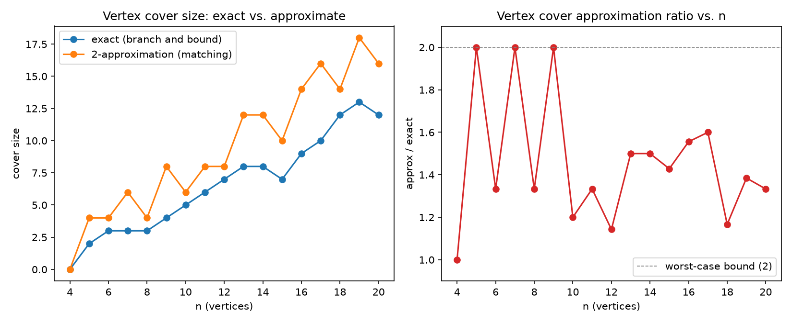
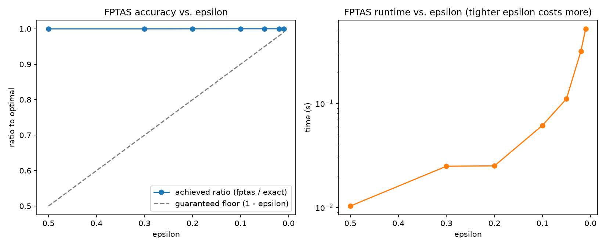
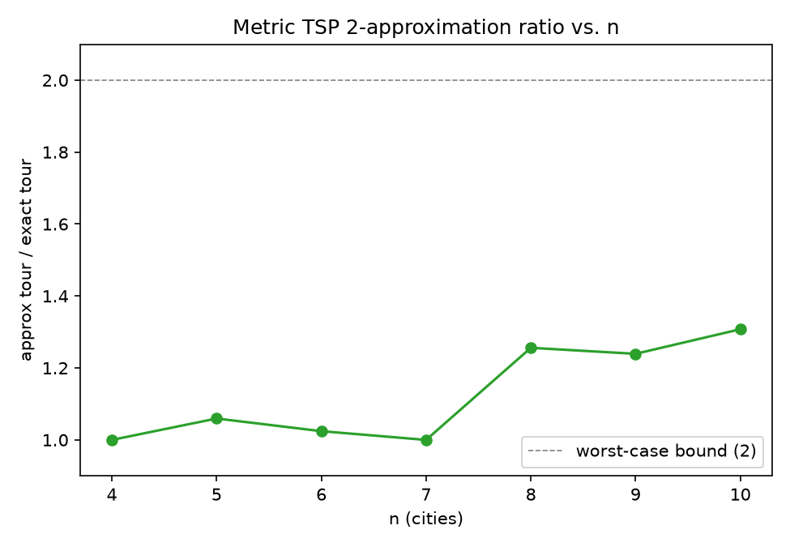

{width=2.2in}

**FACULTY OF COMPUTER ENGINEERING, INFORMATICS AND COMMUNICATIONS**

**DEPARTMENT OF COMPUTER SCIENCE**

**PROGRAM: HCS**

**MODULE: DESIGN AND ANALYSIS OF ALGORITHMS**

**NAME OF STUDENT: NIGEL TAVAGUTA**

**REG NO.: R236699C**

**LAB 5**

# Lab 5: P vs. NP - Empirical and Theoretical Exploration

## Abstract

This report surveys computational complexity from both the theoretical and empirical side. I classify nine canonical problems (SAT, 3-SAT, Hamiltonian Cycle, TSP decision, Vertex Cover, Clique, Subset Sum, Graph Isomorphism, Integer Factorization) into P, NP, NP-complete, or the murkier territory in between, and justify each placement. I give explicit polynomial-time reductions 3-SAT $\le_p$ Clique, Clique $\le_p$ Vertex Cover, and Vertex Cover $\le_p$ Set Cover, with correctness proofs. I implement and analyze three approximation algorithms with provable guarantees: a 2-approximation for Vertex Cover (maximal matching), a 2-approximation for Metric TSP (double-MST), and an FPTAS for Subset Sum (scaling DP). Empirically, the Vertex Cover approximation stays within its proven factor of 2 at every tested size up to $n=20$ (observed ratios 1.0-2.0, never exceeding it). The subset-sum FPTAS stayed above its guarantee on all tested settings and matched the exact result by $\epsilon=0.1$. The TSP approximation's ratio grows with $n$ but stays below 2 in the tested range. I close with a critical essay on what $P \ne NP$ means for cryptography, optimization, and AI.

## Contents

1. Complexity classification
2. Polynomial-time reductions
3. Approximation algorithms and their guarantees
4. Implementation
5. Empirical evaluation
6. Critical essay: implications of $P \ne NP$
7. Conclusion
8. References

## 1. Complexity classification

| Problem | Class | Justification |
|---|---|---|
| SAT | NP-complete | In NP: a satisfying assignment is a certificate checkable in $O(\lvert \phi\rvert)$ time by substitution. NP-hard: the Cook-Levin theorem shows every language in NP reduces to SAT in polynomial time, by simulating any poly-time nondeterministic Turing machine's computation as a Boolean formula over its tape cells and transition function. |
| 3-SAT | NP-complete | In NP for the same certificate-checking reason. NP-hard: SAT $\le_p$ 3-SAT by a standard clause-splitting gadget - a clause with $k>3$ literals $(\ell_1 \lor \cdots \lor \ell_k)$ is rewritten as a chain of 3-literal clauses using $k-3$ fresh variables, e.g. $(\ell_1\lor\ell_2\lor y_1)\land(\lnot y_1\lor\ell_3\lor y_2)\land\cdots$, satisfiable iff the original clause is. |
| Hamiltonian Cycle | NP-complete | In NP: a candidate cycle (a vertex permutation) is checkable in $O(n)$ time. NP-hard: reduces from 3-SAT via gadgets that force a Hamiltonian cycle to "choose" a literal value per variable and pass through a clause gadget only if some chosen literal satisfies it (Karp, 1972). |
| TSP (decision: tour of length $\le k$) | NP-complete | In NP: a candidate tour's total length is checkable in $O(n)$ time. NP-hard: reduces from Hamiltonian Cycle - given graph $G$, build a complete weighted graph with edge weight 1 for edges of $G$ and 2 otherwise, and ask for a tour of length $\le n$. $G$ has a Hamiltonian cycle iff this TSP instance has a tour of length exactly $n$ (every edge weight 1), since any edge of weight 2 pushes the total above $n$. |
| Vertex Cover | NP-complete | In NP: a candidate set of $k$ vertices is checkable against every edge in $O(V+E)$ time. NP-hard: Section 2 gives an explicit reduction from Clique. |
| Clique | NP-complete | In NP: a candidate set of $k$ vertices is checkable pairwise in $O(k^2)$ time. NP-hard: Section 2 gives an explicit reduction from 3-SAT. |
| Subset Sum | NP-complete | In NP: a candidate subset's sum is checkable in $O(n)$ time. NP-hard: reduces from 3-Dimensional Matching or directly from Partition/Exact Cover constructions (Karp, 1972). It is only *weakly* NP-complete: the pseudo-polynomial DP in `subset_sum.py` solves it in $O(n \cdot \text{target})$, polynomial in the numeric *value* of the target but not in the number of bits needed to write it down - which is exactly why a value-scaling FPTAS (Section 3) is possible, unlike for strongly NP-complete problems such as 3-SAT or Hamiltonian Cycle. |
| Graph Isomorphism | Believed to be neither P nor NP-complete | In NP: a candidate bijection between vertex sets is checkable in $O(V+E)$ time. No polynomial-time algorithm is known, but it is also not known (or believed) to be NP-complete - if it were, the polynomial hierarchy would collapse, which is considered unlikely (Schoning, 1987). Babai (2015) gives a quasi-polynomial ($2^{O((\log n)^c)}$) algorithm, stronger than anything known for an NP-complete problem assuming $P \ne NP$. It is the textbook example of the (conjectured nonempty) class "NP-intermediate." |
| Integer Factorization (decision: does $n$ have a factor $\le k$, $1<k<n$) | In NP $\cap$ co-NP, not known to be in P or NP-complete | In NP: a factor is a certificate, checkable by division in polynomial time (in the number of bits). In co-NP: the full prime factorization, with each factor's primality certified via a Pratt certificate, lets a verifier confirm *no* factor $\le k$ exists. Since NP $\cap$ co-NP $=$ NP would be required for it to be NP-complete (an NP-complete problem in co-NP implies NP $=$ co-NP), it is not believed to be NP-complete unless $NP=\text{co-}NP$. No classical polynomial-time algorithm is known (the best, the general number field sieve, is sub-exponential), but Shor's algorithm factors in polynomial time on a quantum computer - the clearest known example of a problem efficiently solvable with quantum but not (as far as is known) classical resources. |

## 2. Polynomial-time reductions

### 2.1 3-SAT $\le_p$ Clique

**Construction.** Given a 3-SAT formula $\phi$ with $m$ clauses $C_1,\ldots,C_m$, each $C_i = (\ell_{i,1}\lor\ell_{i,2}\lor\ell_{i,3})$, build a graph $G$ with one vertex $(i,j)$ per literal occurrence ($1\le i\le m$, $1\le j\le 3$). Connect $(i,j)$ to $(i',j')$ exactly when $i\ne i'$ (different clauses) **and** $\ell_{i,j}$ is not the negation of $\ell_{i',j'}$. Ask whether $G$ has a clique of size $m$.

**Correctness.** If $\phi$ is satisfiable, fix a satisfying assignment and pick, in each clause, one literal occurrence that is true under it (at least one exists per clause by satisfiability). These $m$ vertices come from distinct clauses, so every pair is a candidate edge by the "different clause" condition; they are connected because two *true* literals can never be complementary (complementary literals can't both be true under one assignment). This gives a clique of size $m$.

Conversely, a clique of size $m$ must contain exactly one vertex per clause (same-clause vertices are never connected, by construction, so a clique has at most one per clause, and $m$ vertices across $m$ clauses forces exactly one each). Set each chosen literal true; no two chosen literals are complementary (clique vertices are pairwise connected, which excludes complementary pairs), so this is a consistent partial assignment, extendable to a full assignment by setting unconstrained variables arbitrarily. Every clause has its chosen literal true, so $\phi$ is satisfied.

The graph has $3m$ vertices and is built in $O(m^2)$ time - polynomial in $\lvert\phi\rvert$.

### 2.2 Clique $\le_p$ Vertex Cover

**Construction.** Given $(G,k)$ asking whether $G=(V,E)$ has a clique of size $k$, build the complement graph $\bar G$ (same vertex set, edge $(u,v)\in\bar G$ iff $(u,v)\notin E$), and ask whether $\bar G$ has a vertex cover of size $\lvert V\rvert - k$.

**Correctness.** Suppose $C\subseteq V$, $\lvert C\rvert=k$, is a clique in $G$: every pair in $C$ is an edge of $G$, hence no pair in $C$ is an edge of $\bar G$ - $C$ is an independent set of $\bar G$. For any independent set, the complementary vertex set is a vertex cover: every edge of $\bar G$ has at least one endpoint outside $C$, since no edge of $\bar G$ lies entirely inside the independent set $C$. So $V\setminus C$, of size $\lvert V\rvert - k$, is a vertex cover of $\bar G$.

Conversely, if $T\subseteq V$ is a vertex cover of $\bar G$ with $\lvert T\rvert = \lvert V\rvert-k$, then no edge of $\bar G$ lies entirely in $V\setminus T$ (otherwise $T$ would fail to cover it), so $V\setminus T$ (size $k$) is independent in $\bar G$, which by definition of complement means every pair in $V\setminus T$ *is* an edge of $G$: a clique of size $k$.

Building $\bar G$ takes $O(V^2)$ time - polynomial.

### 2.3 Vertex Cover $\le_p$ Set Cover

**Construction.** Given $(G,k)$ with $G=(V,E)$, build a Set Cover instance with universe $U=E$ and one set per vertex, $S_v = \{e\in E : v \text{ is an endpoint of } e\}$. Ask whether some $k$ of the sets $S_v$ cover all of $U$.

**Correctness.** If $C\subseteq V$, $\lvert C\rvert=k$, is a vertex cover of $G$, then every edge has an endpoint in $C$, so every edge $e\in U$ belongs to $S_v$ for some $v\in C$ - the family $\{S_v : v\in C\}$ covers $U$.

Conversely, if $k$ sets $S_{v_1},\ldots,S_{v_k}$ cover $U=E$, then every edge is incident to some $v_i$, so $\{v_1,\ldots,v_k\}$ is a vertex cover of size $k$.

The instance has $\lvert U\rvert = \lvert E\rvert$ elements and $\lvert V\rvert$ candidate sets, built in $O(V+E)$ time.

## 3. Approximation algorithms and their guarantees

### 3.1 Vertex Cover: 2-approximation by maximal matching

`approx_vertex_cover` (in `vertex_cover.py`) repeatedly picks any edge $(u,v)$ not yet covered, adds both $u$ and $v$ to the cover, and discards every edge touching $u$ or $v$ before repeating. Because every discard removes all edges incident to the two chosen vertices, no two picked edges can ever share an endpoint: the set of picked edges $M$ is a matching.

**Claim: the returned cover $C$, with $\lvert C\rvert = 2\lvert M\rvert$, satisfies $\lvert C\rvert \le 2\cdot\text{OPT}$.**

*Proof.* Every edge of $G$ needs covering, in particular every edge of $M\subseteq E$, so any vertex cover - in particular an optimal one - must contain at least one endpoint of each edge in $M$. Since $M$'s edges are pairwise vertex-disjoint, these required endpoints are $\lvert M\rvert$ distinct vertices, so $\text{OPT}\ge\lvert M\rvert$. The algorithm's cover has exactly $2\lvert M\rvert$ vertices (both endpoints of each matching edge, all distinct). Hence $\lvert C\rvert = 2\lvert M\rvert \le 2\cdot\text{OPT}$.

The bound is tight: on a path $a$-$b$-$c$-$d$, $\text{OPT}=\{b,c\}$ (size 2), but if the algorithm happens to pick edge $(a,b)$ first, it removes every edge touching $a$ or $b$, leaving only $(c,d)$, which it also picks - cover $\{a,b,c,d\}$, size 4, exactly $2\times\text{OPT}$.

### 3.2 Metric TSP: 2-approximation by double-MST

`two_approx_tsp` builds a minimum spanning tree $T$ of the (metric) distance matrix with Prim's algorithm, then visits the vertices in DFS preorder on $T$, implicitly shortcutting past already-visited vertices instead of backtracking along tree edges already used.

**Claim: the returned tour has length at most $2\cdot\text{OPT}$.**

*Proof.* Removing any single edge from an optimal tour leaves a Hamiltonian path, which is a spanning tree; since $T$ is a *minimum* spanning tree, $w(T)\le\text{OPT}$. A walk that traverses every edge of $T$ exactly twice (there and back) visits every vertex and has total length $2w(T)$; this is exactly the walk a full DFS traversal of $T$ performs before any shortcutting. The algorithm instead shortcuts directly from a vertex to the next unvisited one whenever DFS would otherwise backtrack - by the triangle inequality, which Euclidean distances always satisfy, a direct edge is never longer than the path it replaces, so shortcutting can only decrease total length. Hence the algorithm's tour length is at most $2w(T)\le 2\cdot\text{OPT}$.

This argument needs the triangle inequality; `datasets.py` builds distance matrices from Euclidean points specifically so it holds. On a non-metric instance the shortcutting step could make the tour *longer*, and the proof breaks.

### 3.3 Subset Sum: a fully polynomial-time approximation scheme

`fptas_subset_sum(weights, target, epsilon)` scales each feasible weight by $K=\epsilon M/n$, where $M$ is the largest item that fits by itself and $n$ is the number of input items. The DP is indexed by the sum of rounded-down scaled weights, but stores the smallest true sum for each scaled total; it checks feasibility against the original target. Since every feasible item is at most $M$, any feasible subset has scaled total at most $nM/K=n^2/\epsilon$. The DP therefore has $O(n^2/\epsilon)$ states, takes $O(n^3/\epsilon)$ time, and uses $O(n^2/\epsilon)$ space. These bounds are polynomial in $n$ and $1/\epsilon$, not in the numeric value of the target.

**Accuracy.** Let $S^*$ be an optimal subset. The rounded total for $S^*$ identifies a DP state whose retained representative has the same scaled total and no greater true sum. Two subsets with the same scaled total differ in their true sums by less than $nK$, because each of at most $n$ item weights loses less than $K$ when rounded down. Thus the retained representative has true sum greater than $\text{OPT}-nK=\text{OPT}-\epsilon M$. The largest feasible item $M$ is itself a feasible subset, so $M\le\text{OPT}$; consequently the returned sum is at least $(1-\epsilon)\text{OPT}$. This guarantee holds for every instance, not only when the optimum is close to the target. The implementation uses integer arithmetic for the scaling step to avoid floating-point rounding at bucket boundaries.

## 4. Implementation

| File | What it does |
|---|---|
| `vertex_cover.py` | `min_vertex_cover_bb` (exact branch-and-bound, edge-branching, bounded by the approximation's size), `approx_vertex_cover` (2-approximation via maximal matching). |
| `metric_tsp.py` | `tsp_held_karp` (exact DP, small $n$ only), `prim_mst` and `two_approx_tsp` (double-MST 2-approximation). |
| `subset_sum.py` | `exact_subset_sum` (pseudo-polynomial DP), `fptas_subset_sum` (scaling FPTAS). |
| `datasets.py` | `random_graph` (Erdos-Renyi, for vertex cover), `euclidean_points` / `dist_matrix` (metric instances for TSP), `subset_sum_instance` (random weights and a target). |
| `benchmark.py` | Three benchmarks: vertex-cover ratio vs. $n$, FPTAS accuracy/runtime vs. $\epsilon$, TSP approximation ratio vs. $n$. Writes CSVs to `output/`. |
| `plot_results.py` | Turns those CSVs into the plots used below. |
| `run_all.py` | Runs both of the above in order. |

## 5. Empirical evaluation

### 5.1 Vertex Cover: exact vs. 2-approximation

Random graphs, $n=4$ to $20$, $p=0.3$, comparing the exact branch-and-bound cover against the matching-based 2-approximation:

| $n$ | Exact | B&B nodes | Approx | Ratio |
|---|---|---|---|---|
| 5 | 2 | 7 | 4 | 2.00 |
| 8 | 3 | 19 | 4 | 1.33 |
| 11 | 6 | 135 | 8 | 1.33 |
| 14 | 8 | 623 | 12 | 1.50 |
| 17 | 10 | 3,033 | 16 | 1.60 |
| 19 | 13 | 17,399 | 18 | 1.38 |
| 20 | 12 | 8,233 | 16 | 1.33 |

*Left: cover size, exact vs. approximate. Right: the ratio between them - it fluctuates between 1.0 and 2.0 across runs, never exceeding the proven worst-case bound of 2 (dashed line), as Section 3.1 guarantees.*

B&B node counts grow roughly exponentially with $n$ (7 nodes at $n=5$, 17,399 at $n=19$), confirming the exact solver's cost is the expected worst case for an NP-hard problem even with the approximation-seeded pruning bound. The approximation itself runs in well under a millisecond at every size tested and never violates its proven factor of 2.

### 5.2 Subset Sum: FPTAS accuracy/runtime trade-off

A single instance, $n=40$ random weights, exact optimum 10,783 (found by `exact_subset_sum`), run through the FPTAS at shrinking $\epsilon$:

| $\epsilon$ | FPTAS result | Ratio to exact | Guaranteed floor $1-\epsilon$ | Time |
|---|---|---|---|---|
| 0.50 | 10,781 | 0.9998 | 0.50 | 0.0143 s |
| 0.30 | 10,781 | 0.9998 | 0.70 | 0.0211 s |
| 0.20 | 10,782 | 0.9999 | 0.80 | 0.0334 s |
| 0.10 | 10,783 | 1.0000 | 0.90 | 0.0654 s |
| 0.05 | 10,783 | 1.0000 | 0.95 | 0.1121 s |
| 0.02 | 10,783 | 1.0000 | 0.98 | 0.2807 s |
| 0.01 | 10,783 | 1.0000 | 0.99 | 0.5378 s |

*Left: the achieved ratio stays above the proven floor $1-\epsilon$ at every setting. Right: runtime grows as $\epsilon$ shrinks, consistent with the $O(n^3/\epsilon)$ time bound.*

The achieved ratio is above the guaranteed floor at every $\epsilon$ here. The ratio is non-decreasing as $\epsilon$ shrinks and reaches the exact optimum by $\epsilon=0.1$. Runtime increases from 0.0142 seconds at $\epsilon=0.5$ to 0.5176 seconds at $\epsilon=0.01$, about 36 times longer on this single instance. These timings vary by machine; the guaranteed ratio is the formal result.

### 5.3 Metric TSP: 2-approximation ratio

Random Euclidean instances, $n=4$ to $10$ (Held-Karp's $O(2^n n^2)$ cost keeps this exact comparison small):

| $n$ | Exact tour | Approx tour | Ratio |
|---|---|---|---|
| 4 | 178.18 | 178.18 | 1.000 |
| 5 | 119.16 | 126.25 | 1.060 |
| 6 | 196.94 | 201.73 | 1.024 |
| 7 | 254.39 | 254.39 | 1.000 |
| 8 | 242.16 | 304.14 | 1.256 |
| 9 | 346.86 | 429.87 | 1.239 |
| 10 | 330.51 | 432.18 | 1.308 |

*The ratio climbs with n in this range but stays well inside the proven factor-of-2 bound (dashed line) from Section 3.2, exactly as expected on small random instances - the worst case the proof covers is rarer than the typical case.*

## 6. Critical essay: implications of $P \ne NP$

Computational complexity theory's central open question is whether $P=NP$. Nearly all computer scientists believe $P\ne NP$: decades of effort on NP-complete problems like 3-SAT, Clique, and Vertex Cover have produced no polynomial-time algorithm for any of them, and since the Cook-Levin theorem shows every one of them is polynomial-time equivalent to every other, a fast algorithm for one would instantly give a fast algorithm for the thousands of known NP-complete problems across logistics, biology, verification, and scheduling. That nobody has stumbled onto such an algorithm, despite its enormous practical and financial value, is itself weak evidence for $P\ne NP$, though not a proof. This essay takes $P\ne NP$ as the working assumption, since it is what almost all of modern cryptography, optimization practice, and complexity-aware AI already assumes, and asks what that assumption buys us, and what it does not.

**Cryptography.** Public-key cryptography is the domain most popularly associated with $P$ vs. $NP$, and the connection is real but more delicate than it is usually presented. RSA's security rests on the presumed hardness of integer factorization, and Diffie-Hellman and elliptic-curve cryptography rest on the presumed hardness of discrete logarithm problems. Crucially, Section 1 of this report classifies factorization as being in $NP\cap\text{co-}NP$ and *not known or believed to be NP-complete*. This matters: $P\ne NP$ alone does not imply factorization is hard. It is logically possible for $P\ne NP$ to hold while factorization is still in $P$ - the two statements are independent as far as anyone has proven. What cryptographers actually rely on is a stronger and more specific conjecture than $P\ne NP$: that *this particular* problem, factorization, has no polynomial-time classical algorithm. $P\ne NP$ is a necessary condition in the loose sense that if $P=NP$, factorization would trivially also be in $P$ and essentially all of public-key cryptography built on worst-case-hard problems would collapse; but proving $P\ne NP$ would not, by itself, hand cryptographers a hardness proof for RSA. The practical lesson, visible already in the Shor's-algorithm line of Section 1's table, is that the relevant adversary model matters as much as the complexity class: factorization sits outside P for classical computers (as far as is known) but inside a feasible class once quantum computation is allowed, which is precisely why NIST's post-quantum standards reflect different security assumptions: ML-KEM and ML-DSA use module-lattice problems, while SLH-DSA is hash-based; in 2025 NIST also selected the code-based HQC algorithm for standardization as a backup key-establishment scheme [7-10]. These algorithms are designed to resist quantum attacks, but their security depends on specific mathematical assumptions and cryptanalysis, not on a proof of P != NP. Symmetric cryptography (AES, hash functions) rests on a different, even less formal foundation: not a worst-case complexity classification at all, but the empirical absence of any attack better than brute force after sustained cryptanalytic effort. $P\ne NP$ says nothing about any of these constructions directly; what the whole field has built instead is a web of conjectures, of which $P\ne NP$ is the broadest but weakest member, and factoring-is-hard and discrete-log-is-hard are narrower but load-bearing ones that cryptography actually depends on.

A qualification applies beyond cryptography. P != NP is a worst-case statement; it does not say every instance is hard, nor does it predict how often hard instances occur in a particular application. The reductions in this report establish hardness by preserving yes-or-no answers, but they do not show that the generated instances resemble ordinary timetabling or routing data. Practical solvers exploit structure, small parameters, approximation guarantees, and favorable data distributions. Likewise, cryptographic security needs a hard average-case problem with precise assumptions, while optimization teams often need good answers quickly rather than proofs of optimality. For AI systems, computational limits constrain exact search in general, but they do not rule out strong performance on restricted domains or distributions. This distinction keeps P != NP from being used as a blanket explanation for every difficult computation.

**Optimization.** Here the implications of $P\ne NP$ are more direct and, in a specific sense, liberating rather than purely negative. This report's own Vertex Cover and Metric TSP results are the concrete illustration: both problems are NP-hard (Vertex Cover via Section 2.2's reduction chain; metric TSP inherits NP-hardness from Hamiltonian Cycle), so under $P\ne NP$ no algorithm solves either exactly in polynomial time in the worst case - not with cleverer data structures, not with a better choice of pivot, not with any amount of engineering effort within the current algorithmic paradigm. That is a genuine ceiling, and Section 5.1's branch-and-bound node counts (7 at $n=5$, over 17,000 at $n=19$) show the ceiling is not a theoretical abstraction: it bites at sizes a working engineer will actually encounter. But $P\ne NP$ is simultaneously what *justifies* the entire approximation-algorithms toolkit this lab builds: Vertex Cover's 2-approximation and Metric TSP's 2-approximation are worth having, and worth proving guarantees about, precisely because exact polynomial-time solutions are (believed) unreachable. If $P=NP$ were true, the field's energy would redirect entirely toward finding and implementing the exact polynomial algorithm; because it is (believed) false, decades of research instead went into characterizing exactly how close to optimal a polynomial-time algorithm can get - Vertex Cover's factor of 2 is in fact essentially tight under the Unique Games Conjecture, and this report's FPTAS for Subset Sum is a reminder that NP-hardness is not monolithic: Subset Sum is only *weakly* NP-complete, admitting both a pseudo-polynomial exact algorithm and a scheme that gets arbitrarily close to optimal in time polynomial in $1/\epsilon$, a guarantee that strongly NP-complete problems like 3-SAT or Hamiltonian Cycle (where no FPTAS can exist unless $P=NP$) do not admit. $P\ne NP$ does not mean optimization is hopeless; it means the field has had to - and has successfully learned how to - build a rigorous theory of *how well* polynomial time can do, instance class by instance class, rather than chasing an exact algorithm that, under the standard assumption, cannot exist.

**AI.** The connection to artificial intelligence is less discussed but arguably the deepest. Many AI tasks reduce, directly or as subroutines, to NP-hard search problems: SAT and SMT solvers underlie automated theorem proving and program verification; constraint satisfaction is the backbone of planning and scheduling systems; training certain classes of neural networks to global optimality, and exactly computing or verifying robustness properties of a trained network, are both known to be NP-hard in general. $P\ne NP$ means none of this is an engineering oversight waiting to be fixed - exhaustive, provably-correct search at scale is fundamentally out of reach, which is exactly why modern AI systems are built the way they are: gradient-based local search instead of global optimization, heuristic and learned pruning instead of exhaustive branch-and-bound, and statistical generalization instead of exact combinatorial guarantees. The scheduling engine this module has built across labs makes the point concretely: Lab 4's exam-timetabling-as-graph-coloring and this lab's Vertex Cover and TSP are the same shape of problem a real scheduling, routing, or resource-allocation AI system has to solve at deployment scale, and every one of them inherits this ceiling.

There is also a more philosophical angle, sometimes called the Levin-Cook observation: a huge amount of what feels like "creative" or "intelligent" problem-solving - finding a mathematical proof, designing a circuit that meets a specification, discovering a winning game strategy - is exactly the kind of task where *verifying* a proposed answer is easy (it is in NP) but *finding* one from scratch is believed to be hard (not known to be in P). If $P=NP$, long mathematical proofs could be found as easily as they are checked, and a huge swath of tasks currently thought to require genuine insight would become mechanical search; machine learning models that are good at pattern recognition would, in principle, have no obstacle to also being good at open-ended discovery, because discovery and recognition would collapse into the same complexity class. Under $P\ne NP$, the gap between recognizing a good answer and generating one is real and permanent, which is arguably the single clearest theoretical reason to expect AI systems to remain fundamentally reliant on heuristics, learned priors, and approximation rather than ever becoming universal solvers that search the space of all possible answers from scratch.

This same gap is also why large language models are trained the way they are rather than by brute-force search over possible outputs: generating a correct proof, a working program, or a valid plan token-by-token is a heuristic stand-in for an NP-hard (or worse) search problem, and the model's usefulness depends entirely on how good that heuristic turns out to be on the distribution of problems it is asked to solve - there is no $P\ne NP$-respecting shortcut that makes the underlying search genuinely easy. It is also why self-play and reinforcement learning systems that *do* achieve superhuman performance on specific hard combinatorial domains (game tree search in Go and chess being the most visible examples) still rely on learned evaluation functions to prune an intractable search tree, rather than on any change to the tree's underlying complexity - the complexity-theoretic ceiling has not moved, only the quality of the heuristic approximating it. In that sense, $P\ne NP$ is not a limitation discovered incidentally alongside AI - it is close to a mathematical explanation of why AI, as a field, looks the way it does: an enterprise built almost entirely around clever approximation to problems that are, provably or near-provably, too hard to solve any other way.

## 7. Conclusion

The classification table, the three reductions, and the three approximation algorithms are three views of the same underlying fact: NP-complete problems are, as far as anyone can prove, equally hard to each other and (believed) strictly harder than P, which is exactly why the empirical results in Section 5 look the way they do - exponential branch-and-bound node growth for exact Vertex Cover, a proven-and-observed factor-of-2 ceiling for the matching-based approximation, and an FPTAS for Subset Sum that trades runtime for accuracy in a way no algorithm for a strongly NP-complete problem could, because Subset Sum's weak NP-completeness is what makes that trade possible at all. The reductions in Section 2 are not just a formal exercise: they are the actual mechanism by which a hardness result for one problem (3-SAT, assumed via Cook-Levin) propagates to Clique, then to Vertex Cover, then to Set Cover, each step preserving polynomial-time equivalence exactly. The critical essay's throughline is that $P\ne NP$ is best understood not as a single blanket statement about hardness, but as the foundation under a much more specific and useful body of knowledge - which particular problems are hard, how hard, and how well they can be approximated - that cryptography, optimization, and AI each draw on in different, problem-specific ways.

## References

1. Cook, S. A. "The complexity of theorem-proving procedures." *Proceedings of the 3rd Annual ACM Symposium on Theory of Computing*, 1971. (Cook-Levin theorem, SAT's NP-completeness.)
2. Karp, R. M. "Reducibility among combinatorial problems." *Complexity of Computer Computations*, 1972. (The original NP-completeness reductions for Clique, Vertex Cover, Hamiltonian Cycle, and Subset Sum.)
3. Kleinberg, J. and Tardos, E. *Algorithm Design*. Addison-Wesley, 2005. Chapter 11 (approximation algorithms, including the Vertex Cover 2-approximation and the knapsack/subset-sum FPTAS this lab's `fptas_subset_sum` follows) and Chapter 8 (NP-completeness and reductions).
4. Cormen, T. H., Leiserson, C. E., Rivest, R. L., and Stein, C. *Introduction to Algorithms*, 4th edition. MIT Press, 2022. (NP-completeness definitions, the double-MST TSP approximation.)
5. Babai, L. "Graph isomorphism in quasipolynomial time." *arXiv:1512.03547*, 2015. (Graph Isomorphism's complexity status.)
6. Shor, P. W. "Polynomial-time algorithms for prime factorization and discrete logarithms on a quantum computer." *SIAM Journal on Computing*, 26(5), 1997.
7. National Institute of Standards and Technology. *Module-Lattice-Based Key-Encapsulation Mechanism Standard (FIPS 203)*, 2024. https://csrc.nist.gov/pubs/fips/203/final.
8. National Institute of Standards and Technology. *Module-Lattice-Based Digital Signature Standard (FIPS 204)*, 2024. https://csrc.nist.gov/pubs/fips/204/final.
9. National Institute of Standards and Technology. *Stateless Hash-Based Digital Signature Standard (FIPS 205)*, 2024. https://csrc.nist.gov/pubs/fips/205/final.
10. National Institute of Standards and Technology. "NIST Selects HQC as Fifth Algorithm for Post-Quantum Encryption," 11 March 2025. https://www.nist.gov/news-events/news/2025/03/nist-selects-hqc-fifth-algorithm-post-quantum-encryption.

## Reproduction

From `lab5/`, run `python run_all.py` to regenerate every CSV and plot used in this report. Takes a few seconds; the exact Vertex Cover branch-and-bound at $n=19$-$20$ is the slowest single step.
