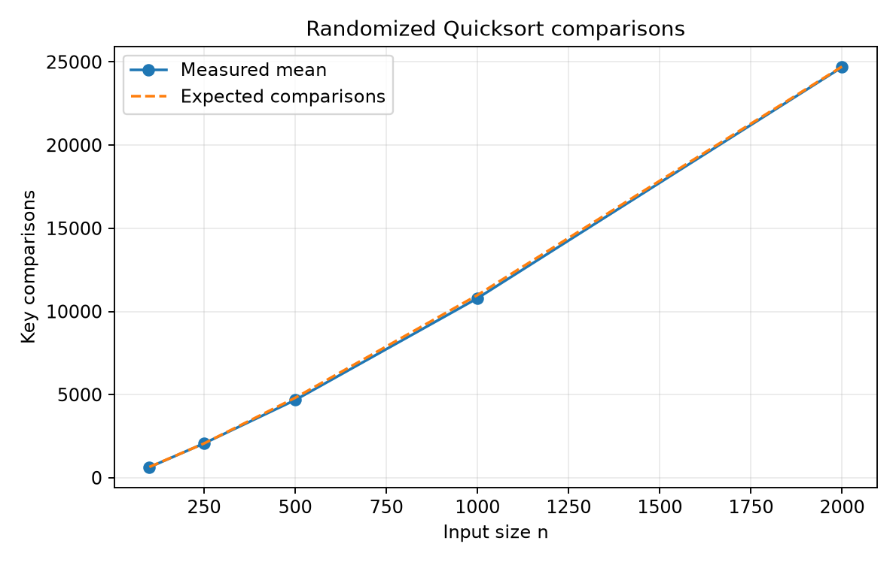
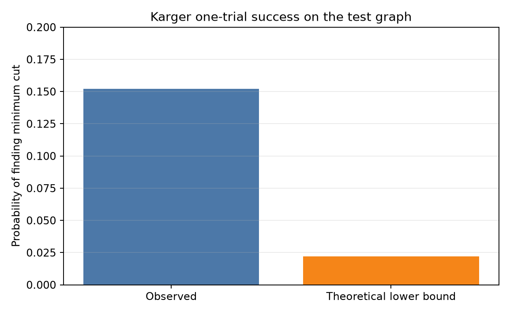
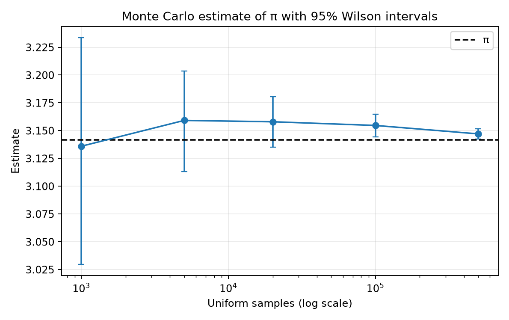
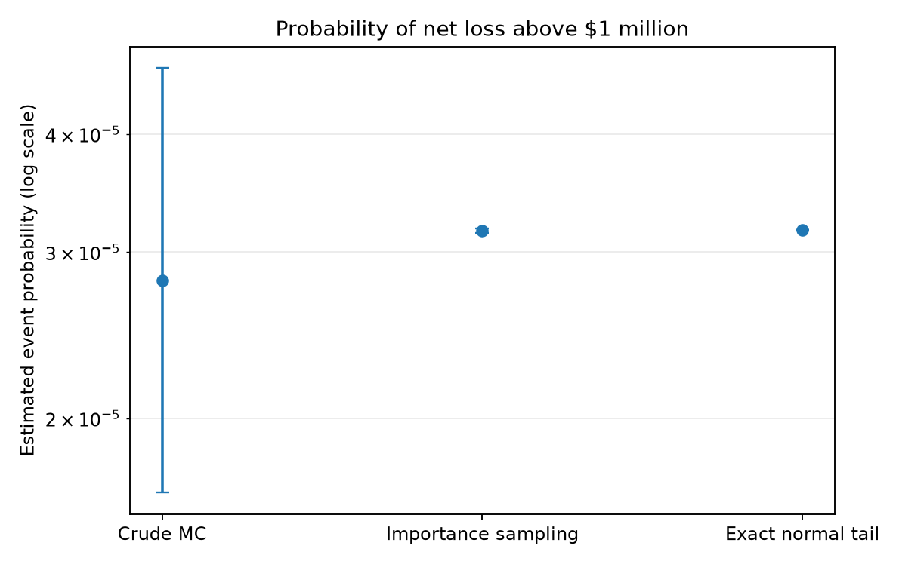
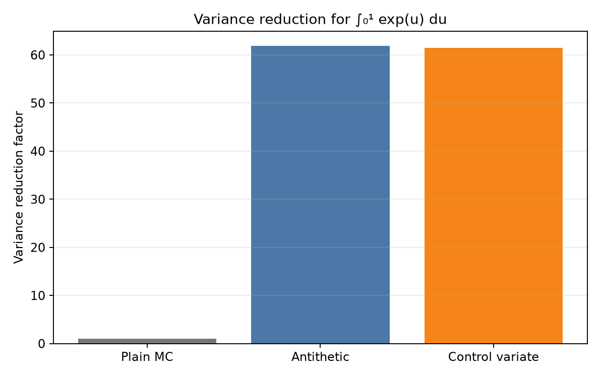
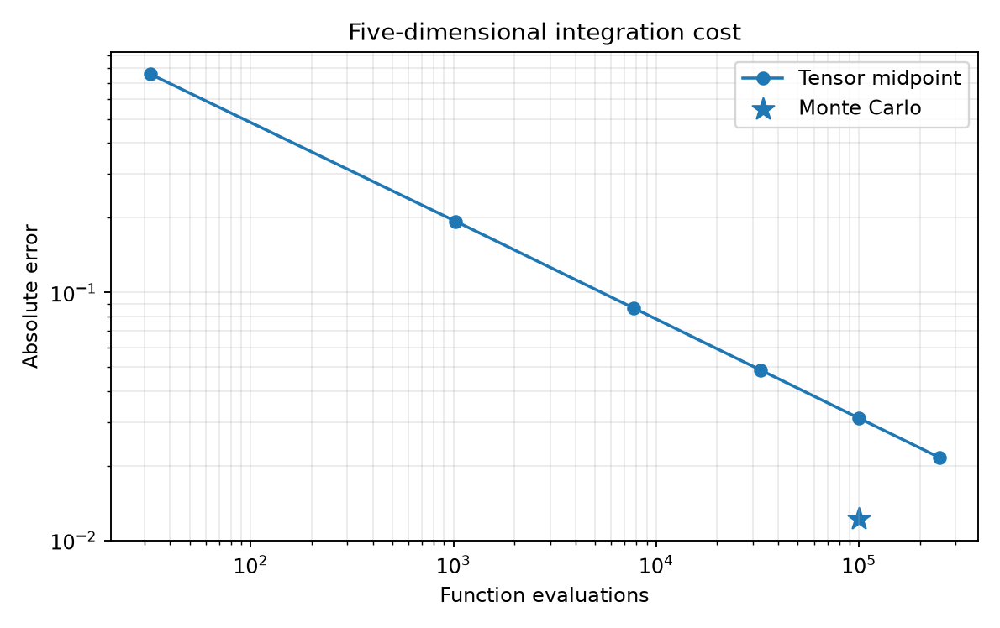

{width=2.2in}

**FACULTY OF COMPUTER ENGINEERING, INFORMATICS AND** 
**COMMUNICATIONS**

**DEPARTMENT OF COMPUTER SCIENCE**

**PROGRAM: HCS**

**MODULE: DESIGN AND ANALYSIS OF ALGORITHMS**

**NAME OF STUDENT: NIGEL TAVAGUTA**

**REG NO.: R236699C**

**LAB 6**

# Lab 6: Monte Carlo Simulation and Randomized Algorithms

## Abstract

This report evaluates randomized algorithms and Monte Carlo methods in a reproducible risk analysis setting. It implements randomized Quicksort, Miller–Rabin primality testing, and Karger’s Min-Cut algorithm, then measures their results against their theoretical guarantees. The simulation studies estimate π, model an M/M/1 service queue, estimate the probability of a net loss above $1 million using importance sampling, and compare antithetic variates and a control variate. A five-dimensional integral is evaluated using both Monte Carlo sampling and deterministic tensor midpoint quadrature. Experiments use fixed pseudorandom seeds and provide confidence intervals where sampling uncertainty is relevant. The results illustrate expected-time analysis, one-sided error, repeated-trial guarantees, the square-root convergence of ordinary Monte Carlo, and the practical value of variance reduction.

## 1. Introduction

Randomized algorithms use random choices as part of their computation. Their running time or answer quality can vary across executions, so a useful analysis describes expected performance or the probability of error. Monte Carlo simulation applies random sampling to estimate quantities that are difficult to calculate directly. These methods are relevant to risk analysis because rare losses, queueing delays, and high-dimensional expectations can be expensive to evaluate exactly.

The experiments answer three questions. Do measured randomized algorithms agree with their analytical expectations? How much work is needed for an estimate to become useful? Can a better sampling design reduce uncertainty without simply increasing the sample count?

All experiments use Python’s pseudorandom generator with recorded fixed seeds. This makes the output repeatable, but it does not make Python’s random generator suitable for cryptographic key generation. Results from one seed are demonstrations rather than universal guarantees. The report separates mathematical guarantees from observations on the selected inputs.

## 2. Method and analysis

### 2.1 Randomized Quicksort

The implementation chooses a pivot uniformly at random from each active subarray, partitions by key comparison, and processes the smaller partition before the larger one using an explicit stack. This limits auxiliary stack growth even when pivots repeatedly give unbalanced splits.

For distinct keys, let the sorted keys be $z_1,\ldots,z_n$. The pair $z_i,z_j$ is compared exactly when the first pivot selected from the interval $z_i,\ldots,z_j$ is one of its two endpoints. Its probability is $2/(j-i+1)$. Summing over all pairs gives the expected comparison count:

$$
\mathbb{E}[C_n] = \sum_{1\leq i<j\leq n}\frac{2}{j-i+1}
=2(n+1)H_n-4n=\Theta(n\log n),
$$

where $H_n=\sum_{k=1}^n 1/k$. The benchmark sorts an already ordered list, but random pivot selection still gives the same distribution of pivot ranks as on any distinct-key order. It records key comparisons over 20 independent seeds for each size.

### 2.2 Miller-Rabin primality test

For odd $n>2$, write $n-1=2^s d$, with $d$ odd. A randomly chosen base $a\in\{2,\ldots,n-2\}$ is tested by modular exponentiation. A witness proves that $n$ is composite. If $n$ is prime, it passes every valid base. If $n$ is an odd composite, at most one quarter of possible bases are strong liars. With $k$ independent rounds, the probability that a composite is incorrectly declared prime is at most

$$
\Pr[\text{false prime}]\leq 4^{-k}.
$$

The test uses repeated squaring, requiring $O(k\log n)$ modular multiplications, with bit cost depending on the multiplication algorithm. Small prime divisors are checked first. For this experiment, known primes and composites, including Carmichael numbers, are tested at several round counts. This validates outputs on the selected cases. It does not empirically establish the worst-case probability bound, which follows from the theorem and independent random bases.

### 2.3 Karger's contraction algorithm

Karger's algorithm repeatedly chooses a uniformly random edge and contracts its endpoints until two supervertices remain. Parallel edges are retained, and self-loops are ignored. The edges between the two remaining supervertices form a cut.

Suppose the graph has $n$ vertices and minimum cut size $\lambda$. Every vertex has degree at least $\lambda$, so there are at least $n\lambda/2$ edges. At a stage with $r$ vertices, the probability of contracting a minimum-cut edge is at most $r\lambda/(r\lambda/2)=2/r$. Therefore the probability of avoiding all minimum-cut edges through the contractions is at least

$$
\prod_{r=3}^{n}\left(1-\frac{2}{r}\right)=\frac{2}{n(n-1)}.
$$

Independent repetition $R$ times fails with probability at most $(1-p)^R$, where $p=2/[n(n-1)]$. To make this bound at most $\delta$, it is sufficient to run

$$
R\geq\left\lceil\frac{\ln\delta}{\ln(1-p)}\right\rceil
$$

trials and return the smallest cut seen. This is a conservative bound. The observed success rate can be substantially higher for a particular graph.

### 2.4 Monte Carlo estimates and confidence intervals

To estimate $\pi$, uniform points $(X,Y)$ are drawn from the unit square. The indicator $I=1\{X^2+Y^2\leq1\}$ has expectation $\pi/4$, so $4\bar I$ estimates $\pi$. A 95% Wilson interval is calculated for the underlying hit probability and multiplied by four. This interval is preferable to a plain normal interval when the outcome is a proportion.

For a mean estimated from $N$ independent observations with sample standard deviation $s$, the large-sample 95% interval is

$$
\bar X\pm1.96\frac{s}{\sqrt{N}}.
$$

To plan a sample count for target half-width $h$, a pilot estimate $s$ gives $N\approx(1.96s/h)^2$. For the $\pi$ estimator, using $p=\pi/4$, the approximate absolute-error requirement is $N\geq1.96^2\,16p(1-p)/h^2$. This gives about 61,500 samples for $h=0.01$ and 246,000 for $h=0.005$. Since the standard error decreases like $N^{-1/2}$, dividing the error by two requires approximately four times as many samples.

### 2.5 M/M/1 queue

The queue has independent exponential interarrival times with rate $\lambda$ and exponential service times with rate $\mu$. It is stable when $0<\lambda<\mu$. Lindley's recursion simulates the waiting time before service:

$$
W_{i+1}=\max(0,W_i+S_i-A_{i+1}),
$$

where $S_i$ is service time and $A_{i+1}$ is the next interarrival time. For an M/M/1 queue, utilization is $\rho=\lambda/\mu$, and the theoretical mean time in the system is $E[T]=1/(\mu-\lambda)$. The simulation discards an initial warm-up segment. Because consecutive customer times are dependent, the reported interval uses 40 batch means rather than treating every customer as independent.

### 2.6 Importance sampling and variance reduction

The rare-event example models one-period net loss $L\sim N(400{,}000,150{,}000^2)$, with amounts in dollars, and estimates $P(L>1{,}000{,}000)$. The threshold is four standard deviations above the mean. This is a deliberately stylized example. Direct Monte Carlo samples from the original distribution and averages the event indicator. Importance sampling instead samples from $N(1{,}075{,}000,150{,}000^2)$, which produces more threshold exceedances. Each observation is multiplied by the likelihood ratio

$$
w(x)=\frac{f_{400000,150000}(x)}{f_{1075000,150000}(x)}
=\exp\left(\frac{(x-1075000)^2-(x-400000)^2}{2(150000)^2}\right).
$$

The estimator is the mean of $w(X)1\{X>1{,}000{,}000\}$. It remains unbiased because the likelihood ratio corrects the change in sampling distribution. The crude estimator uses a Wilson confidence interval. The weighted estimator uses a normal interval for its sample mean. Importance sampling is only effective when the proposal distribution both visits the rare region and assigns stable weights.

For variance reduction, the known integral $\int_0^1e^u\,du=e-1$ is estimated in three ways. The antithetic method averages the paired observations $e^U$ and $e^{1-U}$, which have negative covariance. For the control variate, $C=U-1/2$ has known mean zero. The estimator averages $e^U-\beta C$, using the analytically chosen coefficient $\beta=\operatorname{Cov}(e^U,C)/\operatorname{Var}(C)=6(3-e)$. The variance reduction factor is the plain sample variance divided by the adjusted sample variance. The same sample size is used for all three methods.

### 2.7 Five-dimensional numerical integration

The test integral is

$$
I=\int_{[0,1]^5}\exp(x_1+x_2+x_3+x_4+x_5)\,dx=(e-1)^5\approx14.9786.
$$

Monte Carlo draws uniform points and averages the integrand. The deterministic comparator is the tensor midpoint rule with $m$ points per axis and $m^5$ function evaluations. For a smooth integrand, the midpoint error is $O(m^{-2})$ in each fixed dimension, while the number of evaluations grows as $m^5$. The Monte Carlo error decreases as $O(N^{-1/2})$, independently of dimension in its convergence exponent. A deterministic rule can be more accurate at a given budget in some cases, but the tensor grid becomes expensive as dimension increases.

## 3. Implementation

The implementation is in Python 3.12. `randomized.py` contains the three randomized algorithms. `simulation.py` contains the estimators and queue model. `benchmark.py` writes the CSV tables, `plot_results.py` generates figures, and `run_all.py` reproduces the complete experiment with one command. The run requires Matplotlib for plots. Random seeds and sample counts are set in `benchmark.py`.

The Karger test graph has ten vertices split into two complete groups of five. Three cross-group edges form a known minimum cut. This small graph permits an exact success count across repeated trials while preserving the random contraction behavior. The queue uses lambda = 0.8 and mu = 1.0, giving theoretical utilization 0.8 and mean system time 5 time units.

## 4. Results

### 4.1 Randomized Quicksort

| n | Mean comparisons over 20 runs | Expected comparisons |
|---:|---:|---:|
| 100 | 632.1 | 647.9 |
| 250 | 2,064.9 | 2,062.5 |
| 500 | 4,674.3 | 4,806.4 |
| 1,000 | 10,794.6 | 10,985.9 |
| 2,000 | 24,690.4 | 24,729.8 |

The sample means track the expected comparison counts. Differences at smaller sizes are normal sampling variation across only 20 random pivot sequences. The counts grow faster than linearly and follow the $n\log n$ trend. A few repetitions cannot guarantee that every execution is fast. The theoretical expectation is averaged over pivot randomness, and an unlucky sequence can still produce quadratic work.

### 4.2 Miller–Rabin

The selected known primes were all accepted, and the tested composites were rejected. This includes Carmichael numbers 561 and 1105, which defeat simpler Fermat tests. The per-composite false-prime bound decreases from $1/4$ after one round to approximately $9.1\times 10^{-13}$ after 20 independent rounds. The benchmark confirms expected decisions for its finite list. It does not show that no composite can pass by chance.

### 4.3 Karger Min-Cut

| Graph vertices | Known minimum cut | Trials | Successful trials | Observed success | One-trial lower bound | Trials sufficient for 99% bound |
|---:|---:|---:|---:|---:|---:|---:|
| 10 | 3 | 5,000 | 760 | 15.2% | 2.22% | 205 |

The observed success probability exceeds the worst-case lower bound of 2.22%. The lower bound describes the least success probability guaranteed across eligible graphs. On this particular graph, 5000 trials produced the true cut in 760 runs. The 205-trial figure is a conservative guarantee of at least 99% success using the lower bound, not a claim that 205 trials always succeed.

### 4.4 Monte Carlo estimate of π

| Samples | Estimate | 95% Wilson interval |
|---:|---:|---:|
| 1,000 | 3.1360 | [3.0297, 3.2336] |
| 5,000 | 3.1592 | [3.1131, 3.2035] |
| 20,000 | 3.1580 | [3.1352, 3.1804] |
| 100,000 | 3.1547 | [3.1445, 3.1648] |
| 500,000 | 3.1471 | [3.1425, 3.1516] |

The intervals narrow as the sample count increases and contain the true value in these runs. The estimates do not improve monotonically. Random error can move an estimate farther from π even when the sample size increases. An interval communicates sampling uncertainty more usefully than a single value.

### 4.5 M/M/1 queue

| Customers after warm-up | Theoretical mean time | Simulated mean | 95% batch-means interval | Busy fraction estimate |
|---:|---:|---:|---:|---:|
| 10,000 | 5.000 | 4.902 | [4.237, 5.567] | 0.791 |
| 50,000 | 5.000 | 5.125 | [4.651, 5.599] | 0.796 |
| 200,000 | 5.000 | 5.007 | [4.753, 5.260] | 0.797 |

As the number of simulated customers grows, the mean is close to five time units. Short runs can differ because a heavily utilized queue has occasional long waits. The confidence intervals include the analytical mean in all three runs. The queue is stable because λ is below μ. At or above that boundary, a finite steady-state mean does not exist under this model.

### 4.6 Rare-event estimation

| Method | Samples | Estimate for net loss above $1 million | 95% interval | Sample variance |
|---|---:|---:|---:|---:|
| Crude Monte Carlo | 500,000 | 0.0000280 | [0.0000167, 0.0000470] | 2.80e-5 |
| Importance sampling | 500,000 | 0.0000316 | [0.0000314, 0.0000318] | 4.89e-9 |
| Exact normal tail | — | 0.00003167 | — | — |

The importance sampling estimate is close to the exact normal tail probability. At equal sample counts, its observed sample variance is about 5,700 times smaller than the crude estimator’s variance. Crude Monte Carlo observed only 14 exceedances, which explains its wide interval. For a 10% relative half-width at 95% confidence, crude Monte Carlo would need about 12.1 million independent samples at this event probability, using N approximately 1.96^2*(1-p)/(p*0.1^2). The weighted observations target the same probability while sampling the region where the event occurs more often. Importance sampling needs a suitable proposal; a poor proposal can increase variance or create unstable weights.

### 4.7 Variance reduction

| Method | Estimate of e - 1 | Sample variance | Variance reduction relative to plain MC |
|---|---:|---:|---:|
| Plain Monte Carlo | 1.71746 | 0.24255 | 1.0x |
| Antithetic variates | 1.71844 | 0.00392 | 61.9x |
| Control variate | 1.71845 | 0.00395 | 61.4x |

Both techniques reduce variance substantially in this smooth one-dimensional example because the paired observations are strongly negatively correlated and the control is correlated with the integrand. The exact factors depend on the function and sampling distribution. These values should not be generalized to every simulation problem.

### 4.8 Five-dimensional integration

The exact integral is approximately 14.9786. Monte Carlo used 100,000 function evaluations and estimated 14.9664, with an absolute error of 0.0122 and a 95% interval of [14.9020, 15.0307]. Selected tensor midpoint results are:

| Points per axis (m) | Tensor evaluations m^5 | Estimate | Absolute error |
|---:|---:|---:|---:|
| 2 | 32 | 14.2200 | 0.7586 |
| 4 | 1,024 | 14.7850 | 0.1937 |
| 6 | 7,776 | 14.8922 | 0.0864 |
| 8 | 32,768 | 14.9300 | 0.0487 |
| 10 | 100,000 | 14.9475 | 0.0312 |
| 12 | 248,832 | 14.9570 | 0.0217 |

In this run, Monte Carlo had lower error than the midpoint grid at 100,000 evaluations. The deterministic grid error decreases steadily for this smooth integrand, while Monte Carlo error is random and can be larger or smaller on a particular run. The grid’s cost grows rapidly with dimension. At 12 points per axis the grid already needs nearly a quarter-million function evaluations; maintaining the same resolution in more dimensions becomes impractical. Monte Carlo’s 1/sqrt(N) convergence rate does not depend on dimension, although its constant can still be large.

## 5. Limitations and interpretation

The experiments are demonstrations, not production financial forecasts. The portfolio example assumes a normal loss distribution with mean $400,000 and standard deviation $150,000. Real losses may be skewed, heavy-tailed, dependent, or affected by changing market conditions. Importance sampling must be designed and validated against the distribution of the actual risk model. The reported variance reduction applies only to this chosen Gaussian example.

The Karger result uses a single small graph. The algorithm is randomized and can return a cut larger than the minimum cut on any one trial. Repetition improves success probability, but the theoretical repetition bound can be conservative. The Miller–Rabin empirical table checks a finite test set; the false-prime guarantee comes from the theorem and independent sampling assumptions.

Confidence intervals are approximate summaries of simulation uncertainty. Wilson intervals are used for the Bernoulli probabilities. Mean intervals rely on large-sample normal approximations. The queue uses batch means to reduce the effect of serial dependence, but other batch sizes or longer warm-up periods can change interval estimates. Reproducibility is achieved through fixed seeds, and independent seeds are still needed to understand between-run variation.

## 6. Conclusion

The measured Quicksort comparison counts agree with the expected Theta(n log n) behavior. Miller–Rabin provides a controllable one-sided error bound, while repeated Karger trials turn a low per-run guarantee into a high overall success guarantee. Monte Carlo estimates become more precise as sample counts rise, but the 1/sqrt(N) rate makes high precision expensive. The M/M/1 simulation approaches its analytical mean, and importance sampling and control variates demonstrate how sampling design can reduce uncertainty dramatically. In the five-dimensional example, deterministic quadrature is accurate at modest resolution but pays a cost that grows exponentially with dimension. Together, the experiments show why randomized methods need both mathematical error analysis and careful empirical validation.

## References

1. Cormen, T. H., Leiserson, C. E., Rivest, R. L., and Stein, C. *Introduction to Algorithms*, 4th ed. MIT Press, 2022. Randomized Quicksort and randomized algorithms.
2. Motwani, R. and Raghavan, P. *Randomized Algorithms*. Cambridge University Press, 1995. Randomized Quicksort and Karger’s Min-Cut algorithm.
3. Miller, G. L. “Riemann’s hypothesis and tests for primality.” *Journal of Computer and System Sciences*, 13(3), 1976, pp. 300–317.
4. Rabin, M. O. “Probabilistic algorithm for testing primality.” *Journal of Number Theory*, 12(1), 1980, pp. 128–138.
5. Karger, D. R. “Global min-cuts in RNC, and other ramifications of a simple min-cut algorithm.” *Proceedings of the 4th Annual ACM-SIAM Symposium on Discrete Algorithms*, 1993, pp. 21–30.
6. Ross, S. M. *Simulation*, 5th ed. Academic Press, 2013. Monte Carlo methods and queueing simulation.
7. Glasserman, P. *Monte Carlo Methods in Financial Engineering*. Springer, 2004. Importance sampling and variance reduction.
8. Law, A. M. *Simulation Modeling and Analysis*, 5th ed. McGraw-Hill, 2015. Confidence intervals, batch means, and simulation output analysis.

## Reproduction

From the `lab6/` directory, run `python run_all.py`. The command writes all CSV tables and figures to `output/`. Exact seeds and parameters are in `benchmark.py`.
