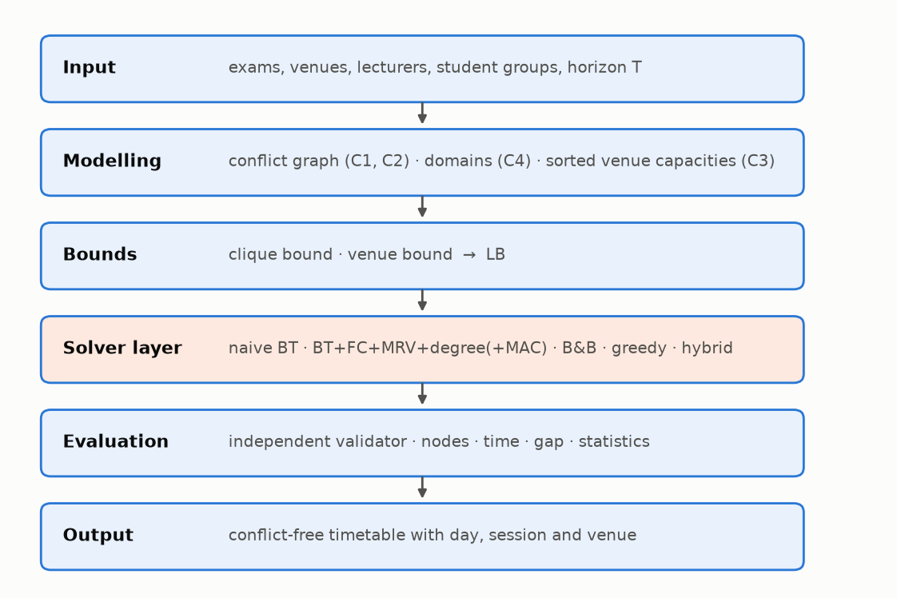
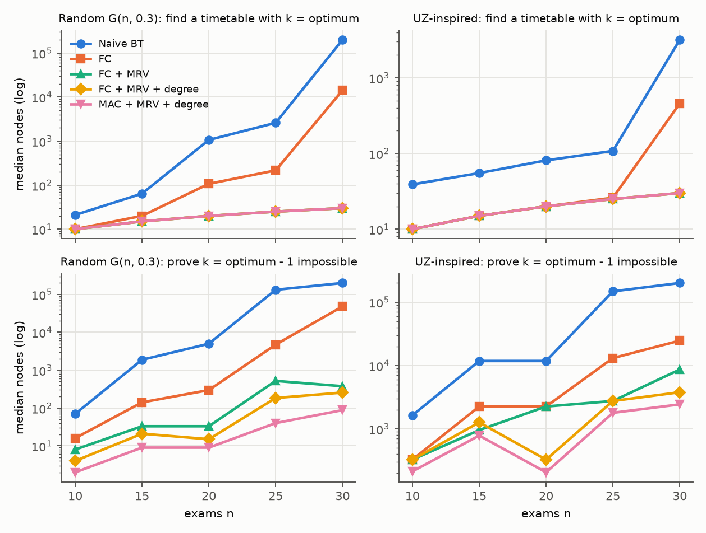
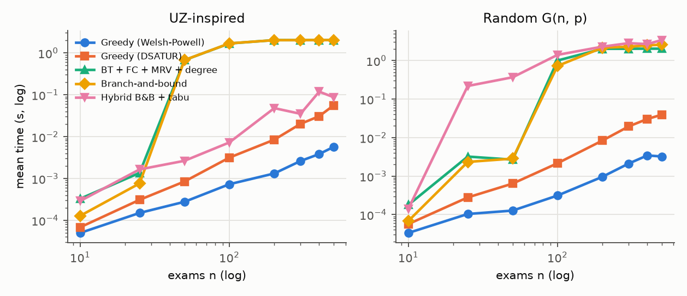
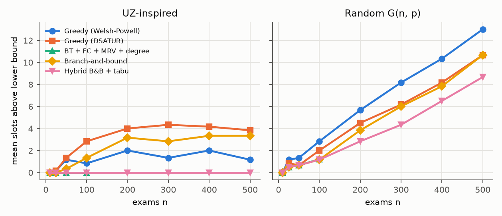
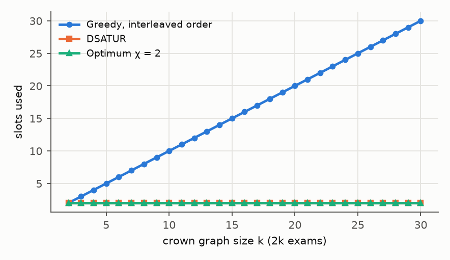
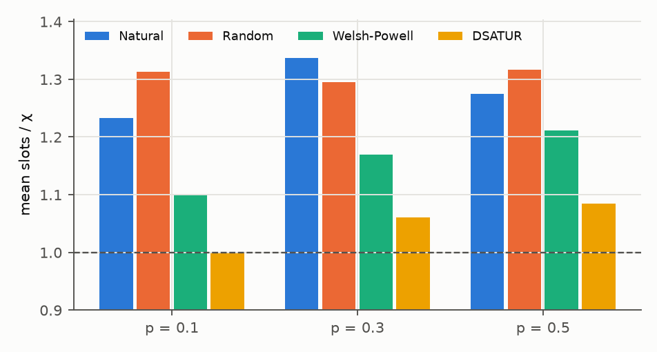
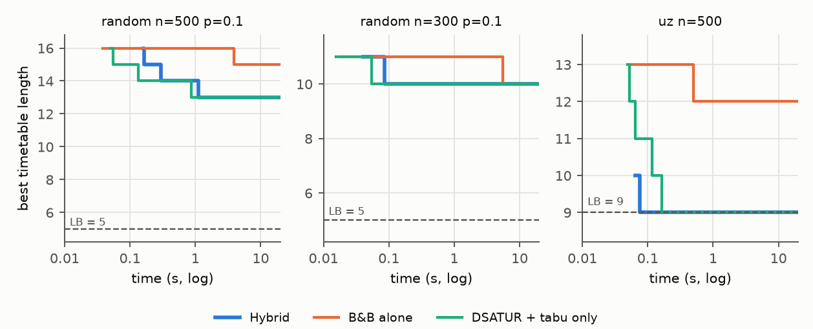
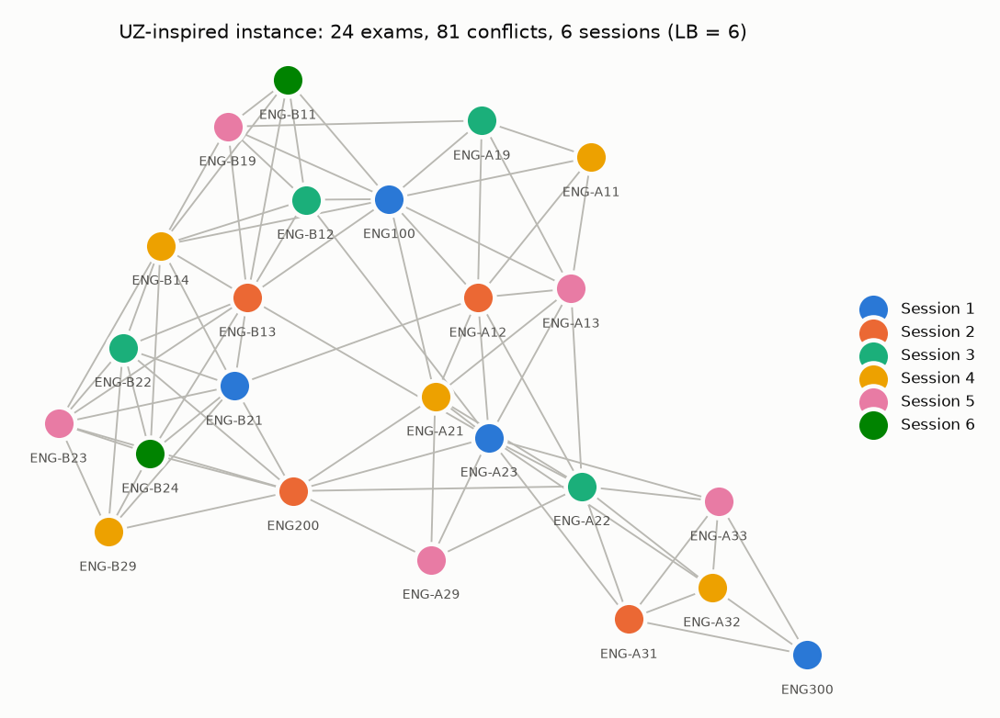
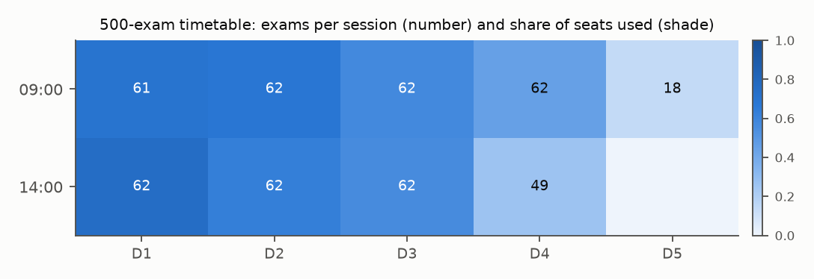

<style>
  body { font-size: 12pt; line-height: 1.3; max-width: 7.4in; margin: 0 auto; }
  p { margin: 0.5em 0; }
  img { max-width: 5.6in; height: auto; display: block; margin: 0.25em auto; }
  @page { size: letter; margin: 0.55in; @bottom-center { content: counter(page); font-size: 9pt; } }
  @page:first { @bottom-center { content: ""; } }
  table { font-size: 10.5pt; }
  h1, h2, h3 { margin-top: 0.7em; margin-bottom: 0.35em; }
</style>

<div style="text-align:center; margin-bottom: 2em;">

{width=2.2in}

**FACULTY OF COMPUTER ENGINEERING, INFORMATICS AND COMMUNICATIONS**

**DEPARTMENT OF COMPUTER SCIENCE**

**PROGRAM: HCS**

**MODULE: DESIGN AND ANALYSIS OF ALGORITHMS (HCS301)**

**GROUP 11**

| NAME OF STUDENT | REG NO. |
|---|---|
| NIGEL TAVAGUTA | R236699C |
| MALVINE MAREVERE | R231556W |
| CLAUDY GONYORA | R231542E |
| NASHEL MASHUMBA | R231524V |
| TANAKA GUTSIRE | R204569J |

**PROJECT: NP-HARD SCHEDULING ENGINE FOR UNIVERSITY EXAM TIMETABLING**

</div>

<div style="page-break-after: always;"></div>

# Exam Timetabling Engine (ETE): A Hybrid CSP Solver for University Exam Timetabling

## Abstract

Universities have to place hundreds of exams into a small number of sessions without any student or lecturer being required in two places at once, without exceeding the rooms available, and without scheduling a paper when its lecturer is away. This report designs, implements and evaluates an Exam Timetabling Engine (ETE) for that problem. The problem is formalised as a constraint satisfaction problem (CSP) whose core is graph colouring. Exams are variables, sessions are values, shared students and shared lecturers are "not equal" constraints, lecturer availability restricts domains, and venue capacity is a per-session matching constraint. The report proves that the decision version is NP-complete through the chain 3-SAT ≤ₚ 3-colouring ≤ₚ exam timetabling, and that venue feasibility of a single session can nevertheless be decided by sorting. Five solvers are implemented in Python: naive backtracking, backtracking with forward checking, minimum remaining values (MRV), the degree heuristic and maintained arc consistency (MAC), an exact branch-and-bound (B&B) with clique and venue lower bounds, greedy colouring (Welsh-Powell and DSATUR), and a hybrid that combines greedy construction, tabu search and B&B. Correctness proofs are given for the exact methods, along with the Δ + 1 bound and an unbounded worst case for greedy colouring, and a complexity analysis of every algorithm. Experiments on random graphs and on synthetic UZ-inspired instances with 10 to 500 exams measure nodes explored, time, timetable quality, conflicts and pruning effectiveness, with confidence intervals and Wilcoxon signed-rank tests. Every timetable produced by every solver is conflict-free. Forward checking with MRV and the degree heuristic removes almost all of the naive search tree, and the hybrid solver proves optimality on every UZ-inspired instance up to 500 exams within a fraction of a second while greedy colouring needs one to three extra sessions.


## Contents

1. Introduction
2. Literature review
3. Problem definition and CSP model
4. Theoretical results
5. Algorithms and design
6. Complexity analysis
7. Implementation and testing
8. Experimental design
9. Results
10. Discussion
11. Conclusion
12. References
13. Appendix: reproduction

## 1. Introduction

### 1.1 Motivation

At the end of each semester the University of Zimbabwe (UZ) runs an examination session that covers every faculty and every Part (year of study). Each paper must be placed in a morning or afternoon session and in a room large enough for its candidates. Every student, cohort, lecturer and venue limits the choices. A student registered for two papers cannot sit both in the same session. A lecturer who must be present as chief invigilator cannot be in two halls at once. A hall that seats 400 cannot host a paper with 450 candidates, and it cannot host two papers in the same session. When a timetable is built by hand, the usual symptoms are clashes discovered after publication, emergency re-sits and examination periods that are longer than necessary.

The problem looks simple, but it is one of the classic NP-hard problems. Its central part is graph colouring, which was among the first problems shown to be NP-complete (Karp, 1972). No known algorithm solves every instance in polynomial time, so a practical engine must combine exact search, which can prove optimality on small or well-structured inputs, with heuristics that produce good timetables quickly on large inputs.

### 1.2 Aim and objectives

The aim of this project is to design, implement and evaluate a hybrid CSP solver for exam timetabling. The objectives, taken from the project brief, are to:

1. model exam timetabling as graph colouring and as a CSP;
2. implement backtracking with forward checking, MRV and the degree heuristic;
3. implement branch-and-bound with lower bounds;
4. prove NP-completeness;
5. implement greedy approximation and analyse its ratio;
6. design a hybrid of branch-and-bound and local search;
7. evaluate all of the above experimentally, with statistical analysis.

### 1.3 Contributions

The work makes the following contributions.

* **A formal model** (Section 3) that covers exams, venues, lecturers and student groups (cohorts, elective groups and carry-over students). The model is a CSP with binary "not equal" constraints, unary availability constraints and one global capacity constraint per session.
* **Theory** (Section 4): an NP-completeness proof through 3-SAT ≤ₚ 3-colouring ≤ₚ timetabling, a lemma showing that venue feasibility of one session reduces to a sorted comparison, two lower bounds with proofs, correctness proofs for backtracking and B&B, and the approximation analysis of greedy colouring.
* **Five solvers** (Section 5) sharing one model and one validator. Each pruning technique can be switched on and off, so its effect can be measured on its own.
* **An experimental study** (Sections 8 and 9) on two datasets, random graphs and UZ-inspired instances with 10 to 500 exams. The study reports nodes, time, quality, conflicts and pruning effectiveness with confidence intervals and hypothesis tests.
* **A documented code repository** with 22 unit tests and a single command that reproduces every table and figure.

### 1.4 Group roles

The project was carried out by Group 11. The brief's five roles were allocated as follows, and every member reviewed the final report and code. Each member completes the Group 11 peer evaluation form, which is submitted separately to the lecturer.

| Role | Responsibility | Member |
|---|---|---|
| CSP Modeller | formal model, NP-completeness proof | Malvine Marevere |
| Backtracking Engineer | backtracking with FC, MRV, degree, MAC | Claudy Gonyora |
| B&B Engineer | branch-and-bound and lower bounds | Nigel Tavaguta |
| Evaluation Lead | benchmarks, statistics, plots | Nashel Mashumba |
| Documentation Lead | report, presentation | Tanaka Gutsire |

## 2. Literature review

### 2.1 Exam timetabling as a research problem

Automated timetabling is one of the oldest applications of combinatorial optimisation. Welsh and Powell (1967) were already linking an upper bound on the chromatic number of a graph to timetabling: if exams are vertices and clashes are edges, a clash-free timetable is a proper colouring and the number of sessions is the number of colours. Their "largest degree first" ordering is still the most widely taught greedy heuristic, and it is one of the two greedy orders implemented here.

Carter, Laporte and Lee (1996) studied examination timetabling at several universities and released the Toronto benchmark instances. These range from about 80 to over 600 exams and remain the standard test set for the uncapacitated problem. They compared ordering heuristics (largest degree, saturation degree, largest enrolment, largest weighted degree) combined with backtracking. A key finding was that the best ordering depends on the instance, and that limited backtracking greatly improves simple greedy construction. Burke and Petrovic (2002) and later Qu, Burke, McCollum, Merlot and Lee (2009) surveyed the field. Qu et al. classify approaches into graph-based sequencing heuristics, constraint-based techniques, local search (tabu search, simulated annealing, great deluge), population-based methods, multi-criteria techniques and hyper-heuristics. Their survey also separates hard constraints, which every feasible timetable must satisfy (no clashes, room capacity), from soft constraints, which measure quality (spreading a student's exams, placing large exams early). This report follows that split: the engine enforces the hard constraints and minimises the number of sessions, while the soft "same-day" measure is reported but not optimised.

The second International Timetabling Competition (McCollum et al., 2010) introduced a richer examination track with rooms of fixed capacity, period lengths, precedence constraints and soft-constraint penalties. Its instances showed that room constraints change the problem: an instance can have a small chromatic number yet need many periods because rooms run out. This observation motivated the venue model and the venue lower bound in this project.

### 2.2 Graph colouring: exact and heuristic methods

The chromatic number problem asks for the minimum number of colours in a proper colouring of a graph. Brélaz (1979) introduced DSATUR, which always colours next the vertex whose neighbours already use the most distinct colours (its saturation degree). It breaks ties by degree. DSATUR is exact on bipartite graphs and is usually much better than static orderings. Brélaz also used it as the branching rule of an exact algorithm, building on the implicit enumeration of Brown (1972). That DSATUR-based branch-and-bound is still a standard exact method, and the B&B solver in this project follows the same design. Leighton (1979) proposed the recursive largest first (RLF) heuristic for large scheduling problems. RLF builds one colour class at a time as a large independent set.

Malaguti and Toth (2010) and Lewis (2021) survey later exact methods, including integer programming formulations, column generation and the maximum-clique-based bounds used in modern branch-and-bound codes. Two lessons from this literature shape the design here. The first is that the clique number ω(G) is the natural cheap lower bound, because χ(G) ≥ ω(G), and that a good initial upper bound from a heuristic sharply reduces the tree. The second is that colour symmetry must be broken: any permutation of colours gives an equivalent colouring, and an exact search that ignores this explores the same solution k! times.

### 2.3 Constraint satisfaction techniques

The CSP view treats each exam as a variable with a domain of sessions. Haralick and Elliott (1980) compared look-ahead schemes for CSP search. They showed that forward checking (FC), which removes values from the domains of future variables as soon as a value is chosen, is a very effective technique. They also introduced the "fail-first" principle, now called minimum remaining values (MRV): choose next the variable with the smallest domain, because it is the one most likely to fail. The degree heuristic breaks MRV ties by the number of constraints a variable has with unassigned variables, as described by Russell and Norvig (2020). Mackworth (1977) formalised arc consistency. Sabin and Freuder (1994) showed that maintaining arc consistency throughout the search (MAC) often beats forward checking despite its extra cost per node. Prosser (1993) analysed hybrids of backjumping and look-ahead and identified "thrashing", in which chronological backtracking repeatedly rediscovers the same failure in an unrelated part of the problem. Dechter (2003) gives a unified treatment of these methods. The backtracking solver in this report implements chronological backtracking, FC, MRV, the degree heuristic and MAC as independent switches, so that the incremental contribution of each can be measured.

### 2.4 Local search and hybrids

Hertz and de Werra (1987) introduced TabuCol, a tabu search for the k-colouring problem. It allows conflicts, repeatedly moves a conflicting vertex to the colour that most reduces the number of conflicting edges, and forbids moving a vertex back to a colour it has just left. Galinier and Hao (1999) combined TabuCol with a crossover operator in their hybrid evolutionary algorithm, which was the best colouring heuristic for many years. They also popularised the dynamic tabu tenure used in this project. In exam timetabling, Thompson and Dowsland (1998) built a robust simulated annealing system around Kempe-chain moves, and Merlot, Boland, Hughes and Stuckey (2003) combined constraint programming (to build an initial feasible timetable), simulated annealing and hill climbing. That combination of a complete method for feasibility with local search for quality is the pattern the hybrid in this report follows.

The design decisions that come from this literature are as follows.

1. **Construct, improve, prove.** A greedy method gives a feasible timetable at once. Local search shortens it. An exact method then either proves the result optimal or keeps improving it within a time budget.
2. **Share bounds between components.** The local search result becomes the incumbent of the B&B, which therefore starts with a tight upper bound. The lower bound lets every component stop as soon as optimality is proven.
3. **Keep hard constraints that are expensive to repair outside the objective.** In this engine, lecturer availability stays a hard constraint during local search, while clashes and venue overflow are penalties to be driven to zero.

### 2.5 Complexity and approximability

Cook (1971) proved SAT NP-complete. Karp (1972) included chromatic number in his list of 21 NP-complete problems. Garey, Johnson and Stockmeyer (1976) showed that 3-colouring stays NP-complete even on restricted graph classes, using the type of gadget reduction from 3-SAT given in Section 4. Garey and Johnson (1979) is the standard reference for these reductions. Approximation is also hard. Johnson (1974) showed that natural greedy colouring algorithms can perform very badly. Zuckerman (2007) proved that, unless P = NP, no polynomial-time algorithm approximates the chromatic number within a factor of n^(1-ε) for any ε > 0. Since the reduction in Section 4.2 maps colourings to timetables of the same length, the same barrier applies to minimising the number of exam sessions. This is the theoretical reason why the evaluation compares heuristic timetables with lower bounds and with proven optima, not with an approximation guarantee.

### 2.6 Gap addressed by this project

Most published systems are either exact methods tested on small, uncapacitated colouring instances, or metaheuristics tested on large benchmark instances with no proof of optimality. This project puts both in one engine with a single validator and a shared model that includes rooms and availability. It then measures, on the same instances, how much each pruning technique and each bound contributes. A second, practical gap is that published benchmarks come from universities in Canada, Europe and Australia. The UZ-inspired generator in this project reproduces the structure of a Zimbabwean university's session: faculties, Parts 1 to 4, shared service courses, electives and carry-over candidates. This gives a test set that reflects the local setting while making clear that it is synthetic.

## 3. Problem definition and CSP model

### 3.1 Entities

An instance contains the following.

* A set of exams $E=\{1,\ldots,n\}$. Exam $e$ has a number of candidates $s_e$ and a responsible lecturer $\ell(e)$.
* A set of venues $R$. Venue $r$ has capacity $c_r$.
* A set of lecturers $L$. Lecturer $\ell$ is unavailable in a set of sessions $U_\ell$.
* A set of student groups $\mathcal{G}$. Group $g$ is a set of students who all sit the same exams $E_g\subseteq E$. A group is a programme cohort (for example a Part 2 class), the elective subset of a cohort, or a small set of carry-over students repeating a lower-Part course.
* A horizon of $T$ sessions (slots) $\{0,\ldots,T-1\}$. For example, 15 days with two sessions per day gives $T=30$.

### 3.2 Variables, domains and constraints

Each exam $e$ has one variable $x_e$, the session in which it is sat. Its domain is the set of sessions in which its lecturer is available:

$$D_e=\{0,\ldots,T-1\}\setminus U_{\ell(e)}.$$

The hard constraints are as follows.

* **C1 (student clash).** For every group $g$ and every pair $e\neq f$ in $E_g$: $x_e\neq x_f$.
* **C2 (lecturer clash).** For every pair $e\neq f$ with $\ell(e)=\ell(f)$: $x_e\neq x_f$.
* **C3 (venue capacity).** For every session $t$, the exams placed in $t$ can be assigned to distinct venues, each large enough. That is, there is an injective map $\rho_t$ from $\{e: x_e=t\}$ to $R$ with $s_e\leq c_{\rho_t(e)}$.
* **C4 (availability).** $x_e\in D_e$. This is enforced by the domain itself.

C1 and C2 are binary "not equal" constraints, so they define an undirected **conflict graph** $G=(E,A)$ in which $\{e,f\}\in A$ exactly when $e$ and $f$ share a group or a lecturer. C3 is a global constraint on each session, and C4 is unary.

### 3.3 Objective

The length of a timetable $x$ is

$$\mathrm{len}(x)=1+\max_{e\in E}x_e,$$

the number of sessions from the start of the examination period to its last paper. The optimisation problem is to find a feasible $x$ of minimum length. The decision problem $\mathrm{TT}(I,k)$ asks whether instance $I$ has a feasible timetable of length at most $k$. When no lecturer has unavailable sessions, every session is interchangeable, and the minimum length equals the minimum number of distinct sessions used.

### 3.4 Graph colouring as a special case

If there are no venue limits and no unavailable sessions, C3 and C4 are always satisfied, and a feasible timetable is exactly a proper colouring of $G$ with colours $0,\ldots,k-1$. The minimum length is then the chromatic number $\chi(G)$. The general problem is therefore graph colouring with two extra features: list colouring (C4) and a capacity constraint on each colour class (C3). This matches the "model as graph colouring / CSP" objective of the brief: the conflict graph carries C1 and C2, and the CSP adds C3 and C4.

### 3.5 Worked example

Consider four exams, HCS201 (80 students), HCS202 (80), HMA201 (300) and HCS101 (20). The first three are taken by the HCS Part 2 cohort, and three carry-over students take HCS101 and HCS202. There are two venues, a hall for 400 and a room for 100. The conflict graph is a triangle on HCS201, HCS202 and HMA201, plus the edge HCS101–HCS202. Three sessions are necessary because of the triangle, and they are sufficient: HCS201 and HCS101 can share session 0 (hall and room), HCS202 takes session 1 and HMA201 takes session 2. If a third 80-student paper were added to the triangle, the clique bound would rise to four. If two 300-student papers had to be placed, the single hall would force them into different sessions even though they do not clash. This second effect is what the venue lower bound in Section 4.4 captures.

## 4. Theoretical results

### 4.1 Membership in NP

**Theorem 1.** $\mathrm{TT}(I,k)$ is in NP.

*Proof.* A certificate is a timetable $x$ together with a venue map $\rho_t$ for each session. Checking $x_e\in D_e$ and $x_e\leq k-1$ takes $O(n)$ time. Checking C1 and C2 takes $O(n+|A|)$ time given the conflict graph, which is built in time polynomial in the input. Checking each $\rho_t$ is injective and respects capacities takes $O(n)$ time. Lemma 4 below even removes the need for $\rho_t$ in the certificate. ∎

### 4.2 3-SAT ≤ₚ 3-colouring

**Theorem 2.** 3-colouring is NP-complete.

*Proof.* Membership in NP is immediate. For hardness, let $\varphi$ be a 3-CNF formula with variables $x_1,\ldots,x_m$ and clauses $C_1,\ldots,C_q$. Build a graph $H_\varphi$ as follows.

1. **Palette.** Three vertices $T$, $F$, $B$ forming a triangle. In any 3-colouring they receive three different colours. Call those colours "true", "false" and "base".
2. **Variables.** For each $x_i$, two vertices $v_i$ and $\bar v_i$, joined to each other and to $B$. Each must take "true" or "false", and they must differ. So every 3-colouring defines a truth assignment ($x_i$ is true iff $v_i$ is coloured "true"), and every truth assignment can be realised.
3. **Clauses.** An OR gadget with inputs $a,b$ has three new vertices $u,w,o$ and edges $au$, $bw$, $uw$, $uo$, $wo$. For a clause $(\lambda_1\vee\lambda_2\vee\lambda_3)$, build $o_1=\mathrm{OR}(\lambda_1,\lambda_2)$ and $o_2=\mathrm{OR}(o_1,\lambda_3)$, and join $o_2$ to $F$ and $B$. This forces $o_2$ to be "true".

*Gadget lemma.* Suppose the inputs of an OR gadget are coloured "true" or "false". (a) If both inputs are "false", then $o$ must be "false". (b) If at least one input is "true", the gadget can be coloured with $o$ "true".

For (a), $u$ and $w$ are both adjacent to a "false" input and to each other, so $\{u,w\}=\{\text{true},\text{base}\}$, and $o$, which is adjacent to both, must be "false". For (b), if $a$ is "true", colour $u$ "false" and $w$ "base" (since $w$'s input $b$ is "true" or "false", $w$ = base is allowed), then $o$ = "true". The case where only $b$ is "true" is symmetric, with $u$ = "base" and $w$ = "false". The first gadget of a clause can only output "true" or "false" by (a) and (b), so the second gadget again has inputs in {true, false}.

If $\varphi$ is satisfied by some assignment, colour the variable vertices accordingly. Each clause has a true literal, so by (b) the chain of two gadgets can be coloured with $o_2$ "true", which is consistent with its edges to $F$ and $B$. Conversely, in any 3-colouring, if every literal of a clause were "false", then by (a) $o_1$ and then $o_2$ would be forced to "false". But $o_2$ is adjacent to $F$, a contradiction. So every clause has a true literal, and the assignment read from the variable vertices satisfies $\varphi$. The graph has $3+2m+6q$ vertices and $3+3m+12q$ edges, so it is built in polynomial time. ∎

### 4.3 Colouring ≤ₚ exam timetabling

**Theorem 3.** $\mathrm{TT}$ is NP-complete, even with unlimited rooms, no lecturer unavailability and $k=3$.

*Proof.* Given a graph $H=(V,A)$ and an integer $k$, build an instance $I_H$ with one exam per vertex (each with its own lecturer, so C2 adds nothing), one single-student group $\{a,b\}$ for each edge $ab\in A$, no venue limits and $T=k$ sessions. The conflict graph of $I_H$ is exactly $H$. Because C3 and C4 are vacuous, a feasible timetable of length at most $k$ is a proper $k$-colouring of $H$ and vice versa, with the session of each exam being its colour. The construction takes $O(|V|+|A|)$ time. Composing with Theorem 2 gives 3-SAT ≤ₚ TT, and with Theorem 1, TT is NP-complete. ∎

**Corollary.** Minimising the number of exam sessions is NP-hard. Because the reduction preserves lengths exactly, any polynomial algorithm that approximated the minimum session count within $n^{1-\varepsilon}$ would approximate $\chi$ within the same factor, which is impossible unless P = NP (Zuckerman, 2007).

Both reductions are implemented in `ete/reductions.py`. Experiment E6 (Section 9.6) checks them: it runs the exact solver on the instances produced, and it builds the colouring promised by the proof from planted satisfying assignments.

### 4.4 Venue feasibility of one session is easy

Although the full problem is hard, C3 for a single session is polynomial.

**Lemma 4.** Let the exams in one session have sizes $a_1\geq a_2\geq\cdots\geq a_m$ and the venues capacities $c_1\geq c_2\geq\cdots\geq c_{|R|}$. The session is feasible iff $m\leq|R|$ and $a_i\leq c_i$ for every $i\leq m$.

*Proof.* If the condition holds, put exam $i$ in venue $i$. Conversely, suppose $a_i>c_i$ for some $i$. The $i$ exams of size at least $a_i$ each need a venue of capacity at least $a_i>c_i$. Only the venues $1,\ldots,i-1$ can have capacity greater than $c_i$, so at most $i-1$ venues are large enough, and by the pigeonhole principle (a special case of Hall's theorem; Hall, 1935) no injective assignment exists. The case $m>|R|$ is immediate. ∎

The check costs $O(m\log m)$ with sorting, or $O(m)$ when the session's sizes are kept sorted, which is what `VenueState` does. Feasibility is also **monotone**: if a size $s$ can be added to a session, so can any $s'\leq s$, and removing an exam never breaks feasibility. These two facts justify the venue forward-checking rule in Section 5.2.

### 4.5 Lower bounds

**Theorem 5 (clique bound).** If $K\subseteq E$ is a clique of the conflict graph, every feasible timetable has length at least $|K|$.

*Proof.* The exams of $K$ pairwise share a group or a lecturer, so C1 or C2 forces them into $|K|$ distinct sessions, and the largest of $|K|$ distinct non-negative integers is at least $|K|-1$. ∎

The engine finds a large clique greedily, seeding from every vertex and repeatedly adding the candidate with most neighbours among the remaining candidates. Any clique gives a valid bound, so the greedy choice affects only the strength of the bound, never its correctness.

**Theorem 6 (venue bound).** For any size threshold $\sigma$, let $n_\sigma=|\{e: s_e\geq\sigma\}|$ and $r_\sigma=|\{r: c_r\geq\sigma\}|$. Every feasible timetable has length at least $\lceil n_\sigma/r_\sigma\rceil$.

*Proof.* An exam of size at least $\sigma$ can only use a venue of capacity at least $\sigma$, and each such venue hosts at most one exam per session. So each session holds at most $r_\sigma$ of the $n_\sigma$ large exams, and at least $\lceil n_\sigma/r_\sigma\rceil$ sessions are needed. ∎

The engine uses $LB=\max(\text{clique bound},\max_\sigma\lceil n_\sigma/r_\sigma\rceil)$, with $\sigma$ ranging over the distinct exam sizes. With $\sigma$ equal to the smallest exam size, the venue bound reduces to $\lceil n/|R|\rceil$.

### 4.6 Correctness of backtracking

**Theorem 7.** For every combination of the switches FC, MRV, degree and MAC, `backtracking(I, k)` returns a feasible timetable of length at most $k$ if one exists, and reports infeasibility otherwise (when no node or time limit is hit).

*Proof.* *Termination.* Each recursive call assigns one more exam, and each exam has at most $k$ values, so the search tree has depth at most $n$ and branching factor at most $k$. It is finite.

*Soundness.* Without FC, a value is accepted only if it is in $D_e$, differs from every assigned neighbour and passes the venue check of Lemma 4. With FC, the invariant is that every value in the domain of an unassigned exam differs from all assigned neighbours (because each assignment deletes its value from the neighbours' domains) and lies in $D_e$. The venue check is still performed when a value is chosen. So every complete assignment returned satisfies C1 to C4.

*Completeness.* Variable ordering (MRV, degree) only decides which exam is branched on next. Every value of that exam is still tried, so ordering cannot lose solutions. A pruning rule is safe if it only deletes values that appear in no solution extending the current partial assignment. FC deletes $c$ from a neighbour of an exam just placed in $c$, and any extension using $c$ there violates C1 or C2. Venue FC deletes $c$ from an exam $u$ when $s_u$ exceeds the largest size that session $c$ can still accept. By monotonicity (Section 4.4), future additions to $c$ can only make it harder, so $u$ can never be placed in $c$ in any extension. MAC deletes $d$ from the neighbours of an exam whose domain is the single value $d$. That exam must take $d$ in every extension, so the deletion is safe. A wiped-out domain therefore proves that no extension exists. Since the search explores every value not deleted by a safe rule, it finds a solution whenever one exists. ∎

### 4.7 Correctness of branch-and-bound

**Theorem 8.** If `branch_and_bound` finishes without hitting a limit, its incumbent is a minimum-length feasible timetable (or the instance is infeasible within the horizon $T$).

*Proof.* Let $UB$ be the length of the incumbent ($T+1$ if there is none). The invariant is that *every feasible timetable not yet excluded by the search has length at least the length of the incumbent, or lies in an unexplored subtree*. The pruning rules preserve the invariant.

1. *Value bound.* A value $c\geq UB-1$ produces a timetable of length at least $UB$, which cannot improve on the incumbent.
2. *Node bound.* After the incumbent improves, a partial assignment that already uses a session $\geq UB-1$ can only complete to timetables of length $\geq UB$.
3. *Forward checking.* This is safe by the argument of Theorem 7, with the extra rule that values $\geq UB-1$ are treated as absent.
4. *Symmetry breaking* (only when no exam has a restricted domain). Suppose the partial assignment uses exactly the sessions $0,\ldots,m-1$ and some extension places the next exam in a session $j>m$. Swapping the labels $j$ and $m$ throughout gives another feasible timetable, because every domain is the full horizon and every session has the same venues. It agrees with the partial assignment, which uses neither $j$ nor $m$, and it uses the same number of distinct sessions. Re-numbering its sessions to remove gaps does not increase its length. So restricting the next value to $\{0,\ldots,m\}$ loses no optimal solution.
5. *Lower-bound stop.* If an incumbent reaches $LB$, it is optimal by Theorems 5 and 6.

At the end of the search no unexplored subtree remains, so the incumbent is optimal. Termination follows as in Theorem 7. ∎

### 4.8 Approximation analysis of greedy colouring

This section analyses the colouring core (no venue limits and no unavailability). Let $\Delta$ be the maximum degree of the conflict graph.

**Theorem 9.** For every vertex order, greedy colouring uses at most $\Delta+1$ colours. Hence its approximation ratio is at most $(\Delta+1)/\chi(G)$.

*Proof.* When vertex $v$ is coloured, at most $\deg(v)\leq\Delta$ of its neighbours already have colours, so at least one of the colours $0,\ldots,\Delta$ is free, and greedy picks the smallest such colour. ∎

For the Welsh-Powell order $d_1\geq d_2\geq\cdots\geq d_n$, the same argument gives the sharper bound $\max_i\min(d_i+1,i)$, since the $i$-th vertex has at most $\min(d_i,i-1)$ coloured neighbours.

**Theorem 10.** The ratio of greedy colouring is unbounded: for every $k$ there is a bipartite graph ($\chi=2$) and a vertex order for which greedy uses $k$ colours.

*Proof.* Take the crown graph on $a_1,\ldots,a_k,b_1,\ldots,b_k$ with $a_i b_j$ an edge iff $i\neq j$. Colour in the order $a_1,b_1,a_2,b_2,\ldots$. By induction, $a_i$ and $b_i$ both receive colour $i-1$: when $a_i$ is coloured, it is adjacent to $b_1,\ldots,b_{i-1}$, which use colours $0,\ldots,i-2$, and it is not adjacent to the $a_j$. The same holds for $b_i$, which is not adjacent to $a_i$. So $k$ colours are used, whereas the two sides form a 2-colouring. Here $\Delta+1=k$, so Theorem 9 is tight. ∎

**Remark.** Every graph has *some* order for which greedy is optimal: list the vertices class by class from an optimal colouring. So greedy's weakness lies in the order, not the rule, which is why DSATUR and Welsh-Powell are used. DSATUR is optimal on bipartite graphs (Brélaz, 1979), so it colours every crown graph with two colours. No polynomial order is good in general, because of the inapproximability result in Section 4.3. With venue limits, first-fit greedy can fail to place an exam within the horizon even when a feasible timetable exists, because a session's venues may be filled by earlier exams. The engine reports such runs as "failed" rather than returning an infeasible timetable.

## 5. Algorithms and design

### 5.1 Architecture

The engine follows the architecture in the brief (Figure 1). Each layer depends only on the one before it.

{width=72%}

| Layer | Module | Responsibility |
|---|---|---|
| Input | `generators.py`, or user data via `model.py` | Exams, venues, lecturers, student groups, horizon |
| Modelling | `model.py` | Conflict graph (C1, C2), domains (C4), sorted venue capacities (C3), validator |
| Bounds | `bounds.py` | Clique bound, venue bound |
| Solver layer | `backtracking.py`, `branch_bound.py`, `greedy.py`, `local_search.py`, `hybrid.py` | The five algorithms |
| Evaluation | `benchmark.py`, `stats.py`, `plot_results.py` | Nodes, time, quality, conflicts, statistics |
| Output | `model.assign_venues`, E7 | Conflict-free timetable with day, session and venue |

Every solver returns the same `SolveResult` record: timetable, length, nodes, seconds, status, whether optimality was proven, and the lower bound. The `violations` function then counts every broken hard constraint. It is used by the tests and by every experiment, so the "conflicts" metric is measured independently of the solver that produced the timetable.

### 5.2 Naive backtracking and backtracking with pruning

Naive backtracking assigns exams in index order. For each exam it tries sessions $0,\ldots,k-1$ and accepts a value if it is allowed, clashes with no assigned neighbour and passes the venue check. One *node* is counted for every (exam, session) pair tried, so node counts are comparable across all variants.

```
procedure BT(partial assignment x):
    if every exam is assigned: return x
    v <- SELECT-UNASSIGNED()          # index order | MRV | MRV + degree
    for c in domain(v) in increasing order:
        if c is consistent with x (C1-C4):
            assign v <- c
            removed <- FORWARD-CHECK(v, c)       # if FC is on
            if no domain is empty and (not MAC or PROPAGATE()):
                result <- BT(x)
                if result != failure: return result
            restore removed values; unassign v
    return failure
```

The pruning techniques work as follows.

* **Forward checking.** After $v\leftarrow c$, the value $c$ is removed from every unassigned neighbour's domain. In addition, a venue check is made: the largest size that session $c$ can still accept is computed with Lemma 4 (binary search over the distinct venue capacities), and $c$ is removed from every unassigned exam that is larger than this. If any domain becomes empty, the branch fails at once.
* **MRV.** The next exam is the unassigned exam with the smallest current domain.
* **Degree heuristic.** Ties in MRV are broken by the number of *unassigned* neighbours, which is kept up to date as exams are assigned and unassigned.
* **MAC.** After FC, every neighbour whose domain has become a single value $d$ is propagated: $d$ is removed from its own neighbours, and the propagation repeats. For "not equal" constraints, this is exactly what arc consistency enforces.

All deleted values are recorded on an undo list and restored when the search backtracks, so each node costs time proportional to the changes it makes, not to the size of the instance.

`min_slots_backtracking` turns the decision procedure into an optimiser by trying $k=LB, LB+1,\ldots$ until a timetable is found. Every $k$ below the optimum must be refuted completely, which is why the experiments measure both a feasible case ($k=\chi$) and a refutation case ($k=\chi-1$).

### 5.3 Branch-and-bound

The B&B solver minimises length directly instead of solving a sequence of decision problems.

1. **Bounds.** $LB$ comes from Theorems 5 and 6. The initial incumbent comes from DSATUR (or from the caller, in the hybrid), so the search starts with a good $UB$.
2. **Branching.** The exam with the fewest *live* values (values below $UB-1$ still in its domain) is chosen, with ties broken by unassigned degree. This is the DSATUR rule of Brélaz (1979) restricted to the CSP domains.
3. **Pruning.** Values $\geq UB-1$ are never tried, and a node using a session $\geq UB-1$ is abandoned as soon as the incumbent improves. Forward checking (including the venue rule) removes values, and a domain with no live value ends the branch.
4. **Symmetry breaking.** When the instance has no availability restrictions, a new session may only be opened as the lowest unused session (Theorem 8, rule 4).
5. **Early stop.** The search stops as soon as $UB=LB$.
6. **Callback.** Each new incumbent is passed to an optional `on_improve` function. If that function returns a shorter timetable, the shorter one becomes the incumbent. The hybrid uses this to run tabu search inside the B&B.

An early version lacked the node bound in rule 3. After an improvement, it kept completing subtrees whose earlier assignments already used the old last session, and it recorded thousands of non-improving "incumbents" on a 500-exam instance. Adding the node bound removed this. The bug did not affect correctness, only speed, but it shows why the invariant in Theorem 8 has to be enforced at every node and not only at the value loop.

### 5.4 Greedy approximation

Greedy colouring visits the exams once in a chosen order and gives each one the lowest session that is allowed, clash-free and still has a large enough free venue. Four orders are provided: natural (index order), random, Welsh-Powell (decreasing degree) and DSATUR (dynamic, highest saturation first). Greedy never backtracks, so if no session in the horizon fits an exam, the run is reported as failed.

### 5.5 Tabu search (local search)

The local search shortens a feasible timetable one session at a time. To go from length $k$ to $k-1$, the exams in the last session are moved to the session with the lowest cost among $0,\ldots,k-2$, largest exams first. TabuCol (Hertz and de Werra, 1987) then minimises

$$f(x)=N_{\mathrm{clash}}(x)+\sum_t\left(m_t-\mu_t\right),$$

where $N_{\mathrm{clash}}$ is the number of clashing pairs, $m_t$ is the number of exams in session $t$ and $\mu_t$ is the size of a maximum exam-to-venue matching for that session. By Lemma 4, $\mu_t$ is computed with a two-pointer scan over sorted sizes and capacities. The second term counts exams that cannot be seated.

Each iteration considers every exam that clashes or sits in an overflowing session, and every other session open to its lecturer. It computes the exact change in $f$. The clash part uses a table $\gamma[v][c]$ holding the number of neighbours of $v$ in session $c$. The venue part uses, for each session, the largest size that can be added without increasing the overflow. The best non-tabu move is made, with ties broken at random. A tabu move is allowed only if it would give the best $f$ seen so far (the aspiration criterion). After $v$ leaves session $c$, returning to $c$ is tabu for $\lfloor 0.6\,|C|\rfloor$ plus a random 0 to 9 iterations, where $C$ is the set of candidate exams (Galinier and Hao, 1999). When $f$ reaches zero, the shorter timetable is accepted and the process repeats. When the iteration or time budget runs out, the last feasible timetable is returned. Lecturer availability is never relaxed.

An earlier version treated venue capacity as a hard constraint during the moves. It almost never shortened the UZ-inspired timetables, because moving any exam into a full session was forbidden, so the search could not pass through slightly overfull sessions on the way to a better timetable. During development, on three test instances with 50, 200 and 500 exams, the hard-constraint version left the timetables at 11, 12 and 12 sessions. The penalty version reached 10, the lower bound, on all three.

### 5.6 Hybrid B&B + local search

The hybrid runs three phases under one time budget. It stops as soon as $UB=LB$.

```
procedure HYBRID(I, budget):
    LB <- max(clique bound, venue bound)
    x  <- best of DSATUR and Welsh-Powell (random orders if both fail)
    if len(x) = LB: return x (optimal)
    x  <- TABU-REDUCE(x, 40% of budget)               # Phase 2: improve
    if len(x) = LB: return x (optimal)
    x  <- B&B(I, incumbent = x, LB, remaining budget,
              on_improve = TABU-REDUCE with 0.3 s)     # Phase 3: prove
    return x, proven optimal iff B&B finished
```

The three phases suit three kinds of instance. On easy instances, greedy reaches $LB$ and the hybrid finishes in milliseconds. On instances where greedy is a few sessions away from $LB$ but the optimum equals $LB$ (the typical UZ-inspired case), tabu search closes the gap and the lower bound proves optimality without any B&B nodes. On hard instances, where $LB<\chi$, tabu search provides a strong incumbent, and B&B either proves it optimal or keeps searching for a better one. Each B&B improvement is immediately shortened further by tabu search. The solver is *anytime*: it always holds a feasible timetable and can be stopped at any moment.

## 6. Complexity analysis

Notation: $n$ exams, $|A|$ conflict edges, $\Delta$ maximum degree, $k$ sessions tried, $T$ horizon, $|R|$ venues and $m_t\leq|R|$ exams in a session.

| Algorithm | Worst-case time | Space | Notes |
|---|---|---|---|
| Venue check (Lemma 4) | O(m) per insertion | O(n) | sorted session lists |
| Clique bound | O(n Δ³) | O(n + \|A\|) | n seeds, ≤ Δ additions, O(Δ²) scoring |
| Venue bound | O(n (n + \|R\|)) | O(n) | one pass per distinct size |
| Naive backtracking | O(kⁿ (Δ + \|R\|)) | O(n) | at most Σ kⁱ nodes |
| BT + FC + MRV + degree | O(kⁿ (n + Δ + \|R\| log \|R\|)) | O(nk) | same worst case, far fewer nodes in practice |
| BT + MAC | O(kⁿ (n + \|A\|)) | O(nk) | each exam propagated at most once per node |
| Branch-and-bound | O(Tⁿ (n + ΔT + \|R\| log \|R\|)) | O(nT) | bounds and symmetry cut the tree |
| Greedy, fixed order | O(n + \|A\|) colouring core; O(n log n + \|A\| + nT\|R\|) with venues | O(n + \|A\|) | see below |
| DSATUR | O(n² + \|A\|) | O(n + \|A\|) | O((n + \|A\|) log n) with a heap |
| TabuCol iteration | O(n + \|C\| k) plus O(\|R\| log \|R\|) per move | O(nk) | C = clashing or unseated exams |
| Hybrid | bounded by the time budget | O(nT) | anytime |

**Greedy in $O(V+E)$.** With a fixed order and no venue limits, colouring $v$ needs only the colours of its neighbours. Marking them in a Boolean array of size $\deg(v)+1$ and scanning for the first unmarked entry takes $O(\deg(v)+1)$ time, because by Theorem 9 the answer is at most $\deg(v)$. Summing over all vertices gives $O(n+|A|)$, which matches the $O(V+E)$ entry in the brief. The implementation uses Python sets for clarity. With venues, each candidate session also needs an $O(|R|)$ capacity check, which gives the second bound.

**Backtracking.** The naive tree has at most $\sum_{i=1}^{n}k^i=O(k^n)$ nodes. FC, MRV, degree and MAC do not change this worst case, since any of them can be defeated by an adversarial instance. What they change is the effective branching factor, which Section 9.1 measures. The extra cost per node is $O(\Delta)$ for FC on neighbours, $O(n)$ for the venue forward check and for the MRV scan, and $O(|A|)$ in the worst case for MAC propagation.

**Branch-and-bound.** The bound is the same exponential, with $T$ as the branching factor in the worst case. Symmetry breaking divides the number of equivalent leaves by up to $k!$. Each node costs $O(T)$ for the node bound and live-value counting, $O(\Delta)$ for neighbour FC with an $O(T)$ wipe-out test each, and $O(n)$ for the venue FC.

**Lower bounds versus exact values.** Computing $\omega(G)$ exactly is itself NP-hard. The greedy clique costs $O(n\Delta^3)$ in the worst case, but on sparse conflict graphs it runs in milliseconds even for $n=500$. Weaker bounds stay valid. They only reduce how often B&B can stop early.

## 7. Implementation and testing

### 7.1 Implementation choices

The engine is written in Python 3.12 with no third-party dependencies except Matplotlib for plotting. The conflict graph is a list of Python sets. Domains are sets of session numbers, venue loads are sorted lists, and the node and time budget is a small `Budget` object whose `tick` method raises `SearchLimit` when it is exhausted. Every random choice takes a seed, so slot counts and node counts can be repeated exactly. Times depend on the machine. All experiments were run on one Windows 11 laptop with Python 3.12.0.

The UZ-inspired generator builds an instance faculty by faculty until the requested number of exams exists. Each faculty has two to four programmes. For each Part 1 to 4 there are one or two service courses shared by every programme in the faculty. Each programme cohort has three or four core courses and one elective, taken by 20 to 50 per cent of the cohort. Cohort sizes are drawn from a normal distribution with mean $120-18p$ for Part $p$ and standard deviation 35, with a minimum of 15. Small groups of one to six carry-over students sit their current core courses together with one course from the Part below. Lecturers teach one to three courses, and 15 per cent of lecturers are unavailable for two to six random sessions. There are $\max(5,\lfloor n/8\rfloor)$ venues, cycling through capacities 600, 400, 250, 180, 120, 80, 60 and 40, with the largest hall enlarged if necessary to fit the largest exam. The horizon is 15 days of two sessions ($T=30$). The structure follows a large university's examination session, but all names and numbers are generated. No real UZ data was used.

The random dataset is the Erdős–Rényi graph $G(n,p)$ with $p=0.3$ for $n\leq40$ and $p=0.1$ above, unlimited rooms and $T=n$.

### 7.2 Testing

The test suite (`tests/test_ete.py`, 22 tests, about 5 seconds) covers the following.

* **Model.** Conflict edges from groups and from shared lecturers, unavailability domains, the violation counter, and room assignment producing distinct rooms that are large enough.
* **Lemma 4.** `sizes_fit` agrees with a brute-force search over all injective venue assignments on 300 random cases. The incremental `VenueState` checks are also tested.
* **Bounds.** The greedy clique is a clique. The lower bound never exceeds the brute-force optimum on random graphs. The venue bound is checked on a hand-made instance.
* **Exact solvers.** B&B finds the known chromatic numbers of $C_5$ (3), $C_6$ (2), $K_5$ (5), the Petersen graph (3), a crown graph (2) and $K_1$ (1). B&B without any bounds matches exhaustive enumeration on ten random graphs. All five backtracking variants solve $k=\chi$ and refute $k=\chi-1$ on six random graphs, and minimum-slot backtracking agrees with B&B on a UZ instance with venues and unavailability.
* **Greedy.** Every order stays within $\Delta+1$ (Theorem 9). The natural order uses $k$ colours on the crown graph of size $k$, while DSATUR uses 2 (Theorem 10).
* **Local search and hybrid.** Tabu search never makes a timetable longer, and the hybrid is conflict-free and never below $LB$.
* **Reductions.** On 25 random formulas, satisfiability agrees with the existence of a 3-session timetable, and the assignment decoded from the timetable satisfies the formula. An unsatisfiable formula (all eight sign patterns) gives an infeasible instance of the predicted size.
* **Edge cases.** An empty instance, a single exam, an exam larger than every venue (greedy fails, B&B reports infeasible), too few sessions for a clique, and node limits being reported as `limit` rather than as an answer.

## 8. Experimental design

### 8.1 Datasets and metrics

The brief asks for four metrics: nodes explored (a count), time (seconds), quality (conflicts) and pruning effectiveness (percentage reduction). They are measured on random and UZ-inspired data with $n$ from 10 to 500. Quality is reported in two parts. The number of hard-constraint violations is counted by the independent validator, and the timetable length is compared with the lower bound as the *gap* $\mathrm{len}(x)-LB$. A gap of zero proves optimality. Pruning effectiveness for variant $V$ on an instance is $100\,(1-N_V/N_{\mathrm{naive}})$ per cent, where $N$ is the node count.

### 8.2 Experiments

| ID | Purpose | Instances | Settings |
|---|---|---|---|
| E1 | Pruning effectiveness | Random and UZ, n = 10, 15, 20, 25, 30; 15 seeds each | 5 BT variants at k = χ and k = χ − 1; node limit 200,000 |
| E2 | Scaling and quality | Random and UZ, n = 10, 25, 50, 100, 200, 300, 400, 500; 6 seeds | greedy-LF, greedy-DSATUR, min-slot BT, B&B, hybrid; 2 s budget each |
| E3 | Greedy ratio | Crown graphs k = 2 to 30; G(30, p), p = 0.1, 0.3, 0.5, 20 seeds | 4 greedy orders vs exact χ |
| E4 | B&B bound ablation | Random n = 30 to 60, UZ n = 30 to 80; 10 seeds | with and without LB and greedy UB; 10 s limit |
| E5 | Anytime behaviour | Random n = 300, 500; UZ n = 500 | hybrid, B&B and DSATUR + tabu traces; 20 s |
| E6 | Reduction check | 3-SAT with 3 variables, 8 to 20 clauses (exact); planted 3-SAT with 10 to 200 variables (constructive) | 10 seeds per size |
| E7 | Full timetable | UZ n = 500 | hybrid, 10 s; rooms assigned |

For E1 and E3, $\chi$ is computed by B&B, and only instances where B&B proved optimality are used.

### 8.3 Statistical analysis

Node counts are heavily skewed and span several orders of magnitude, so pruning comparisons use paired, non-parametric statistics: the median per-instance reduction with a 95 per cent percentile bootstrap confidence interval (2,000 resamples; Efron, 1979), and the two-sided Wilcoxon signed-rank test on the paired node counts (Wilcoxon, 1945). The test is exact for 20 pairs or fewer without ties, and otherwise uses the normal approximation with tie and continuity corrections. Means of times and gaps are reported with Student-$t$ 95 per cent intervals. Slot counts of the hybrid and of each other solver are compared on the same instances with the Wilcoxon test. Runs that hit the node limit are recorded at the limit. This *understates* the true node count of the slower variant, so the reductions reported for naive backtracking are conservative.

## 9. Results

Every timetable returned by every solver in every experiment was checked by the independent validator. **No hard-constraint violation occurred in any run**, so the "conflicts" metric is zero throughout and is not repeated in each table. Runs that found no timetable within their budget are reported as unsolved, never as timetables with conflicts.

### 9.1 Pruning effectiveness (E1)

Figure 2 shows the median number of nodes for the five backtracking variants. Table 1 gives the refutation case. It is the harder of the two, because the whole tree must be explored to prove that $k=\chi-1$ sessions are not enough.

{width=72%}

**Table 1.** Median nodes to prove $k=\chi-1$ impossible (number of runs that hit the 200,000-node limit in brackets).

| Dataset | n | Naive | FC | FC + MRV | FC + MRV + degree | MAC + MRV + degree |
|---|---:|---:|---:|---:|---:|---:|
| Random | 10 | 70 | 16 | 8 | 4 | 2 |
| Random | 20 | 4,980 (3) | 297 | 33 | 15 | 9 |
| Random | 30 | 200,000 (15) | 48,064 (3) | 376 | 256 | 88 |
| UZ | 10 | 1,630 | 325 | 325 | 325 | 212 |
| UZ | 20 | 11,742 (4) | 2,245 (2) | 2,245 (2) | 325 (1) | 205 (1) |
| UZ | 30 | 200,000 (7) | 24,599 (6) | 8,605 (4) | 3,770 (4) | 2,426 (3) |

**Table 2.** Pruning effectiveness relative to naive backtracking: median per-instance node reduction with 95 per cent bootstrap CI, and the Wilcoxon signed-rank $p$-value (75 random and 73 UZ instance pairs).

| Dataset, case | FC | FC + MRV | FC + MRV + degree | MAC + MRV + degree |
|---|---|---|---|---|
| Random, find $k=\chi$ | 78.9% [65.3, 83.0] | 96.8% [76.6, 98.5] | 96.8% [76.6, 98.9] | 96.8% [76.6, 98.9] |
| Random, refute $k=\chi-1$ | 88.2% [83.5, 90.7] | 98.5% [97.9, 99.3] | 99.3% [99.1, 99.7] | **99.8%** [99.5, 99.9] |
| UZ, find $k=\chi$ | 75.0% [74.1, 76.1] | 75.0% [74.4, 76.5] | 75.0% [74.4, 76.6] | 75.0% [74.4, 76.6] |
| UZ, refute $k=\chi-1$ | 80.1% [80.1, 81.8] | 80.0% [75.4, 83.6] | 84.1% [80.1, 90.7] | **89.9%** [86.9, 94.2] |
| Wilcoxon $p$ (all rows) | $< 2\times10^{-10}$ | $< 2\times10^{-10}$ | $< 5\times10^{-11}$ | $< 2\times10^{-11}$ |

Every technique gives a highly significant reduction over naive backtracking. Since the node limit truncates the naive counts, these reductions are lower bounds. The contribution of each *additional* heuristic depends on the case.

* **Degree heuristic.** When finding a timetable, the degree tie-break made no significant difference (random $p=0.38$, UZ $p=0.16$), because MRV with forward checking already finds a timetable almost without backtracking (about $n$ nodes). When refuting, it reduced nodes by a further 47 per cent on random instances ($p=2.3\times10^{-8}$) and 33 per cent on UZ instances ($p=0.0085$), measured by the geometric mean of per-instance ratios.
* **MAC.** Maintaining arc consistency gave a further 62 per cent (random) and 34 per cent (UZ) reduction in the refutation case, with $p<10^{-12}$ in both. Its extra propagation cost per node is small at these sizes.
* **UZ refutations are hard.** Even MAC hit the limit on 3 of the 13 UZ instances at $n=30$. In these instances the optimum is usually set by the *venue* bound. Proving that 8 sessions cannot seat everyone is a pigeonhole argument, and a search that branches on exams can only reach that conclusion by enumeration. Section 10 returns to this point.

### 9.2 Scaling and quality, n = 10 to 500 (E2)

Figure 3 shows the mean running time and Figure 4 the mean gap to the lower bound. Each solver had a two-second budget per instance.

{width=76%}

{width=76%}

**Table 3.** Selected E2 results: mean timetable length, number of the 6 instances proven optimal, and mean time.

| Dataset | n | LB | Greedy WP | Greedy DSATUR | BT (min-slot) | B&B | Hybrid |
|---|---:|---:|---|---|---|---|---|
| UZ | 50 | 9.0 | 10.17 · 1 · 0.3 ms | 10.33 · 1 · 0.8 ms | 4 of 6 solved · 0.67 s | 9.33 · 4 · 0.67 s | **9.00 · 6 · 2.6 ms** |
| UZ | 100 | 9.3 | 10.17 · 3 · 0.7 ms | 12.17 · 0 · 3 ms | 1 of 6 solved · 1.67 s | 10.67 · 1 · 1.68 s | **9.33 · 6 · 7 ms** |
| UZ | 200 | 8.3 | 10.33 · 0 · 1.3 ms | 12.33 · 0 · 8 ms | none · 2.0 s | 11.50 · 0 · 2.0 s | **8.33 · 6 · 48 ms** |
| UZ | 500 | 9.3 | 10.50 · 1 · 6 ms | 13.17 · 0 · 56 ms | none · 2.0 s | 12.67 · 0 · 2.0 s | **9.33 · 6 · 87 ms** |
| Random | 50 | 3.3 | 4.67 · 1 · 0.1 ms | 4.00 · 2 · 0.6 ms | 4.00 · 6 · 2.7 ms | 4.00 · 6 · 2.8 ms | 4.00 · 6 · 0.37 s |
| Random | 100 | 3.8 | 6.67 · 0 · 0.3 ms | 5.83 · 0 · 2 ms | 5 of 6 solved · 1.0 s | 5.00 · 6 · 0.72 s | **5.00 · 6** · 1.40 s |
| Random | 200 | 4.2 | 9.83 · 0 · 1 ms | 8.67 · 0 · 8 ms | none · 2.0 s | 8.00 · 0 · 2.15 s | **7.00** · 0 · 2.29 s |
| Random | 500 | 5.0 | 18.00 · 0 · 3 ms | 15.67 · 0 · 39 ms | none · 2.0 s | 15.67 · 0 · 2.57 s | **13.67** · 0 · 3.41 s |

The main observations are as follows.

* **The hybrid proved optimality on all 48 UZ-inspired instances**, from 10 to 500 exams, in at most 0.3 seconds (under 0.12 seconds on average at every size). In every case the timetable reached the lower bound, which was set by the venue bound or the clique bound. Greedy needed 1.1 (Welsh-Powell) to 2.6 (DSATUR) extra sessions on average, and B&B alone needed 1.8 extra sessions. Table 4 shows that these differences are significant.
* **Exact search does not scale.** Minimum-slot backtracking solved no instance above $n=100$ within two seconds, and B&B alone stopped improving on its DSATUR start on almost all larger instances. This is the practical face of NP-hardness.
* **Random graphs are harder.** Their clique bound (5 at $n=500$) is far below the true chromatic number, so no method can prove optimality at large $n$, and the "gap" overstates the true distance from optimal. The hybrid still gave the shortest timetables at every size, two sessions shorter than DSATUR on average at $n=500$.
* **Welsh-Powell beats DSATUR on UZ data.** DSATUR is better on random graphs, as the literature predicts. On UZ data, Welsh-Powell is better by 1.5 sessions on average. A plausible explanation is that DSATUR's saturation rule ignores room capacity: it fills the early sessions with high-saturation exams regardless of size, which uses up the large halls, while the large service courses (which also have the highest degree) are placed first by Welsh-Powell.
* **Time budget.** The hybrid's mean time on the largest random instances (3.4 s) exceeds its 2 s budget. The B&B checks the clock every 256 nodes, and at $n=500$ a node costs several milliseconds, so the last interval overruns. Checking more often would fix this at a small cost.

**Table 4.** Sessions saved by the hybrid (mean difference, 95 per cent $t$ interval) over 48 paired instances per dataset, with Wilcoxon $p$-values.

| Comparison | UZ-inspired | Random |
|---|---|---|
| Greedy WP − hybrid | 1.08 [0.81, 1.36], $p=4.6\times10^{-7}$ | 2.23 [1.75, 2.71], $p=9.7\times10^{-8}$ |
| Greedy DSATUR − hybrid | 2.58 [2.00, 3.17], $p=1.5\times10^{-7}$ | 1.04 [0.77, 1.31], $p=7.0\times10^{-7}$ |
| B&B alone − hybrid | 1.79 [1.32, 2.27], $p=1.0\times10^{-6}$ | 0.75 [0.49, 1.01], $p=1.1\times10^{-5}$ |

The hybrid was never worse than any other solver on any instance.

### 9.3 Greedy approximation ratio (E3)

Figure 5 confirms Theorem 10 experimentally. On crown graphs the interleaved order uses exactly $k$ sessions for every $k$ from 2 to 30, the $\Delta+1$ bound, while DSATUR always uses the optimal 2. On ordinary random graphs the picture is much milder (Figure 6 and Table 5).

{width=52%}

{width=66%}

**Table 5.** Greedy on $G(30,p)$: mean ratio to $\chi$ (worst ratio in brackets) and the number of the 20 graphs on which the order was optimal.

| $p$ | mean $\chi$ | mean $\Delta+1$ | Natural | Random | Welsh-Powell | DSATUR |
|---|---:|---:|---|---|---|---|
| 0.1 | 3.1 | 7.5 | 1.23 (1.67), 7 | 1.31 (1.67), 2 | 1.10 (1.33), 14 | **1.00 (1.00), 20** |
| 0.3 | 5.1 | 15.1 | 1.34 (1.40), 0 | 1.30 (1.60), 0 | 1.17 (1.40), 5 | **1.06 (1.20), 14** |
| 0.5 | 7.2 | 21.4 | 1.27 (1.57), 0 | 1.32 (1.43), 1 | 1.21 (1.43), 0 | **1.08 (1.29), 9** |

In practice greedy is far better than its worst-case bound. $\Delta+1$ is two to three times $\chi$ here, yet no order exceeded 1.67 times $\chi$. DSATUR was optimal on 43 of 60 graphs and never more than 29 per cent above. The quality of greedy depends on the order, which matches the remark after Theorem 10.

### 9.4 Branch-and-bound bounds (E4)

**Table 6.** B&B with and without its bounds (geometric mean nodes over 10 instances; instances proven optimal within 10 s in brackets).

| Instances | LB + greedy UB | greedy UB only | LB only | neither |
|---|---:|---:|---:|---:|
| Random $n=30$, $p=0.5$ | 40 (10) | 41 (10) | 64 (10) | 66 (10) |
| Random $n=40$, $p=0.5$ | 379 (10) | 379 (10) | 493 (10) | 493 (10) |
| Random $n=60$, $p=0.3$ | 4,304 (10) | 4,304 (10) | 4,337 (10) | 4,337 (10) |
| UZ $n=30$ | **46 (9)** | 5,657 (7) | 301 (9) | 13,717 (7) |
| UZ $n=50$ | **970 (8)** | 240,467 (0) | 3,976 (9) | 270,800 (0) |
| UZ $n=80$ | **53,911 (2)** | 195,137 (0) | 104,067 (1) | 169,068 (0) |


On random graphs the lower bound barely matters, because the clique bound is usually below $\chi$, so the search must refute $\chi-1$ in full anyway. The greedy upper bound saves a modest number of nodes. On UZ instances the **lower bound is decisive**. With it, B&B stops as soon as it meets the venue or clique bound. Without it, B&B proved optimality on none of the 20 instances with 50 or 80 exams within 10 seconds. Over all 70 paired instances, removing the lower bound, the upper bound or both increased the node count significantly (Wilcoxon $p=1.4\times10^{-4}$, $1.2\times10^{-4}$ and $1.9\times10^{-6}$). Even with both bounds, B&B alone proved optimality on only 2 of the 10 instances with 80 exams. It needs the incumbent from tabu search, which is what the hybrid provides.

### 9.5 Anytime behaviour (E5)

{width=80%}

On the 500-exam UZ instance, the hybrid reached the optimal 9 sessions in 0.08 seconds and stopped, because 9 is the lower bound. DSATUR followed by tabu alone took 0.16 seconds. B&B alone was still at 12 sessions after 20 seconds. On the random instances with 300 and 500 exams, tabu search did all the useful work within about one second (10 and 13 sessions). B&B alone needed 5.6 seconds to reach 10 sessions on the 300-exam graph and was still at 15 sessions after 20 seconds on the 500-exam graph. The 20-second B&B phase of the hybrid did not shorten these timetables further, and could not prove them optimal against a lower bound of 5.

### 9.6 Checking the NP-completeness reduction (E6)

**Table 7.** 3-SAT → 3-colouring → timetabling. Part A decides each reduced instance exactly (15 s limit). Part B builds the timetable from a planted satisfying assignment.

| Part | Variables | Clauses | Exams | Conflicts | Satisfiable | 3-session timetable | Agree / decided |
|---|---:|---:|---:|---:|---:|---:|---|
| A | 3 | 8 | 57 | 108 | 10 / 10 | 10 / 10 | 10 / 10 |
| A | 3 | 12 | 81 | 156 | 8 / 10 | 8 / 10 | 10 / 10 |
| A | 3 | 16 | 105 | 204 | 7 / 10 | 7 / 9 | 9 / 9 |
| A | 3 | 20 | 129 | 252 | 5 / 10 | 4 / 6 | 6 / 6 |
| B | 10 | 43 | 281 | 549 | 10 / 10 | 10 / 10 | 10 / 10 |
| B | 20 | 85 | 553 | 1,083 | 10 / 10 | 10 / 10 | 10 / 10 |
| B | 50 | 213 | 1,381 | 2,709 | 10 / 10 | 10 / 10 | 10 / 10 |
| B | 100 | 426 | 2,759 | 5,415 | 10 / 10 | 10 / 10 | 10 / 10 |
| B | 200 | 852 | 5,515 | 10,827 | 10 / 10 | 10 / 10 | 10 / 10 |
| **Total** | | | | | | | **85 / 85** |

Every decided case agreed with the proof: a formula was satisfiable exactly when its timetabling instance had a 3-session timetable. The instance sizes match the formula $3+2m+6q$ exams and $3+3m+12q$ conflicts, and they grow linearly. Five of the forty Part A instances could not be decided within 15 seconds, even though the largest has only 129 exams. During testing, formulas with 4 variables (113 exams) already took 15 to 30 seconds, and 5 variables exceeded 30 seconds. Instances produced by a hardness reduction are much harder per exam than realistic timetabling data. This is the thrashing behaviour described by Prosser (1993): a wrong early choice for a literal is rediscovered separately inside every independent clause gadget.

### 9.7 A full UZ-inspired timetable (E7)

The hybrid solved the 500-exam UZ-inspired instance described in Table 8 in 0.06 seconds. The result is a proven-optimal timetable of 9 sessions (four and a half days). Each exam was given a venue with `assign_venues`, and the complete timetable is in `output/e7_timetable.csv`. Figures 8 and 9 show a small instance and the large timetable.

**Table 8.** The E7 instance and its timetable.

| Property | Value | Property | Value |
|---|---:|---|---:|
| Exams | 500 | Clique bound | 7 |
| Conflict edges | 2,219 | Venue bound | 9 |
| Student groups | 360 | Sessions used | **9 (optimal)** |
| Seats required | 40,064 | Hard-constraint violations | 0 |
| Venues | 62 | Mean seat utilisation | 52.5% |
| Lecturers (exams with restricted sessions) | 274 (95) | Solve time | 0.06 s |

{width=58%}

{width=78%}

The venue bound is binding here. With 62 venues and one paper per venue per session, 500 papers need at least $\lceil 500/62\rceil=9$ sessions, while the clique bound gives only 7. The calendar shows the result. The first seven sessions use 61 or 62 of the 62 venues, and only the last two sessions are partly empty. The soft measure that was reported but not optimised, the number of student-paper pairs falling on the same day, is 17,192. A real deployment would add this as a secondary objective (Section 11.2).

### 9.8 Comparison with the real UZ Block 4 timetable

To check the UZ-inspired generator against reality, the published *Consolidated Modularised Examination Timetable, Block 4* (26 November to 4 December 2026, 725 entries) was extracted from its PDF and summarised (Table 9). The published timetable lists each paper's session, venue and number of candidates. It does not list which students sit which papers, so its clash structure, and therefore its chromatic number, cannot be recovered. The comparison is therefore about scale and venue use, not about session counts.

**Table 9.** The real Block 4 timetable compared with the 500-exam UZ-inspired instance of E7.

| Property | UZ Block 4 (published) | UZ-inspired (E7) |
|---|---|---|
| Papers | 718 distinct modules | 500 |
| Candidates (paper sittings) | 39,156 | 40,064 |
| Exam days used | 7 (weekend excluded) | 5 |
| Start times | 09:00 and 14:00, with some papers at 12:00 and 15:00 (21 distinct sessions) | 09:00 and 14:00 |
| Busiest session | 143 papers, 6,613 candidates, 50 venues | 62 papers |
| Venues used | 75 | 62 |
| Candidates per paper | median 20, maximum 650 | mostly 15 to 180, larger for shared courses |
| Papers sharing one venue in one session | up to 16 (Great Hall, 3,069 candidates) | never (one paper per venue) |

The overall scale of the generator is realistic: the number of candidates and the number of venues are close to the real block. Two differences matter.

1. **Venues are shared.** In 150 venue-sessions of the real timetable, two or more papers sit in the same room. The Great Hall hosts up to 16 papers in one session. Constraint C3 in this project allows one paper per venue per session, which is stricter than UZ practice. Every timetable the engine produces is still valid under the UZ rule, but the venue bound and the session counts reported here overestimate what shared seating would need. Under shared seating, a session's check becomes bin packing (papers packed into rooms by seat count), which is itself NP-hard. Lemma 4 would no longer apply, and the engine would need a packing heuristic or a relaxation such as total seats per session. This is the most important extension for real use (Section 11.2).
2. **Real papers are smaller and more numerous.** 69 per cent of real papers have fewer than 50 candidates, because many modules are taken by small programme groups. The generator's cohort sizes are larger than UZ's median.

The extraction also found **data inconsistencies** that an automated validator would flag before publication. Six modules appear twice in the same session and venue, one module (LMIL103) appears in two different sessions, and one entry each has no date or no start time. This supports the practical case for a model-based engine with an independent checker such as `violations()`.

## 10. Discussion

### 10.1 Theory against practice

The experiments agree with every theoretical claim and show where the worst-case results are loose.

* **Exponential worst cases are real, but structure matters more than size.** Exact search refuted 30-exam random instances in a few hundred nodes, yet could not decide some 129-exam instances produced by the 3-SAT reduction. Exam timetables from realistic data sit at the easy end. Their difficulty comes from rooms, not from the colouring structure.
* **Pruning compounds.** FC removed 79 to 88 per cent of the naive tree. Each later heuristic removed a further large share *of what remained*, so the overall effect was 99.8 per cent on random refutations. The degree heuristic mattered only when MRV had ties to break, which happens mostly during refutation.
* **Bounds matter as much as search.** The venue bound, a one-line consequence of Lemma 4, is what lets the hybrid prove optimality on large UZ instances in milliseconds. Without it, B&B could not prove optimality on any of the 20 UZ instances with 50 or 80 exams. A weak bound, like the clique bound on large random graphs, leaves even a good timetable unproven.
* **Greedy is far better than $\Delta+1$ on typical inputs but has no useful guarantee.** The crown graphs reached the worst case exactly, and the inapproximability result means no polynomial order can avoid this in general.

### 10.2 Why the hybrid works

Each component covers the others' weaknesses. Greedy is instant but loses one to four sessions. Tabu search removes those sessions quickly but cannot prove anything. B&B can prove optimality but, started from a weak incumbent, spends its budget on parts of the tree that a better incumbent would cut away. Started from the tabu result and stopped by a good lower bound, it often has nothing left to do. Two design decisions were essential. Treating venue overflow as a penalty during tabu search let the search pass through slightly overfull sessions, and on test instances it turned "no improvement" into "optimal". Sharing $LB$ between all phases turned "a good timetable" into "a proven-optimal timetable".

### 10.3 Comparison with simpler designs

A colouring-only engine, which ignores rooms and lecturer availability and leaves room allocation to a separate pass after colouring, can return timetables that cannot be seated. With 62 venues, for example, a session can hold at most 62 papers, however few clashes there are. In E7 the venue bound (9) was stricter than the clique bound (7), so a colouring-only engine would have aimed for 7 sessions, which no allocation of rooms can achieve. Modelling C3 inside the search, through Lemma 4, avoids this at the cost of an $O(m)$ check per assignment.

### 10.4 Threats to validity

* **Synthetic data.** The UZ-inspired instances are generated. Section 9.8 shows that their scale matches the real Block 4 timetable, but real clash data was not available, and UZ shares venues between papers, which our model does not allow.
* **Time measurements.** All times come from one laptop running Python, and Python's overhead per node is large. Absolute times would be 10 to 100 times lower in C++. The comparisons between solvers, node counts and slot counts do not depend on the machine.
* **Node limits.** Runs that hit the limit were counted at the limit, which understates the advantage of pruning (Section 8.3).
* **Budget overrun.** The hybrid exceeded its 2 s budget on large random instances (Section 9.2). This does not affect slot counts, but the times for those rows are optimistic about the budget.
* **Lower bounds on random graphs.** Gaps on large random graphs are measured against a weak bound, so they overstate the true distance from optimal.

## 11. Conclusion

### 11.1 Summary

This project designed, implemented and evaluated an Exam Timetabling Engine that meets each objective of the brief.

1. **Model.** Exam timetabling is formulated as a CSP over a graph-colouring core, with binary clash constraints from student groups and lecturers, availability domains, and a per-session venue constraint that Lemma 4 reduces to a sorted comparison.
2. **Backtracking.** Naive backtracking and backtracking with FC, MRV, the degree heuristic and MAC are implemented with independent switches. Together they remove over 99 per cent of the search tree on random refutations ($p\approx5\times10^{-14}$).
3. **Branch-and-bound.** B&B with clique and venue lower bounds, symmetry breaking and an incumbent bound is proven correct. The lower bound is decisive on capacitated instances.
4. **NP-completeness.** The decision problem is NP-complete through 3-SAT ≤ₚ 3-colouring ≤ₚ timetabling. Both reductions are implemented and checked on 85 formulas.
5. **Greedy.** Greedy colouring is within $\Delta+1$ but has an unbounded ratio (crown graphs). DSATUR was optimal on 72 per cent of small random graphs.
6. **Hybrid.** Greedy, then tabu search with a venue-overflow penalty, then B&B seeded by tabu, proved optimality on all 48 UZ-inspired instances up to 500 exams in at most 0.3 seconds. It never returned a longer timetable than any other solver.
7. **Evaluation.** Seven experiments with confidence intervals and Wilcoxon tests, 22 unit tests, and a single reproduction command.

### 11.2 Future work

* **Real data.** Run the engine on anonymised UZ registration data and compare its timetables with the published ones.
* **Soft constraints.** Add a second phase that minimises same-day and back-to-back exams for students without increasing the number of sessions, for example with tabu search or simulated annealing on Kempe-chain moves (Thompson and Dowsland, 1998).
* **Shared and split venues.** Allow several papers to share a venue up to its seat count, as UZ does (Section 9.8), and allow a large paper to use several venues. The per-session check then becomes bin packing, which needs a packing heuristic or a seat-total relaxation in place of Lemma 4.
* **Stronger exact methods.** Use conflict-directed backjumping (Prosser, 1993) to avoid the thrashing seen in E6, a stronger lower bound such as an exact maximum clique or a linear-programming bound for random-like instances, and a venue-aware branching rule that reasons about room counts directly.
* **Speed.** Port the inner loops to C++ or use bitsets for domains, and check the time budget more often.

## 12. References

1. Brélaz, D. (1979). New methods to color the vertices of a graph. *Communications of the ACM*, 22(4), 251–256.
2. Brown, J. R. (1972). Chromatic scheduling and the chromatic number problem. *Management Science*, 19(4), 456–463.
3. Burke, E. K. and Petrovic, S. (2002). Recent research directions in automated timetabling. *European Journal of Operational Research*, 140(2), 266–280.
4. Carter, M. W., Laporte, G. and Lee, S. Y. (1996). Examination timetabling: algorithmic strategies and applications. *Journal of the Operational Research Society*, 47(3), 373–383.
5. Cook, S. A. (1971). The complexity of theorem-proving procedures. In *Proceedings of the Third Annual ACM Symposium on Theory of Computing*, 151–158.
6. Dechter, R. (2003). *Constraint Processing*. Morgan Kaufmann.
7. Efron, B. (1979). Bootstrap methods: another look at the jackknife. *The Annals of Statistics*, 7(1), 1–26.
8. Galinier, P. and Hao, J.-K. (1999). Hybrid evolutionary algorithms for graph coloring. *Journal of Combinatorial Optimization*, 3(4), 379–397.
9. Garey, M. R. and Johnson, D. S. (1979). *Computers and Intractability: A Guide to the Theory of NP-Completeness*. W. H. Freeman.
10. Garey, M. R., Johnson, D. S. and Stockmeyer, L. (1976). Some simplified NP-complete graph problems. *Theoretical Computer Science*, 1(3), 237–267.
11. Hall, P. (1935). On representatives of subsets. *Journal of the London Mathematical Society*, 10(1), 26–30.
12. Haralick, R. M. and Elliott, G. L. (1980). Increasing tree search efficiency for constraint satisfaction problems. *Artificial Intelligence*, 14(3), 263–313.
13. Hertz, A. and de Werra, D. (1987). Using tabu search techniques for graph coloring. *Computing*, 39(4), 345–351.
14. Johnson, D. S. (1974). Worst case behavior of graph coloring algorithms. In *Proceedings of the Fifth Southeastern Conference on Combinatorics, Graph Theory and Computing*, 513–527.
15. Karp, R. M. (1972). Reducibility among combinatorial problems. In R. E. Miller and J. W. Thatcher (eds.), *Complexity of Computer Computations*, 85–103. Plenum Press.
16. Land, A. H. and Doig, A. G. (1960). An automatic method of solving discrete programming problems. *Econometrica*, 28(3), 497–520.
17. Leighton, F. T. (1979). A graph coloring algorithm for large scheduling problems. *Journal of Research of the National Bureau of Standards*, 84(6), 489–506.
18. Lewis, R. M. R. (2021). *A Guide to Graph Colouring: Algorithms and Applications* (2nd ed.). Springer.
19. Mackworth, A. K. (1977). Consistency in networks of relations. *Artificial Intelligence*, 8(1), 99–118.
20. Malaguti, E. and Toth, P. (2010). A survey on vertex coloring problems. *International Transactions in Operational Research*, 17(1), 1–34.
21. McCollum, B., Schaerf, A., Paechter, B., McMullan, P., Lewis, R., Parkes, A. J., Di Gaspero, L., Qu, R. and Burke, E. K. (2010). Setting the research agenda in automated timetabling: the second international timetabling competition. *INFORMS Journal on Computing*, 22(1), 120–130.
22. Merlot, L. T. G., Boland, N., Hughes, B. D. and Stuckey, P. J. (2003). A hybrid algorithm for the examination timetabling problem. In *Practice and Theory of Automated Timetabling IV (PATAT 2002)*, LNCS 2740, 207–231. Springer.
23. Prosser, P. (1993). Hybrid algorithms for the constraint satisfaction problem. *Computational Intelligence*, 9(3), 268–299.
24. Qu, R., Burke, E. K., McCollum, B., Merlot, L. T. G. and Lee, S. Y. (2009). A survey of search methodologies and automated system development for examination timetabling. *Journal of Scheduling*, 12(1), 55–89.
25. Russell, S. and Norvig, P. (2020). *Artificial Intelligence: A Modern Approach* (4th ed.). Pearson.
26. Sabin, D. and Freuder, E. C. (1994). Contradicting conventional wisdom in constraint satisfaction. In *Principles and Practice of Constraint Programming (PPCP '94)*, LNCS 874, 10–20. Springer.
27. Thompson, J. M. and Dowsland, K. A. (1998). A robust simulated annealing based examination timetabling system. *Computers & Operations Research*, 25(7–8), 637–648.
28. Welsh, D. J. A. and Powell, M. B. (1967). An upper bound for the chromatic number of a graph and its application to timetabling problems. *The Computer Journal*, 10(1), 85–86.
29. Wilcoxon, F. (1945). Individual comparisons by ranking methods. *Biometrics Bulletin*, 1(6), 80–83.
30. Zuckerman, D. (2007). Linear degree extractors and the inapproximability of max clique and chromatic number. *Theory of Computing*, 3, 103–128.

## 13. Appendix: reproduction

### 13.1 Reproducing the results

From the `project/` folder:

```
python run_all.py            # tests, all experiments, all figures (about 20 minutes)
python run_all.py --quick    # small smoke run
python report/build_pdf.py   # this report as PDF (pandoc + weasyprint)
```

Python 3.10 or later is required, and Matplotlib only for the figures. All instance generators and randomised algorithms take explicit seeds, so slot counts, node counts, gaps and test outcomes are repeatable. Times vary with the machine.

The repository layout and the purpose of each module are described in `README.md` and in Section 5.1. The project is kept under Git version control.
