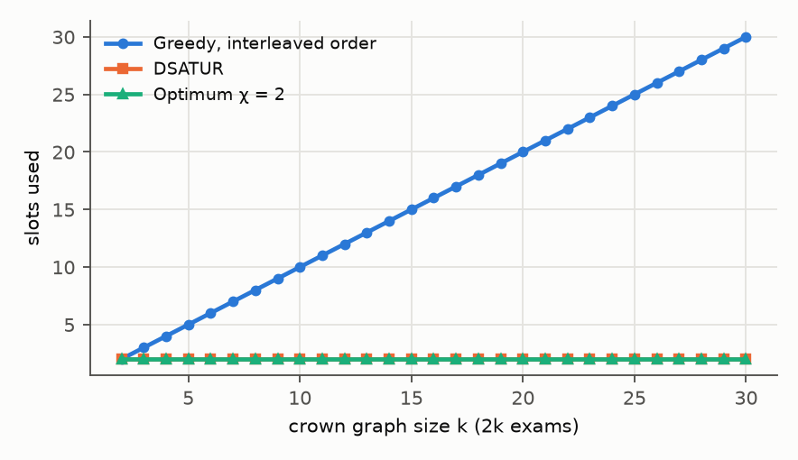
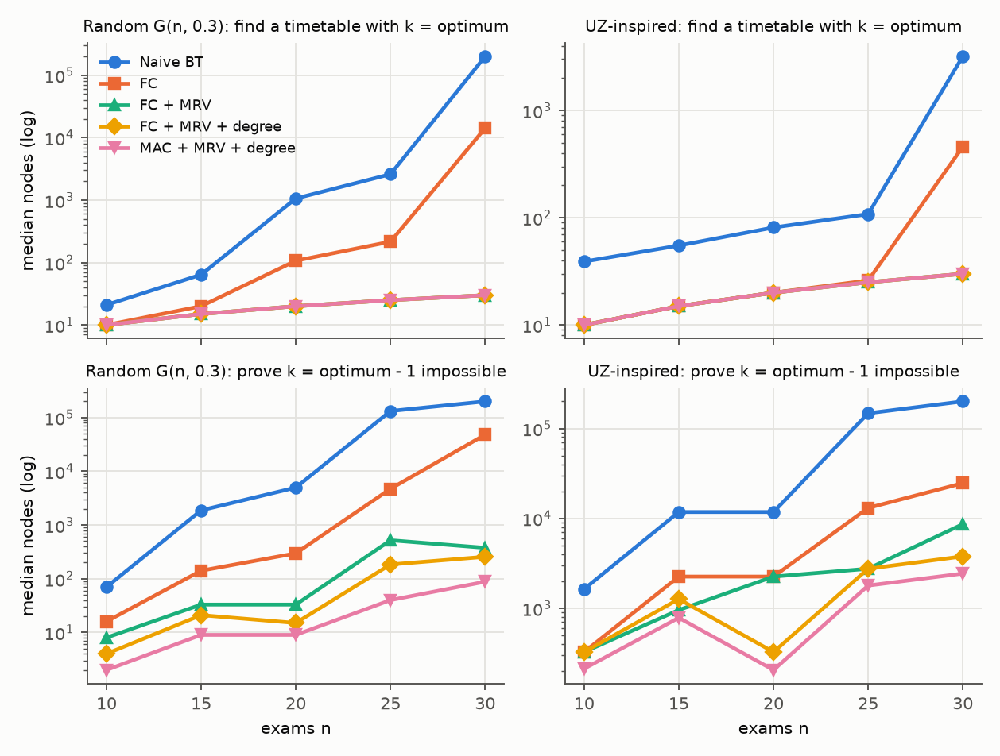
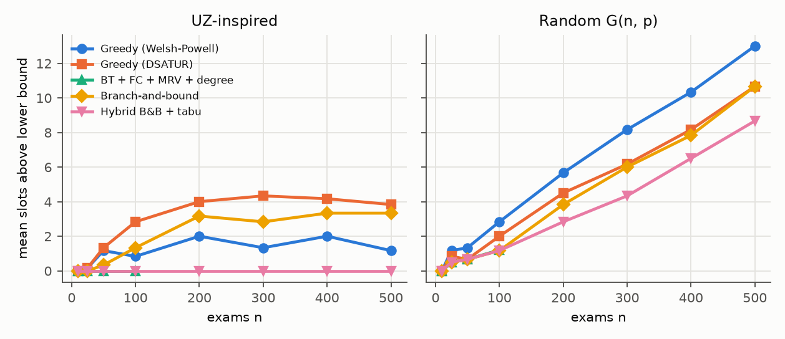
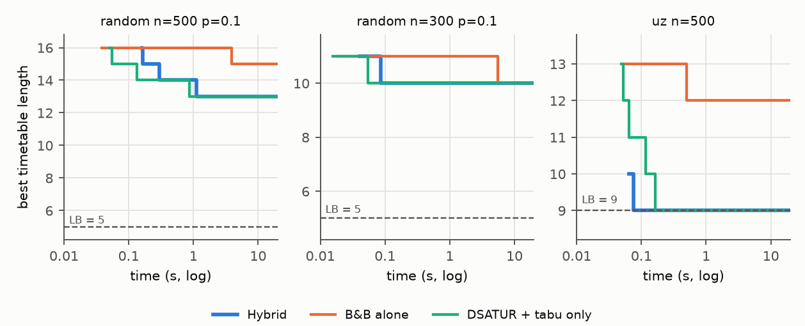
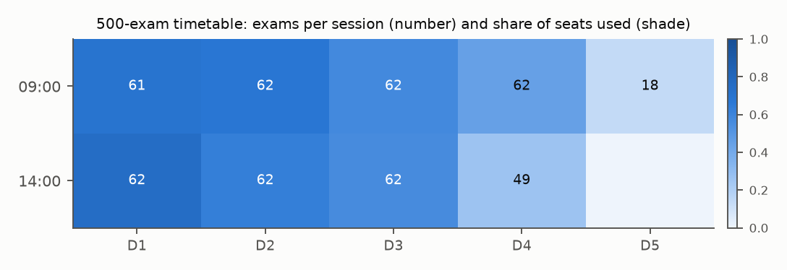

# The problem

- UZ runs one examination session for every faculty and every Part
- Each paper needs a **session** and a **room**
- Hard rules:
  - no student sits two papers at once
  - no lecturer invigilates two papers at once
  - lecturers are away in some sessions
  - one paper per room, and the room must be big enough
- **Goal:** a clash-free timetable with as few sessions as possible

::: notes
About 1 minute. Hand-made timetables lead to clashes found after publication, re-sits and longer exam periods than needed. The engine has to model students, lecturers, rooms and availability together, then shorten the timetable as much as possible.
:::

# Aim and objectives

**Aim:** design, implement and evaluate a hybrid CSP solver for exam timetabling

- Model as graph colouring / CSP
- Backtracking with forward checking, MRV and the degree heuristic
- Branch-and-bound with lower bounds
- Prove NP-completeness
- Greedy approximation and its ratio
- Hybrid B&B + local search, evaluated with statistics

Group 11: Tavaguta, Marevere, Gonyora, Mashumba, Gutsire

::: notes
About 40 seconds. These are the brief's objectives. Every one maps to a module in the repository and a section in the report. Introduce the group members and their roles here.
:::

# The model: graph colouring plus a CSP

| Concept | Model |
|---|---|
| Exam | variable x_e |
| Session (slot) | value / colour |
| Shared student group or lecturer | edge in the conflict graph: x_e ≠ x_f |
| Lecturer unavailable | smaller domain D_e |
| Rooms | per-session matching: exams → distinct rooms with capacity ≥ size |
| Objective | minimise timetable length = last session used + 1 |

No room limits and no availability gaps → exactly **graph colouring**.

::: notes
About 1.5 minutes. The student and lecturer rules are binary not-equal constraints, so they form a conflict graph. Availability is a unary constraint on the domain. Rooms are a global constraint per session. Without rooms and availability, the minimum number of sessions is the chromatic number.
:::

# Why it is hard: NP-completeness

**3-SAT ≤ₚ 3-colouring ≤ₚ exam timetabling**

- Palette triangle T, F, B; each variable is a pair x, ¬x joined to B
- Each clause uses two OR gadgets; the output is forced to T
- OR gadget: output can be T **iff** an input is T
- Graph → timetable: one exam per vertex, one student per edge, k sessions
- So even 3 sessions with unlimited rooms is NP-complete
- No n^(1−ε) approximation unless P = NP (Zuckerman, 2007)

::: notes
About 2 minutes. Walk through the gadget. If both inputs are false, the two inner vertices must take true and base, so the output is forced to false. If one input is true, there is a colouring with output true. Then the timetabling reduction: every graph is a timetabling instance, with one student per edge. The reduction preserves length, so the inapproximability of the chromatic number carries over.
:::

# One easy piece, and two lower bounds

- **Lemma:** a session's rooms work **iff** the i-th largest exam fits the i-th largest room
  - an O(m) check instead of a matching algorithm
- **Clique bound:** pairwise-clashing exams need distinct sessions → len ≥ |K|
- **Venue bound:** exams of size ≥ σ only fit rooms of capacity ≥ σ → len ≥ ⌈n_σ / r_σ⌉
- LB = max of the two; reaching it **proves** optimality

::: notes
About 1.5 minutes. The whole problem is hard, but checking one session's rooms is easy, by a Hall's-theorem style argument. The two bounds matter because the instances are capacitated. For UZ-style data, the venue bound is often the binding one.
:::

# Five solvers, one validator

| Algorithm | Paradigm | Worst case | Purpose |
|---|---|---|---|
| Naive backtracking | backtracking | O(kⁿ) | baseline |
| BT + FC + MRV + degree (+MAC) | backtracking | O(kⁿ), pruned | efficient search |
| Branch-and-bound | B&B | O(Tⁿ), pruned | proven optimum |
| Greedy (Welsh-Powell, DSATUR) | greedy | O(V + E) core | fast approximation |
| Hybrid greedy → tabu → B&B | hybrid | time budget | practical performance |

Every timetable is re-checked by an independent `violations()` validator.

::: notes
About 1 minute. All five solvers share the same model and return the same result record, so the comparisons are fair. Conflicts are counted by a separate validator, not by the solvers themselves.
:::

# Backtracking and branch-and-bound

- **FC:** remove the chosen session from the neighbours' domains, and from exams that no longer fit its rooms
- **MRV:** branch on the exam with the fewest sessions left
- **Degree:** break ties by the number of unassigned clashes
- **MAC:** propagate every single-value domain
- **B&B:** DSATUR branching; incumbent bound UB − 1; node bound; symmetry breaking (open one new session at most); stop at LB
- Proofs: every pruning rule deletes only values that appear in no solution

::: notes
About 1.5 minutes. The correctness argument is that each rule removes only values that cannot appear in any extension. Room feasibility is monotone, so a session that is too full now stays too full. The symmetry rule is valid only when all sessions are interchangeable, so it is switched off when lecturers have unavailable sessions.
:::

# Greedy: Δ + 1, but unbounded ratio

:::::::::::::: {.columns}
::: {.column width="45%"}
- Any order uses at most **Δ + 1** colours
- Crown graph: χ = 2, but the interleaved order uses **k** colours
- DSATUR gets 2 on every crown graph
:::
::: {.column width="55%"}

:::
::::::::::::::

::: notes
About 1.5 minutes. The proof of Δ+1: when a vertex is coloured, at most Δ colours are blocked. The crown graph shows the ratio is unbounded, so the order matters. Some order is always optimal, but finding it is as hard as the problem itself.
:::

# Hybrid design: construct, improve, prove

1. **Construct:** best of DSATUR and Welsh-Powell → first UB
2. **Improve:** TabuCol removes one session at a time
   - penalty = clashing pairs + exams with no room (rooms are *soft* while searching)
3. **Prove:** B&B starts from the tabu timetable; each new incumbent is polished by tabu
4. Stop as soon as UB = LB → proven optimal; otherwise report the gap

::: notes
About 1.5 minutes. One design lesson: with rooms as a hard constraint, tabu could not shorten the UZ timetables at all, because every move into a full session was forbidden. Making overflow a penalty let the search pass through slightly overfull sessions, and it then reached the lower bound.
:::

# Experimental design

- Datasets: **random** G(n, p) and **UZ-inspired** synthetic sessions (faculties, Parts 1–4, service courses, electives, carry-overs, unavailable lecturers, mixed rooms)
- n = 10 to 500; fixed seeds
- Metrics: nodes, seconds, conflicts, gap to LB, pruning %
- Statistics: bootstrap 95% CIs, Wilcoxon signed-rank tests, t intervals
- One command: `python run_all.py`

::: notes
About 1 minute. The UZ data is synthetic. Its structure follows a real session, but no real enrolment data was used. Node counts are heavily skewed, so the tests are non-parametric and paired on the same instances.
:::

# E1: pruning removes almost the whole tree

:::::::::::::: {.columns}
::: {.column width="45%"}
Proving k = χ − 1 impossible, median node reduction vs naive (random graphs):

- FC **88%**
- + MRV **98.5%**
- + degree **99.3%**
- + MAC **99.8%**

Wilcoxon p ≈ 5 × 10⁻¹⁴
:::
::: {.column width="55%"}

:::
::::::::::::::

::: notes
About 2 minutes. Top row: finding a timetable is easy once MRV is on, about n nodes. Bottom row: proving one session fewer is impossible is where pruning matters. Each step removes a large share of what is left. The degree heuristic only helps when MRV has ties, which is mostly during refutation (a further 47 per cent, p = 2 × 10⁻⁸). UZ refutations stay hard because the optimum is often set by rooms, which is a pigeonhole argument that branching on exams handles badly.
:::

# E2: scaling to 500 exams

:::::::::::::: {.columns}
::: {.column width="45%"}
- UZ-inspired: hybrid **proved optimality on all 48 instances**, ≤ 0.3 s each
- Greedy +1.1 (WP) to +2.6 (DSATUR) sessions; B&B alone +1.8 (all p < 10⁻⁵)
- Random graphs: hybrid shortest at every n; weak clique bound, so no proofs at large n
:::
::: {.column width="55%"}

:::
::::::::::::::

::: notes
About 2 minutes. On UZ-style data the gap to the lower bound is zero for the hybrid at every size, so every timetable is proven optimal. Exact search alone stalls above about 100 exams. Random graphs are harder because the clique bound is far below the chromatic number. Note the honest caveat: the hybrid overran its 2 s budget on the largest random graphs because B&B checks the clock every 256 nodes.
:::

# E4 and E5: bounds and anytime behaviour

:::::::::::::: {.columns}
::: {.column width="45%"}
- UZ n = 500: hybrid optimal (9 sessions) in **0.08 s**; B&B alone still at 12 after 20 s
- Without the lower bound, B&B proved **0 of 20** UZ instances (n = 50, 80) in 10 s
:::
::: {.column width="55%"}

:::
::::::::::::::

::: notes
About 1.5 minutes. The trace shows why the hybrid design works: tabu search does the improving, and the lower bound turns a good timetable into a proven one. On capacitated instances the venue bound is decisive.
:::

# Greedy in practice, and the reduction checked

| G(30, p) | Natural | Welsh-Powell | DSATUR |
|---|---|---|---|
| mean slots / χ | 1.23 – 1.34 | 1.10 – 1.21 | **1.00 – 1.08** |
| optimal on | 7 / 60 | 19 / 60 | **43 / 60** |

- 3-SAT reduction: **all 85 decided cases agree** (35 exact, 50 constructive up to 5,515 exams)
- Reduced instances are very hard per exam: 129 exams can exceed 15 s (thrashing)

::: notes
About 1.5 minutes. Greedy is much better than Δ + 1 in practice, but the crown graph shows there is no useful guarantee. The reduction behaves exactly as proved. Gadget graphs are much harder than realistic data of the same size, which is a nice illustration of where NP-hardness bites.
:::

# E7: a 500-exam UZ-inspired timetable

:::::::::::::: {.columns}
::: {.column width="45%"}
- 500 exams, 40,064 seats, 62 venues, 274 lecturers
- **9 sessions, proven optimal** (venue bound 9 > clique bound 7)
- 0 conflicts, 0.06 s
- A colouring-only model would aim for 7 sessions, which no room allocation can seat
:::
::: {.column width="55%"}

:::
::::::::::::::

::: notes
About 1.5 minutes. This is the headline result. The calendar shows the first seven sessions using 61 or 62 of the 62 venues. The full timetable with day, session and venue is in output/e7_timetable.csv. The comparison with a colouring-only model explains why rooms must be modelled inside the search.
:::

# Limitations and future work

- Synthetic data, checked against the real Block 4 timetable: scale matches (39,156 vs 40,064 candidates), but UZ seats up to 16 papers in one venue (Great Hall); our model allows one
- One exam per venue (no splitting); soft constraints measured, not optimised (17,192 same-day pairs)
- Python timings; budget overrun on large random graphs
- Next: real data, Kempe-chain soft-constraint phase, conflict-directed backjumping, stronger bounds, C++ core

::: notes
About 1 minute. Be upfront about these. The most valuable next step is running on anonymised real registration data.
:::

# Conclusion

- Exam timetabling is **NP-complete** (3-SAT ≤ₚ 3-COL ≤ₚ ETE), yet one session's rooms are an O(m) check
- Pruning compounds: **99.8%** of the naive tree removed
- Good **lower bounds** turn good timetables into proven-optimal ones
- The **hybrid** (greedy → tabu → B&B) proved optimality on every UZ-inspired instance up to 500 exams
- Code, 22 tests, data and figures: `python run_all.py`

**Questions?**

::: notes
About 1 minute, then questions. Total talk time is about 20 minutes.
:::
